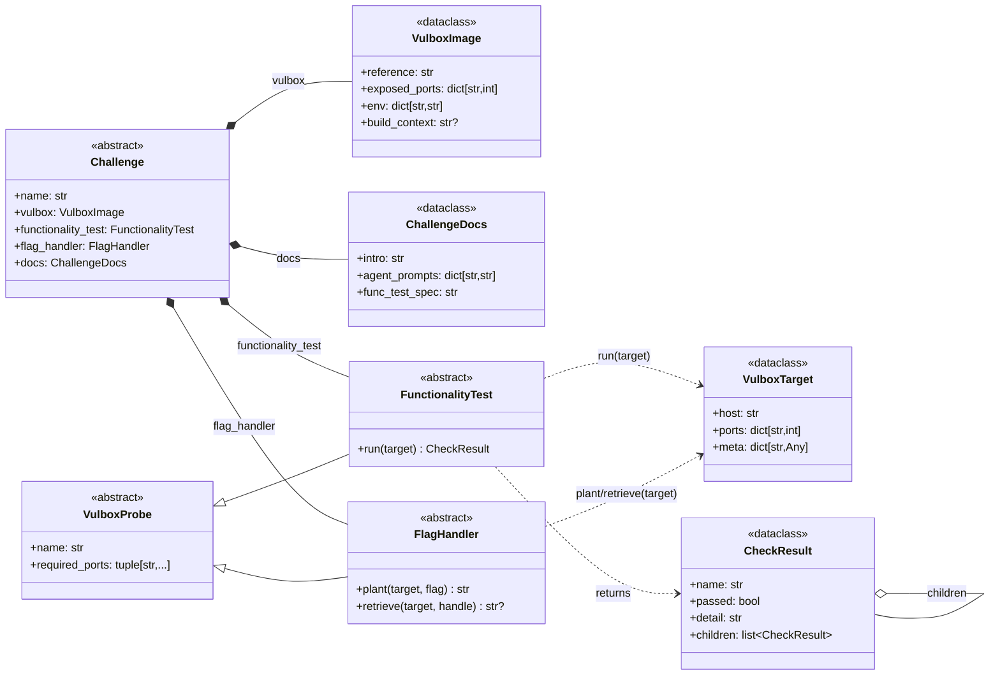

# Challenge interface — original design

> Snapshot of the abstract challenge interface as originally authored
> in [`/challenge interface/`](../../../challenge interface/) (a sibling
> of this repo). Kept here for historical reference: it shows the
> minimal four-component composition root the design started from
> (vulbox / functionality_test / flag_handler / docs).
>
> For the **current** canonical UML — including the additions
> (`RestartHandler` probe + optional `restart_handler` field on
> `Challenge`) that landed when the abstraction was wired into the
> orchestrator — see [docs/UML/challenges.md](../../docs/UML/challenges.md).

## Original class diagram

## Arrow legend

| arrow  | meaning              | reading                                                |
| ------ | -------------------- | ------------------------------------------------------ |
| `*--`  | composition          | `Challenge` owns its four components                   |
| `<\|--`| inheritance          | `FunctionalityTest` / `FlagHandler` extend `VulboxProbe` |
| `..>`  | dependency           | parameter or return-type relationship                  |
| `o--`  | aggregation          | `CheckResult.children` is a tree of `CheckResult`      |

## Two things the diagram makes obvious

1. **`Challenge` is purely a composition root.** It has no methods of its
   own beyond property accessors — the orchestrator pulls the four
   components out and drives each independently.
2. **`VulboxTarget` is the only thing that flows between the orchestrator
   and a probe at runtime.** Everything else is set up once at startup.
   That is why probes can be stateless and shared across teams.

## File map

- [challenge.py](challenge.py) — `Challenge`, `VulboxImage`, `ChallengeDocs`
- [probe.py](probe.py) — `VulboxProbe`, `FunctionalityTest`, `FlagHandler`, `VulboxTarget`, `CheckResult` (+ later `RestartHandler`, `HealthLevel`)
- [__init__.py](__init__.py) — re-exports the public surface
