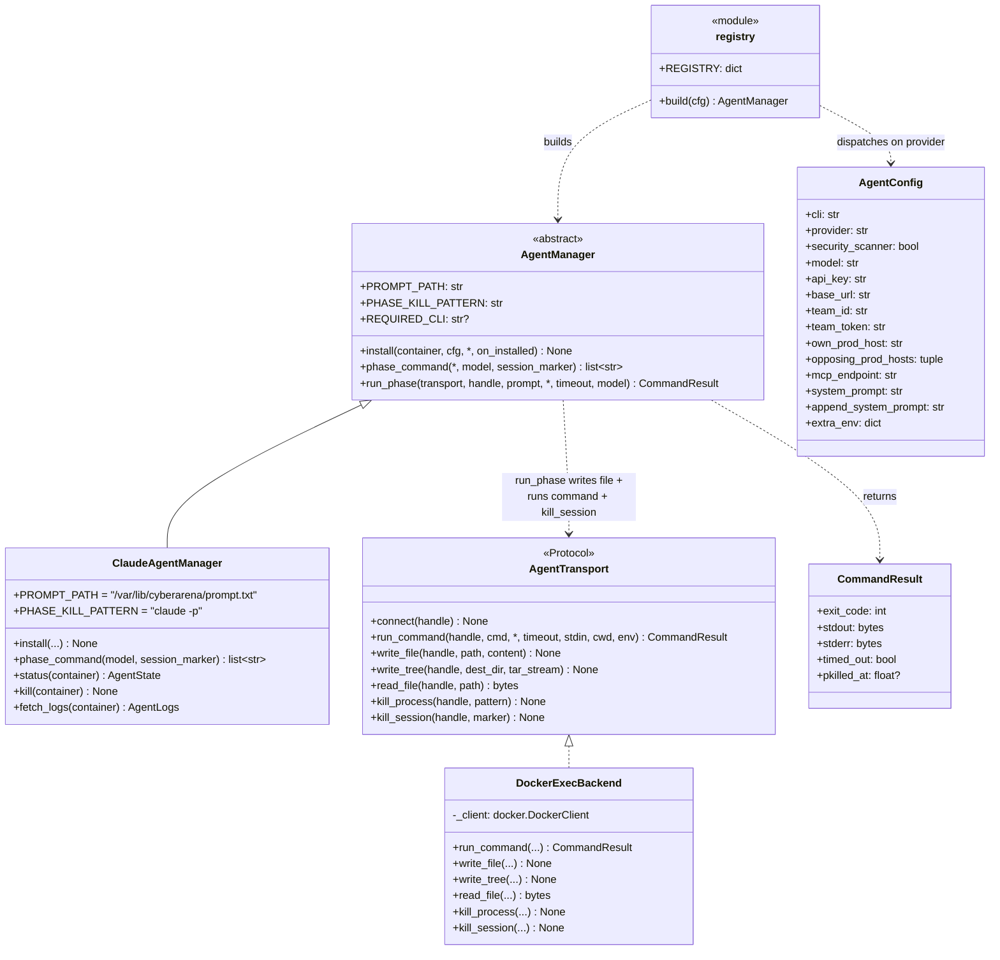
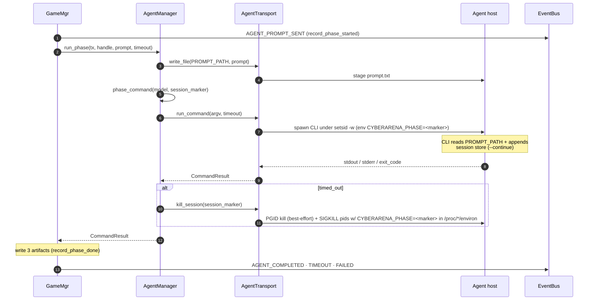

# Agent layer — UML

Two orthogonal abstractions:

- **AgentManager** (ABC) — per-CLI recipe: install + phase_command +
  the `run_phase` glue that drives one phase.
- **AgentTransport** (Protocol) — per-host-kind execution surface
  (docker exec today; SSH later).

Adding a new CLI = one new `AgentManager` subclass (~50–80 LOC).
Adding a new host kind = one new `AgentTransport`. Neither change
touches the other axis.

## Class diagram



## `agent.cli` is a selector token, not the command

In `game.yaml`, `agent.cli` (e.g. `cli: claude`) looks like the command that
will run, but it **is not**. It is consumed in exactly two places, neither of
which uses anything past the leading token:

1. **Adapter dispatch** — `agents.registry.resolve_cls` takes the leading
   whitespace token (`claude` / `codex` / `opencode` / `qwen` / `nexau` /
   `grok` / `openhands` / `kimi` / `script`) to pick the `AgentManager` subclass
   (unknown token → `DEFAULT = ClaudeAgentManager`).
   `agent.provider` overrides this when set.
2. **Logging.**

It used to have a third use — an npm-install gate (`if
cfg.cli.startswith("claude")`) deciding whether to install the CLI at game
start. That install is gone (see below), and the gate with it: which binary an
adapter needs is now declared on the class as `REQUIRED_CLI`, not inferred from
a config string. So `provider` and `cli` can no longer disagree about it.

The command that actually runs is **fixed in each adapter's `phase_command`**
(for claude: `claude -p --continue --output-format stream-json --verbose
--dangerously-skip-permissions --model … --mcp-config … < PROMPT_PATH`). So
flags written after the leading token in `agent.cli` — `--output-format`,
`--max-turns`, `--verbose`, … — have **no effect**. To change what the CLI is
invoked with, edit the adapter's `phase_command`, not the yaml.

Each adapter declares the invocation it honors in `CANONICAL_CLI` (claude →
`"claude"`, codex → `"codex exec"`, opencode → `"opencode run"`, qwen →
`"qwen"`, kimi → `"kimi"`, nexau → `"nexau chat"`, grok → `"grok"`, openhands →
`"openhands"`). For `nexau` and `openhands` that string is **only** the
config-warning token — neither command is ever executed; both adapters run a
Python driver under a baked venv (see "The shipped harnesses"). Config load
(`gamemgr.config`) **warns** when `agent.cli` carries anything beyond that, so
an ignored-flag edit is no longer a silent no-op. The shipped example configs
therefore use the minimal honest form (`cli: claude` / `codex exec` /
`opencode run`).

**Exception — the `script` adapter** (`provider: script`) has
`CANONICAL_CLI = None`: it stashes the *entire* `agent.cli` to a script and
runs it verbatim each phase, so nothing is ignored and no warning fires. This
is the one case where `agent.cli` is the literal command. It also sets
`REQUIRED_CLI = None` — a scripted agent drives no LLM CLI, so there is nothing
to preflight.

## The install phase is bounded, and stages source in one call

`install_all_agents` runs one `install_handler` per team, in parallel, before
the round loop starts. Each does three things in a worker thread: `install()`,
exploit provisioning, and — when `source_in_dev` is on — staging the
challenge's source from that team's own prod into its dev container.

Two properties of that phase are load-bearing, both learned the hard way on
2026-09-16:

**Staging ships the whole tree in ONE `write_tree`, never a write per file.**
`write_file` costs a docker round trip *plus* an in-container `mkdir -p` exec
each time, which does not scale to a real application's source: jenkins
(44,931 files), vikunja (47,157) and nginx-ui (47,527) each spent ~2,000s here,
and the tree is staged once per team, so ~90k files became ~270k round trips.
A tar already encodes its directory structure, so docker creates the
intermediate dirs and the per-file `mkdir` is not merely slow but unnecessary.
`write_tree` is the bulk counterpart on the transport; `write_file` remains
right for the single small files everything else writes.

**The phase has a deadline** (`_AGENT_INSTALL_TIMEOUT_SECS`, default 300s,
override `CYBERARENA_AGENT_INSTALL_TIMEOUT_SECS`). It needs one because this
work happens **between `SETUP_COMPLETE` and `ROUND_START`** — the one window no
budget reaches. `round_secs` governs time *inside* the round, so before the
deadline a stall here was bounded by nothing: the backend kept reporting the job
`running` with `timed_out: false` and the slot was held until a human noticed.

On expiry the handler raises. `install_all_agents` is already best-effort, so
that is a fast, legible failure rather than a crash: the team is logged and
skipped, the round still starts, and its kickoff records a clean `AGENT_FAILED`.
The error names the team and the services it was staging, because the failure it
replaces was a silent 45-minute gap.

It bounds the **wait, not the thread** — cancelling an executor future does not
kill the thread behind it, so a wedged copy runs until teardown.

## The image is the only install path

`install()` does **not** install the agent CLI. The harness image
([dockerfiles/agent/<provider>/](../../dockerfiles/agent/)) bakes it; `install()` calls
`prov.verify_cli(...)`, which asserts the binary named by `REQUIRED_CLI` is on
PATH and compares `--version` against the pin in `agents/*.py`:

| outcome | behavior |
|---|---|
| binary missing | `RuntimeError` at install — fails loud, before any phase runs |
| version ≠ pin | `WARNING` only — the match still runs, drift is on the record |
| `REQUIRED_CLI is None` | skipped entirely (scripted agents) |

Each adapter previously re-ran `npm i -g <pinned pkg>` **once per team** at game
start, against the same version the image had already baked. That cost a
registry round-trip per team, re-extracted the package every time (npm does not
skip a global install that is already satisfied — there is no manifest at the
global root to compare against), and forced an isolated deployment to keep an
npm egress hole open for a package it already had.

The consequence to remember: **bumping a pinned version in `agents/*.py` now
requires rebuilding that harness image** (`bash scripts/build_images.sh`, or
`AGENT_HARNESSES=<provider> bash scripts/build_images.sh` for just one). Before, the
runtime install silently papered over a stale image; now the preflight warns
instead.

### Unknown `agent.*` keys are rejected

The agent block is parsed with a fixed allow-list
(`cli`, `provider`, `model`, `api_key`, `base_url`, `append_system_prompt`,
`security_scanner`).
Any other key (a typo like `append_sytem_prompt`, or a flag someone expects to
exist) makes config load **fail** with a clear error, rather than being
silently dropped by `dict.get(key, default)`.

## Optional prompt addendum (`agent.append_system_prompt`)

`AgentConfig.append_system_prompt` (from `game.yaml` `agent.append_system_prompt`,
default empty) is appended to the agent's staged prompt by `AgentConfig.full_prompt()`,
which the driver (`main.py`) writes to `PROMPT_PATH`. Every CLI reads that one staged prompt
(claude on stdin, codex via `"$(cat …)"`), so it applies to **all** of them with no
per-manager wiring. Opt-in: an empty addendum leaves the prompt byte-for-byte unchanged.
It's a plain string written as bytes (no shell anywhere), so any content is carried verbatim.

## Exploit provisioning

For scripted verification games, the challenge owns the PoC exploit and the
agent container receives a copy during install. `main.py` resolves every
challenge deployed on the team, then `agents/_provisioning.py` copies:

- `_exploit.py` as the entrypoint
- same-directory private helpers matching `_*.py`
- `__init__.py` when present

The files land under `/var/lib/cyberarena/exploits/<challenge>/`, with the
entrypoint path exported in `agent.env` as `CYBERARENA_EXPLOIT_PATH` for
single-challenge games and `CYBERARENA_EXPLOIT_PATHS` for multi-challenge games.
This keeps configs small: a scripted agent can run
`python3 "$CYBERARENA_EXPLOIT_PATH"` from inside the dev container, with no host
path or `docker exec` dependency.

## Per-CLI extension point

Adding a new CLI (codex / gemini / openai_compat) is one new class —
inherited `run_phase` keeps the glue identical:

```python
class CodexAgentManager(AgentManager):
    PROMPT_PATH = "/var/lib/cyberarena/prompt.txt"
    PHASE_KILL_PATTERN = "codex --resume"
    REQUIRED_CLI = "codex"          # must be baked into the agent image

    def install(self, container, cfg, *, on_installed=None):
        # verify_cli(REQUIRED_CLI)  — assert, don't install
        # write env, .codex/config.json, ssh pivot...

    def phase_command(self, *, model=None, session_marker=None):
        return ["bash", "-c", "cd ... && codex --resume ... < $PROMPT_PATH"]
```

Then one line in `agents/registry.py`:

```python
REGISTRY = {"claude": ClaudeAgentManager, "codex": CodexAgentManager}
```
The transport handles host plumbing; `run_phase` on the ABC handles
the prompt-stage / invoke / kill-on-timeout dance — neither needs to
be reimplemented.

## The shipped harnesses

Eight providers are registered. Four are the original set (`claude`, `codex`,
`opencode`, plus the `script` stand-in); four were added later and are
described below.

> **Always set `agent.provider` explicitly** for anything other than claude.
> Adapter dispatch can fall back to `agent.cli`'s leading token, but
> `agents.prompts._helpers.mcp_tool` branches on **`provider` only** and
> `gamemgr.config` never infers it from `cli`. A config with `cli: grok` and no
> `provider:` therefore runs the right adapter but briefs the model with
> `mcp__cyberarena__submit_flag` — a tool name that CLI does not expose. Nothing
> warns you. Every shipped config sets it.

| provider | CLI / entry | installed by | LLM wiring | MCP config | tools named |
|---|---|---|---|---|---|
| `claude` | `claude -p` | npm (baked + runtime) | `ANTHROPIC_*` env | `mcp.json` | `mcp__cyberarena__<t>` |
| `codex` | `codex exec` | npm (baked + runtime) | `config.toml` provider, Responses API | `config.toml` `[mcp_servers]` | `<t>` (bare) |
| `opencode` | `opencode run` | npm (baked + runtime) | `opencode.json` provider | `opencode.json` `mcp` | `cyberarena_<t>` |
| `qwen` | `qwen` | npm (baked + runtime) | `OPENAI_*` env | `settings.json` `mcpServers` | `mcp__cyberarena__<t>` |
| `kimi` | `kimi --print` | PyPI (**baked only**) | `config.toml` provider (Chat/Responses/Anthropic) | `mcp.json` | `mcp__cyberarena__<t>` |
| `nexau` | SDK driver | git+uv (**baked only**) | `LLM_*` env | `agent.yaml` `mcp_servers` | `<t>` (bare) |
| `grok` | `grok -p` | npm (baked + runtime) | `config.toml` BYOK | `config.toml` `[mcp_servers]` | `cyberarena__<t>` |
| `openhands` | SDK driver | uv venv, PyPI (**baked only**) | LiteLLM `LLM_*` env | SDK `mcp_config` | `<t>` (bare) |

### `qwen` — Qwen Code (`agents/qwen.py`)

Alibaba's `qwen` CLI, a fork of Google's gemini-cli, driving any
OpenAI-compatible endpoint. Closest in shape to `opencode`.

- **Invocation:** `qwen --continue --yolo --output-format stream-json "<prompt>"`.
  `--yolo` auto-approves every tool call (headless qwen otherwise blocks);
  `--continue` resumes the prior phase and is a safe no-op on phase 1, so no
  exec-vs-resume marker is needed.
- **LLM:** selected purely by env — `OPENAI_API_KEY` + `OPENAI_BASE_URL` +
  `OPENAI_MODEL`. **All three plus a non-empty model are mandatory**, or the
  non-interactive run exits 1 with "No auth type selected".
- **MCP:** `settings.json` (found via `QWEN_HOME`) with an `httpUrl` server and
  an `X-Team-Token` header. It **must** set `alwaysLoadTools: true` — otherwise
  qwen defers MCP tools behind an in-band ToolSearch and a short phase's agent
  may never surface `submit_flag` / `restart_service`.
- **Tool naming:** qwen *always* fully-qualifies remote MCP tools as
  `mcp__<server>__<tool>`, i.e. the same form Claude Code uses, so `mcp_tool`
  needs no qwen branch.


### `kimi` — Kimi Code CLI (`agents/kimi.py`)

The Python-native Kimi Code harness is baked at `kimi-cli==1.49.0`;
startup verifies that exact image-provided CLI and never installs packages on
the isolated agent network. Each game wipes both `/var/lib/cyberarena/kimi` and the CLI resume store
`/root/.kimi` before writing provider/model config, preventing a reused
container from resuming a previous game session.

- **Invocation:** `kimi --print --output-format stream-json --yolo --afk`,
  with a first-run marker and `-C` on later phases; the shared timeout wrapper
  owns the process group and kills it through the per-phase session marker.
- **LLM:** one custom provider chooses `openai_legacy`, `openai_responses`,
  or `anthropic` from the model family (or validated `KIMI_WIRE_API`
  override), and quotes model IDs in TOML so dotted names remain one key.
- **MCP:** optional `mcp.json` carries the team `X-Team-Token`; no endpoint
  means no MCP file or flag. Stream JSON is parsed into panel trajectory events.

### `nexau` — NexAU (`agents/nexau.py`)

An OSS agent framework (`nex-agi/NexAU`) with no npm/PyPI package: it is
cloned + `uv sync`-ed into the image at a pinned commit. Driven through a small
**SDK driver** rather than its CLI.

- **Why a driver:** `nexau chat` (v0.3.9) builds the agent through a *minimal*
  config path that skips `build_tools()` and `build_mcp_servers()`, so the agent
  would get neither its shell/file tools nor MCP. The driver
  (`agents/nexau_assets/driver.py`) calls `AgentConfig.from_yaml()` — the full
  build — then `Agent.run()`.
- **Agent definition:** a rendered `agent.yaml` plus seven vendored
  `*.tool.yaml` descriptors (`agents/nexau_assets/tools/`): `run_shell_command`,
  `read_file`, `write_file`, `replace`, `search_file_content`, `glob`,
  `list_directory`. NexAU requires a `yaml_path` per tool, which is why they are
  shipped in-repo. At runtime the agent registers those 7 local tools plus every
  tool the MCP gateway advertises (9 today — see `gamemgr/mcp_server.py`; if the
  agent sees fewer, the `cyberarena/mcp-gateway` image is stale, rebuild it).
- **LLM:** NexAU's `LLMConfig` reads `LLM_MODEL` / `LLM_BASE_URL` /
  `LLM_API_KEY` from **the environment**, not from the yaml.
- **Sandbox:** shell runs locally via `SANDBOX_WORK_DIR`; `E2B_API_KEY` is
  deliberately never set, so it never reaches for a cloud sandbox.
- **Upstream bug patched in the image:** NexAU's tool executor injects the
  `sandbox` object into every tool call, and its MCP client filters
  `agent_state` + `global_storage` out of the forwarded kwargs but *not*
  `sandbox` — so every MCP call died with "Object of type LocalSandbox is not
  JSON serializable", returned to the model as a false success. The Dockerfile
  `sed`s `sandbox` into that filter, guarded by a `grep` so a silent miss fails
  the build.

### `grok` — xAI Grok Build CLI (`agents/grok.py`)

xAI's official closed-source `grok` CLI. Shape mirrors `codex` (TOML config).

- **Invocation:** `grok -p "<prompt>" $SESS --always-approve --output-format
  streaming-json --no-auto-update --no-alt-screen`.
- **Session gate (load-bearing):** `-s <uuid>` **creates** a session and refuses
  a UUID that already exists ("Session ID … is already in use", exit 1) — it
  cannot resume. So `$SESS` is `-s <uuid>` on the first invocation and
  `--resume <uuid>` afterwards, gated on a marker file (the same pattern codex
  uses). Without this, the pre-round dry-run burns the UUID and every
  subsequent chunk exits 1 — in async mode that is five fast exits and a failed
  match.
- **LLM:** BYOK `[model.<id>]` block in `~/.grok/config.toml` with `base_url`,
  `env_key`, and `api_backend = "chat_completions"`; auth is the env var named
  by `env_key`, never the browser OAuth flow.
- **Tool naming:** `<server>__<tool>` (double underscore) — unique among the
  providers, hence its own `mcp_tool` branch.
- **Beta hygiene:** the CLI churns fast, so the version is pinned and
  `--no-auto-update` stops a silent self-upgrade mid-match.

### `openhands` — OpenHands V1 SDK (`agents/openhands.py`)

The OpenHands platform (ex-OpenDevin), driven through its SDK rather than its
CLI.

- **Why a driver:** OpenHands' headless CLI mode does **not** support session
  resume, but the per-phase model needs cross-phase memory. The driver
  (`agents/openhands_assets/driver.py`) re-uses a fixed `conversation_id` +
  `persistence_dir`, so a fresh process each phase resumes the prior
  conversation.
- **Runtime:** `LocalWorkspace` — actions run as direct subprocesses, **not** in
  a nested container. `DockerWorkspace` must never be selected: the agent is
  already inside Docker, so that would mean Docker-in-Docker.
- **LLM:** LiteLLM. Models are addressed `openai/<model>` so LiteLLM speaks
  Chat Completions to the api-router.
- **Tools:** `TerminalTool` (autonomous shell) + `FileEditorTool`, plus MCP over
  streamable-HTTP with an `X-Team-Token` header. The SDK exposes remote MCP
  tools under their **bare tool name** — no server prefix at all.

### Operational notes for the two baked-only harnesses

`nexau` and `openhands` do **no** runtime install — the isolated agent network
blocks git/PyPI, so both must be fully baked into their harness images
(`cyberarena/agent-nexau` / `cyberarena/agent-openhands`). Their
`install()` therefore only renders config, and each first asserts its baked
interpreter exists (`test -x`), failing loudly with the rebuild command rather
than dying later as an unexplained `rc=127` inside a dry-run whose stderr is
discarded. **After changing a harness Dockerfile — or `dockerfiles/agent/base/Dockerfile`,
which every harness image is `FROM` — you must rebuild the affected images** —
nothing does it automatically (`main.py start` only warns that they look stale).

`nexau`, `openhands` **and `grok`** do not emit Claude-style `stream-json`, so
their `stream-*.jsonl` artifacts parse to zero events and the live panel shows
no transcript for them (grok streams its own `{"type": "text"|"thought"|"end"|
"error"}` NDJSON, which carries no tool-call records; nexau's file is normally
0 bytes). The stream-derived metrics (`tool_calls`, `tool_latency_*`) are empty
for those three too. Token accounting is unaffected: it comes from the
api-router's usage log, which is provider-agnostic. See
[RUN_ARTIFACT_SPEC.md](../RUN_ARTIFACT_SPEC.md).

### Running several matches on one host

GameMgr's HTTP API binds a host port (default 8000), so parallel matches need
**both** `--port <n>` *and* a matching `CYBERARENA_GM_BASE_URL`
(`http://host.docker.internal:<n>`) in the config's facility nodes — plus
distinct `--namespace`, network subnets, and published host ports. Missing the
port alone makes every additional match die with "address already in use".

**Even with all of that, `setup` must not overlap.** `facility.build` rebuilds
`cyberarena/flag-service` and `cyberarena/health-poller` at a **fixed,
non-namespaced tag** on every run (`facility/build.py`), so two concurrent
setups clobber each other's image and a match can create facility containers
from the *other* match's build — which surfaces as `flag-plant incomplete at
setup: 0/2 flags planted`. Until those tags are namespaced, serialize runs (or
at least their setup phase). Everything else (challenge images, api-router,
mcp-gateway) is either hash-tagged or prebuilt and is safe.


## Agent container images ([dockerfiles/agent/](../../dockerfiles/agent/))

The per-team dev container's image is **layered**: one shared base plus one thin
image per harness, so a claude-vs-codex match runs two small images that differ
*only* in the harness, instead of one image carrying every CLI.

```
dockerfiles/agent/base/Dockerfile        → cyberarena/agent-base        (no harness CLI)
dockerfiles/agent/<provider>/Dockerfile  → cyberarena/agent-<provider>  FROM cyberarena/agent-base
                                           claude · codex · opencode · gemini · qwen ·
                                           kimi · grok · deepseek · nexau · openhands
```

| image | built from | contents |
|---|---|---|
| `cyberarena/agent-base` | `dockerfiles/agent/base/` | `ubuntu:24.04` + official Node 24 LTS binary from nodejs.org (SHA256-verified — neither apt's stale Node 18 nor a NodeSource repo) + `uv` + the full pentest/dev toolset (`nmap`, `sqlmap`, `gobuster`, `pwntools`, `python3`, `tcpdump`, `vim`, `tmux`, `strace`, `rsync`, `openssh-client`, `ripgrep`, `jq`, `golang-go`, …) + `entrypoint.sh`. **Everything an agent can invoke lives here**, so every harness sees an identical toolset — add agent-facing tooling to the base, never to a harness Dockerfile. `script` / `idle` teams run it directly. |
| `cyberarena/agent-<provider>` | `dockerfiles/agent/<provider>/` | `FROM cyberarena/agent-base` + that one harness at its pin — **the only place it is installed** (`install()` merely preflights it via `verify_cli`). npm CLIs land in `/usr/bin` via `NPM_CONFIG_PREFIX=/usr`; the npm cache is dropped in the same layer. `agent-codex` additionally carries `@openai/codex-security` + the routed `codex-security` wrapper + `codex-security-mcp` (only the codex adapter wires them; see below). `agent-deepseek` serves both registry keys `deepseek` and `dsh`. |

**Which image a team uses** is decided by its `agent.provider`: each `AgentManager`
subclass declares `IMAGE` (`agents/registry.expected_image(cfg)` resolves it), and
`gamemgr/config.load` warns when a team's dev node `image:` is not that value — a
claude team pointed at `agent-codex` has no `claude` binary and would otherwise
only fail later, at `verify_cli`. The pre-split all-in-one `cyberarena/agent` gets
a dedicated migration hint. The warning is advisory (a custom image derived from
the expected one is legitimate); nothing rewrites the yaml.

`agents.registry.agent_images()` maps every declared image to its Dockerfile
directory; `tests/test_agent_images.py` asserts the two sets match, so adding a
harness means: a new `dockerfiles/agent/<provider>/Dockerfile` (`ARG
BASE_IMAGE=cyberarena/agent-base` / `FROM ${BASE_IMAGE}` + the install + a
`RUN <cli> --version` smoke check), `IMAGE = "cyberarena/agent-<provider>"` on the
adapter, and nothing else — `scripts/build_images.sh` discovers the directory.

**Build**: `bash scripts/build_images.sh` builds the base and then every harness
directory; `AGENT_HARNESSES="claude codex" bash scripts/build_images.sh` builds a
subset (the base is always built — the harness images are `FROM` it). A change to
the base only reaches a harness image once *that* image is rebuilt; `main.py
start`'s stale-image warning watches both the base and the harness Dockerfile
(plus their `COPY` sources) for exactly this reason.

Shared base details worth knowing:

- `entrypoint.sh` translates `HTTPS_PROXY` env → `/etc/apt/apt.conf.d/99proxy-from-env`
  at container start. apt does not honor proxy env vars natively; this is the
  only clean way to make `_run_install_list` work on an isolated network where
  apirouter is the sole egress.
- `NODE_USE_ENV_PROXY=1` so Node's built-in `fetch` (undici) honors proxy env.
  curl / pip / npm / git already honor it natively.
- `@openai/codex-security` (in `agent-codex`) is baked as a **tool** the agent can
  invoke itself, NOT as an `AgentManager` provider: it has no prompt channel and
  no session resume, and emits findings rather than a trajectory (see "Why
  codex-security is not a provider" below). It vendors its own `@openai/codex`
  under its `node_modules`, which does not disturb the pinned global `codex`. The
  routed `codex-security` wrapper (`dockerfiles/agent/codex/codex-security`) at
  `/usr/local/bin` **shadows** the real binary at `/usr/bin`, so an agent that runs
  `codex-security` gets the routed path by default.

### No translator baked in (intentional)

Claude Code only speaks Anthropic Messages. The image **does not bake**
[claude-code-router](https://github.com/musistudio/claude-code-router) because
the default upstream — ppapi — natively serves `/v1/messages` for *every*
backend model (Anthropic + OpenAI + Gemini), with full streaming + tool use +
system prompt fidelity. Verified empirically; see
[../archived/api_router_plan_v1.md](../archived/api_router_plan_v1.md). For ppapi, CCR is dead
weight.

If the upstream ever changes to one that only speaks OpenAI Chat Completions
(e.g. raw OpenAI API, an internal vLLM proxy, a budget gateway without
multi-format support), re-add a translator layer **at the agent boundary**:

```dockerfile
# In dockerfiles/agent/claude/Dockerfile, alongside the claude-code install:
RUN npm install -g @anthropic-ai/claude-code @musistudio/claude-code-router
```

…plus a `/usr/local/bin/claude` shim that fronts CCR (the previous design;
restore from git history at the `add-claude-code-router-shim` revision). The
PATH ordering in the base image (`/usr/local/bin` before `/usr/bin`) is already
set up for that shim pattern; no other change is needed.

For isolated-network deployments where apirouter is the sole egress, see
[../DEPLOY_ISOLATED_AGENT.md](../DEPLOY_ISOLATED_AGENT.md).

## Why codex-security is not a provider (and what the wrapper is)

`@openai/codex-security` looks like a fourth harness — same vendor, same `codex exec`
underneath — but it cannot satisfy the `AgentManager` contract, and the gaps are
structural rather than missing flags:

| Contract element | Why it fails |
|---|---|
| `PROMPT_PATH` | `scan` has no `--prompt`, no positional prompt, no stdin prompt. Its prompt is compiled in. `--knowledge-base` takes **file paths only** and the built-in prompt labels that content *"untrusted data, not instructions"* — it can change what counts as a vulnerability, never what the agent is trying to do. |
| resume | It only ever calls `startThread()`; the vendored SDK's `resumeThread()` is never invoked, and each scan's `CODEX_HOME` is an isolated `mkdtemp` deleted on dispose. `session_marker` has nothing to bind to. |
| must score | The only scoring primitive is `FlagStore.submit`. There is no exploit mode, no remote-target concept, and the scan sandbox forces the repo read-only. `patch` can write, but runs `codex exec --ignore-user-config` so it can reach **no MCP server ever** — it can never call `restart_service`. |
| parseable stream | Its envelope (`{manifest, findings, coverage, scanDir, …}`) matches none of `_unpack_line`'s three schemas, so `collect_transcripts` drops the file and the team **disappears** from `/game/agents`. |

A new `provider: codex-security` key would also hit the pre-round-1 MCP dry-run gate,
whose exemption is keyed on the literal string `"script"` — and an *unregistered*
provider key silently falls back to `ClaudeAgentManager`, so it would quietly run
claude instead.

So it stays a tool. But a bare invocation is inert in an arena container, three ways:
it ignores the ambient `$CODEX_HOME/config.toml` (isolated home + its own config) and
therefore targets `api.openai.com`, which no firewall allow-list contains; and a
claude-provider team's `agent.env` has no `CODEX_API_KEY` for it to read.

A **routed wrapper** ([dockerfiles/agent/codex/codex-security](../../dockerfiles/agent/codex/codex-security))
closes that. It carries the SAME name as the real binary and installs to `/usr/local/bin`,
which precedes `/usr/bin` on PATH — so an agent that runs `codex-security` gets the wrapper,
and the raw binary is still reachable at its absolute path `/usr/bin/codex-security` (which is
what the wrapper calls, so it does not recurse). It resolves the team's principal token and the
router base URL (from `CSEC_BASE_URL`, then codex's `config.toml`, then `ANTHROPIC_BASE_URL`),
injects the repeatable `--codex 'model_providers.arena.…'` overrides that *are* honored, refuses
`patch` / `validate` (unroutable by design — they reject provider overrides), and remaps exit 1
("found findings") to 0 so a caller does not read a successful scan as a failed step.
It **fails loud (exit 2) rather than falling back to an unrouted call**, because that
fallback is silent, unmetered, outside every per-team budget, and match-wide in blast
radius. Routing therefore lives in one file instead of in every prompt and yaml.

## Four channels reach a model — and only one of them announces itself

Understanding where a capability enters is what decides how it is controlled and whether
it can be counted:

| Channel | Example | Discovery | Executes | Controlled by |
|---|---|---|---|---|
| Provider-hosted tool | codex `web_search`, claude `WebSearch` | automatic (in the request tool schema) | **vendor's servers** | CLI config only — the container firewall never sees it |
| Harness-local builtin | `shell`, `apply_patch`, `WebFetch` | automatic | in-container | already bounded by `HTTPS_PROXY` + the egress allow-list |
| **MCP tool** | `submit_flag`, `restart_service` | automatic (server's tool list is merged into the same schema) | server-side | whether the adapter writes the server block |
| PATH binary | `nmap`, `sqlmap`, `codex-security` | **none** — not a tool at all, just an argument to `shell` | in-container | whether it is in the image |

A binary is invisible unless a prompt names it, and every invocation collapses into one
undifferentiated `command_execution` card. An MCP tool is advertised for free and each call
lands as `mcp_tool_call`, which `gamemgr/transcripts.py` renders and tallies.

### `agent.security_scanner` — the scanner as an MCP tool

`agent.security_scanner: true` on a team does **two** things off one flag, so an operator
never hand-copies a tool description into each config:

1. **Wires it** — `_build_config_toml` emits a second, local stdio MCP server (below), which
   advertises `trigger_security_scan` / `get_security_scan` in the request tool schema.
2. **Describes it** — `build_l1` (`agents/prompts/_l1.py`, gated by `_scanner_wired`) appends
   the scanner to the L1 `YOUR TOOLS` roster, exactly as `submit_flag` et al. are described.
   Being in the schema makes a tool *callable*; being in the roster makes it *discoverable* —
   a distinction proven in practice (see below).

Both are gated to **codex only** (the claude adapter emits no scanner block), so a claude team
with the flag set is a no-op rather than a briefing that names a tool it lacks.

Setting the flag makes `_build_config_toml` emit a **second, local stdio** MCP server next to
the arena's HTTP one:

```toml
[mcp_servers.arena_scanner]
command = "python3"
args = ["/usr/local/bin/codex-security-mcp"]
env_vars = ["CODEX_API_KEY", "CODEX_HOME"]
```

That `env_vars` line is load-bearing, not decoration. **A stdio MCP child inherits nothing**:
codex hands it exactly `HOME`, `LC_CTYPE` and `PATH` (measured against 0.146.0). Without the
forward the server shells out to `codex-security` with no credential and no way to find the
router, so it refuses and *every* call fails — a tool advertised to the model that never works.
`env_vars` forwards by NAME, so the principal token stays in `agent.env` instead of being
copied into a second file. `CODEX_HOME` is what lets the wrapper read `base_url` back out of the
provider block above.

[`codex-security-mcp`](../../dockerfiles/agent/codex/codex-security-mcp) is a stdlib-only stdio MCP
server that shells out to the routed `codex-security` wrapper (so routing stays in one place)
and exposes **`trigger_security_scan` + `get_security_scan`** — trigger-and-poll, mirroring
`trigger_health_check` / `get_health_checks`, because a scan runs for minutes and an MCP call
is request/response.

Verified against codex 0.146.0: `codex exec` really spawns the process
(`pgrep -f '^python3 /usr/local/bin/codex-security-mcp'`) and completes the stdio handshake with
zero `rmcp::transport` errors.

Default **off**, so every existing game keeps a byte-identical `config.toml` and a
byte-identical L1. The flag lives in `game.yaml`, copied verbatim into `runs/<ts>/config.yaml`,
so a scanner A/B arm stays attributable after the fact. `tests/test_security_scanner_flag.py`
pins the yaml-key → emitted-TOML path and `tests/test_prompts_l1_l2.py` pins the roster
injection — both because `challenges[].level` is a live example of a knob that is declared,
documented, consumed, and silently never parsed.

**Available ≠ used.** Verified in a real match: the flag on but *unmentioned in the briefing*
(the earlier hand-written-prompt design) yielded **zero** scanner calls — an attack-focused
agent never reached for a defense tool it was only shown in the schema. Describing it in the
L1 roster gives it the same discoverability as `submit_flag`; but unlike `submit_flag` (the
only scoring action) a scan is never mandatory, so to *steer* an agent toward scanning-first
the operator still adds an `append_system_prompt` — that is a strategy choice, no longer a
prerequisite for the tool to exist.

What this still does not solve, and one open question:

- **Provider asymmetry.** Only the codex adapter emits it today. Enabling it for one team in
  a mixed claude-vs-codex game confounds provider with arm; the claude side needs the
  equivalent block in `_write_mcp_config` before a mixed A/B is clean.
- **Budget.** The scan model (`CSEC_MODEL`, default `gpt-5.6-sol`) must appear in
  `api_router.pricing` or its cost is recorded as `null` and the per-team cap can never fire.
- **No preflight exists for any MCP server.** Neither `codex mcp list` nor `codex doctor`
  spawns the process — both only check that the config is internally consistent. A server
  that is missing, unexecutable or crashing passes both and fails silently mid-match. The
  arena's own `cyberarena` server has the same exposure.
- **OPEN — does the model actually see MCP tools directly?** codex 0.146.0 enables
  `tool_search_always_defer_mcp_tools`, which may put MCP tools behind a `tool_search`
  indirection rather than listing them in the request's `tools` array; one capture on
  `gpt-5.6-sol` reportedly came back with an empty array. Unproven without credentials, and
  it would apply to the arena's own tools too — worth a credentialed re-run before leaning
  on "advertised means discovered".

## One-phase sequence



## File map

| Path | Role |
|---|---|
| `agents/manager.py` | `AgentManager` ABC + `run_phase` glue |
| `agents/claude.py` | `ClaudeAgentManager` + paths constants |
| `agents/codex.py` · `agents/opencode.py` | Codex / OpenCode adapters |
| `agents/qwen.py` · `agents/grok.py` | Qwen Code / xAI Grok adapters (npm CLIs) |
| `agents/kimi.py` | Kimi Code adapter (pinned PyPI CLI baked into the image) |
| `agents/nexau.py` + `agents/nexau_assets/` | NexAU adapter; driver + 7 `*.tool.yaml` descriptors |
| `agents/openhands.py` + `agents/openhands_assets/` | OpenHands adapter + SDK driver |
| `agents/_provisioning.py` | Shared install helpers: state dirs, `agent.env`, SSH pivot, exploit copy, `verify_cli` preflight |
| `agents/transport.py` | `AgentTransport` Protocol + `CommandResult` + `AgentHandle` |
| `agents/transport_docker.py` | `DockerExecBackend` |
| `agents/registry.py` | `REGISTRY` + `build(cfg)` |
| `agents/prompts/__init__.py` | Prompt dispatcher + shared helpers |
| `challenges/<name>/prompts.py` | Per-challenge `build_attack_prompt` / `build_defense_prompt` |
| `models/agent.py` | `AgentConfig`, `AgentStatus`, `AgentState`, `AgentLogs` |
| `dockerfiles/agent/base/Dockerfile` | `cyberarena/agent-base`: ubuntu:24.04 + Node 24 LTS + `uv` + pentest tooling + entrypoint — the shared layer under every harness image; no agent CLI. `script`/`idle` teams run it directly |
| `dockerfiles/agent/<provider>/Dockerfile` | `cyberarena/agent-<provider>` (`FROM cyberarena/agent-base`): that ONE harness baked as the sole install path — claude/codex/opencode/gemini/qwen/grok (npm), kimi-cli (PyPI), dsh (npm + isolated prefix), NexAU at `/opt/nexau` (git+uv), openhands-sdk at `/opt/openhands-venv` (uv). `codex/` also carries codex-security + its wrapper + MCP shim. Rebuild with `scripts/build_images.sh` (or `AGENT_HARNESSES=<p> …`) |
| `dockerfiles/agent/base/entrypoint.sh` | Translates `HTTPS_PROXY` env → apt.conf at start (apt does not honor proxy env natively) |
| `agents/registry.py::expected_image` / `agent_images` | provider → image (`AgentManager.IMAGE`) and image → Dockerfile dir; config load warns on a dev-node/provider image mismatch |
