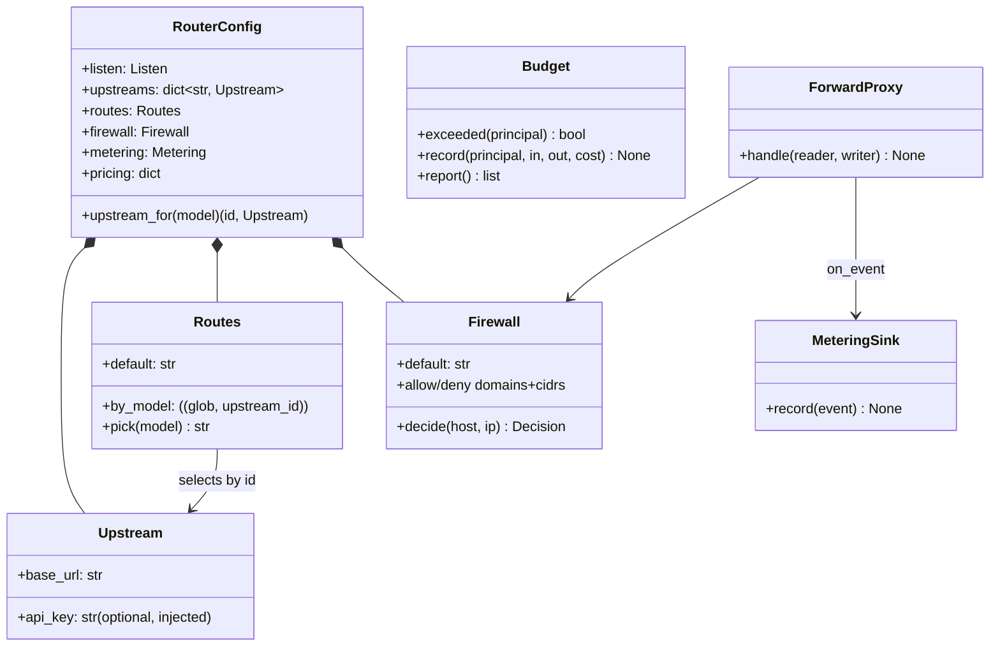
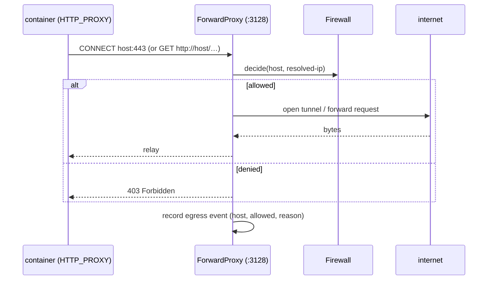

# API Router — UML

Self-contained egress gateway + LLM metering proxy. Lives in
[apirouter/](../../apirouter/); imports nothing from the orchestrator; no
litellm. A **verbatim reverse passthrough** (no format translation) that meters
any response carrying `usage`. Full design:
[docs/archived/api_router_plan_v1.md](../archived/api_router_plan_v1.md).

## Class diagram



`gateway.build_app` (FastAPI) holds a shared `httpx.AsyncClient`, a
`MeteringSink`, and a `Budget` ledger. It forwards verbatim, repairs markdown
JSON (`sanitize.py`), meters via `metering.extract_usage` + `cost_from_pricing`,
and enforces per-principal caps (402) — exposing the running totals at
`GET /usage`. `__main__` starts the `ForwardProxy` in the FastAPI lifespan —
both listeners on one asyncio loop. Config + log live together under `/data`.

## Multi-upstream routing (`routes`)

One router can front several providers on **separate credentials** — e.g. Claude
on the official Anthropic key, everything else through a reseller. The upstream is
chosen **per request from the model name the client sent** (there is no
translation, so it is whatever the client put in the body), and *that* upstream's
key is injected on forward. Metering rows carry an `upstream` field, so
`usage.jsonl` shows which provider each call was billed to.

```yaml
upstreams:
  anthropic: { base_url: "https://api.anthropic.com", api_key: "${ANTHROPIC_API_KEY}" }
  ppapi:     { base_url: "https://app-us.ppapi.ai",   api_key: "${PPAPI_API_KEY}" }
routes:
  default: ppapi                # model matched no rule (or request carried none)
  by_model:
    "claude-*": anthropic       # fnmatch globs, FIRST MATCH WINS (declaration order)
```

Rules, all enforced at load (`config._load_routing`) rather than at request time:

| Config | Result |
|---|---|
| `upstream:` alone | Desugars to `upstreams: {default: …}` — every pre-routing config still loads unchanged |
| `upstreams:` + `routes:` | The routing table |
| **`upstream:` together with either** | **`ValueError`, refuses to start** |
| `upstreams:` with >1 entry, no `routes.default` | `ValueError` — the fallback must be named |
| `routes` naming an undeclared upstream | `ValueError` |

The two spellings are rejected *together* on purpose: a config where "which key
paid for this call?" depends on a precedence rule between two blocks is one that
will mislead whoever edits it next, so there is no precedence rule to learn.

`by_model` is first-match-wins in declaration order, **not** most-specific-wins —
list `"claude-haiku-*"` before `"claude-*"` if you want the narrow rule to bite.

Routing is orthogonal to the **firewall**: picking an upstream does not allow it.
Every upstream's host must also be in `firewall.allow.domains` or the forward
proxy still denies it.

## Compat levers (`compat.sanitize_request_body`)

Optional, per-quirk rewrites for flaky "OpenAI-compatible" upstreams; off by
default. Each operates on the JSON request body before forwarding:

| Lever | Quirk | Action |
|---|---|---|
| `drop_empty_content` (#1) | Some upstreams reject assistant messages with `content:""` alongside `tool_calls` | Drop the empty `content` |
| `drop_params` (#3) | Upstream rejects unknown top-level params (e.g. `reasoning_effort`, `reasoning`) | Strip configured keys |
| `json_schema_fallback` (#4) | Strict `response_format.type=json_schema` rejected with 400 | Retry once with `json_object` |
| `max_request_bytes` (#5/#6) | Oversize bodies | 413 up front |
| `retry_on_5xx` (#10) | Transient 429/502/503/504 + transport errors | Exponential-backoff retry |
| `clamp_max_tokens` (#11) | Client `max_tokens` exceeds the upstream model's hard cap (e.g. Claude Code defaults to 64k; gpt-4o-mini accepts ≤16384) | Per-model: `{model: cap}`, clamp down before forwarding |

`metering.extract_usage` takes the **max** across alias names rather than
first-non-None, so an upstream that populates both Anthropic
(`input_tokens`/`output_tokens`) and OpenAI (`prompt_tokens`/`completion_tokens`)
aliases — but leaves one set stuck at `0` (ppapi does this for Claude/Gemini
in OpenAI shape) — still meters correctly. For streaming, `_merge_stream_usage`
reads usage from three SSE shapes: OpenAI chat `usage`, Anthropic
`message.usage`, and the **Responses API** `response.usage` (codex — whose usage
rides the terminal `response.completed` event). Cached tokens come from either
`prompt_tokens_details` (chat) or `input_tokens_details` (Responses).

**Per-team usage harvest (provider-agnostic).** Because every agent's LLM traffic
flows through this gateway, its metering is the uniform source of token usage —
unlike the per-agent `stream-*.jsonl`, which only some CLIs populate (codex
reports usage solely on a `turn.completed` that never fires for a stopped async
gateway's `/data/usage.jsonl`, attributes each row to a team, writes the per-call,
team-attributed `artifacts/usage-router.jsonl`, then rolls it up (with tool timing)
into `artifacts/metrics.json` — whose per-team `summary` carries the token/cost/cache
totals (this replaced the old standalone `usage-router.json` aggregate). The consumer
(cyber-arena-deploy) reads `metrics.json` to fill any team whose stream had no usage.

**Per-team attribution.** Each routed team presents a **distinct principal token** — a
NON-SECRET per-team label, not a credential, since the router *always* substitutes the
routed upstream's own key on forward. Declare it plainly in `agent.api_key` (self-
contained per config, no shared `.env` var to collide across parallel runs); it is used
verbatim. Leave it empty and `apirouter_cfg.assign_router_principals` mints a **random**
`cad-<hex>` token — random, not `cad-<team_id>`, so one adversarial agent can't guess a
rival team's token and bill against it. Tokens must be distinct per team (a collision is
rejected at startup). The harvest
attributes each row by `principal` first (a reliable per-team id that survives teams
sharing a model family or source IP), then falls back to model family (claude vs
openai), then `client_ip` (every IP a team's dev container holds) for rows predating
principals. Each per-call row records which signal named it (`attribution`), so any
residual collapse is visible.

## Operator debuggability — which team, which request, what error

The router's own logs + JSONL sink must answer, for **any** failure, three
questions without opening the agent's transcript. The rule is *surface* errors,
never translate them (verbatim passthrough is unchanged): a Claude-Code
(Anthropic Messages) request to an OpenAI-only upstream still 404s and is returned
verbatim — the router just makes that 404 obvious.

- **Which request** — every proxied request is stamped with a 12-hex correlation
  id at entry. It appears on **every log line** the request produces and in the
  **`request_id`** field of its sink row — that pairing (log line ↔ sink row) is
  the join. Router-generated error responses (401/402/413/500) also echo it in
  their JSON body. The upstream's own id (Anthropic `request-id` / OpenAI
  `x-request-id`) is captured as `upstream_request_id` so a failure can be taken
  to the provider.
- **Which team** — the `principal` (a team id like `team1`, never the token) on
  every metered/error row, plus `client_ip`. Pre-forward rejects carry it too:
  principal resolution moved **above** the size/budget checks so a 413/402 names
  the team; a 401 carries `client_ip` + a token **fingerprint**.
- **What error** — every non-2xx / transport / mid-stream failure is **logged**
  (4xx→WARNING, 5xx/transport→ERROR) with request-id, team, upstream, the model
  the client asked for, path, status, latency, attempt count, and a
  **truncated + key-scrubbed** upstream error body, AND leaves a sink row. The
  metering guard no longer swallows failures: `_meter` bills only responses that
  reported usage; `_record_error` handles the rest and **never** calls
  `budget.record` (an error has no billable usage — it must not corrupt the ledger
  or the 402 pre-check).

Event types in `usage.jsonl` (all carry `request_id`; all readers use `dict.get`,
so this is additive):

| `event` | When | Key fields |
|---|---|---|
| `llm` | a 2xx that reported usage | tokens, `cost_usd`, `latency_ms`, `attempts`, `status`, `stream` |
| `llm_error` | upstream 4xx/5xx, transport error, aborted stream, mid-stream SSE `error` event, oversize (413), malformed usage, handler crash | `reason`, `status`, `error` (redacted snippet), `attempts`, `upstream_request_id` |
| `auth_reject` | unknown/missing token (401) | `reason` (`missing`\|`unknown`), `token_fp`, `client_ip` (no principal, no token) |
| `budget_block` | 402 pre-check | `principal`, `spent_usd`, `limit_usd` |

`reason` on an `llm_error` is one of `upstream_error`, `transport_error`,
`stream_aborted`, `sse_error_event`, `oversize_request`, `handler_exception`.

**Streaming is never buffered on the success path.** A 2xx `text/event-stream` is
teed through unchanged (buffering it would add latency to every agent call);
metering + mid-stream `error`-event detection run at end-of-stream over the teed
bytes. Only an ERROR stream (a non-2xx delivered with an SSE content-type) is
buffered — errors are small, and buffering also dodges the `StreamConsumed` crash
on the eager response reconstructed for a non-matching `json_schema` 400.

**Secrets never reach a log or a row.** The injected upstream key
(`Authorization` + `x-api-key`) and the client's principal token are the two
credentials in play; neither is ever logged. Upstream error bodies (which can echo
a key back in an auth message) pass through `metering.redact` — exact-strip of the
known injected key, then shape-match of `sk-…`/`sk-ant-…`/`AIza…`/bearer/`cad-…`
and long blobs, then truncate. `redact` and `token_fingerprint` are pure and
unit-tested (`tests/test_apirouter_redact.py`); the end-to-end secret-safety and
per-path logging/row behaviour is pinned in `tests/test_apirouter_debuggability.py`.

The error rows (`llm_error` / `auth_reject` / `budget_block`) live in the router's own
`usage.jsonl` alongside the `llm` rows, distinguished by `event`. Whether a downstream
harvest propagates them into a run artifact is that harvest's concern, out of scope
here — the router's own log + `usage.jsonl` already answer the three questions.

**There is no keyless / key-passthrough mode**, and this is a billing invariant, not
a preference. What an agent holds is a principal token the router minted; it is not a
provider credential, so forwarding it verbatim would only ever earn a 401. The
converse is the real danger: a router with no key of its own leaves agents holding
**real** provider keys, and an agent with a real key can bill against it *without
being metered at all*. So every upstream MUST carry a key — `config.upstreams.<id>.api_key`
is required, and `apirouter_cfg.resolve_upstream_keys` aborts the run at startup if one
cannot be resolved. See `tests/test_apirouter_no_bypass.py`.

## Sequence — one LLM call (non-streaming)

```mermaid
sequenceDiagram
  participant A as agent / judge (any format)
  participant G as gateway (:8080, /<path>)
  participant U as upstream (real proxy)
  participant M as MeteringSink

  A->>G: POST /v1/chat/completions (base_url=router)
  G->>G: copy headers (drop hop-by-hop); optionally inject real api_key
  G->>U: forward verbatim → base_url + /v1/chat/completions
  U-->>G: 200 (maybe ```json-wrapped)
  G->>G: unwrap markdown fence; parse `usage` (OpenAI or Anthropic shape)
  G->>M: record llm row (client_ip, model, tokens, cost, latency)
  G-->>A: return body verbatim (repaired)
```

Streaming (`text/event-stream`): the gateway streams chunks straight through to
the client while teeing them; at end-of-stream it pulls `usage` from the SSE
events and records one metering row.

## Sequence — egress firewall



## Per-run config generation

The `api-router` node uses a baked image config (`dockerfiles/api-router-cfg/config.yaml`).
At game startup, `main.py` generates a fresh apirouter config from the `game.yaml`
`api_router:` section and bind-mounts it into the container so the game config — not
the image — controls firewall rules and principal tokens:

```
game.yaml api_router.firewall  ─┐
game.yaml teams[*].agent.api_key ─┼─► gamemgr/apirouter_cfg.generate()
game.yaml api_router.upstream_url ─┤   (or .upstreams + .routes)
                                   ─┘
           │
           ▼ write to runs/<ts>/apirouter-config.yaml
           │
           ▼ bind-mount :ro into api-router container at /app/config.yaml
           ▼ + set node env APIROUTER_CONFIG=/app/config.yaml (force the mount to win)
           │
           ▼ apirouter reads on startup; expands each ${…_API_KEY} from container env
```

API keys are written to the generated config as literal `${VAR}` **placeholders**,
never values — apirouter expands them from its own container env at startup, so no
real key lands on disk. `resolve_upstream_keys` runs first and guarantees each var
actually reaches the container: it uses the value the node's `env:` already declares,
else injects one from the process env (which `load()` populated from `.env`), else
**raises** — because a container that dies on a missing key while the game loop ticks
on turns a one-line `.env` omission into a whole match of `AGENT_FAILED`.

**Why the `APIROUTER_CONFIG` override matters.** The two image build paths disagree
on where the config lives: `scripts/build_images.sh` (the canonical build) bakes
`config.yaml` to `/data/config.yaml` and leaves the base image's
`APIROUTER_CONFIG=/data/config.yaml`, while `dockerfiles/api-router-cfg/Dockerfile`
uses `/app/config.yaml`. If `main.py` only bind-mounted at `/app/config.yaml`, a
`/data`-built image would **silently ignore the mount** and keep using its baked
firewall. Overriding `APIROUTER_CONFIG` via the node env makes apirouter read the
mounted file regardless of which image was built. (`/app` is the mount target
because — unlike `/data` — it is not a declared VOLUME, so the mount is never
masked by the runtime anonymous volume.)

`ApiRouterConfig` fields in `game.yaml`:

| Field | Effect |
|---|---|
| `container` | node id of the api-router (required to inject the volume) |
| `upstream_url` | Single-provider shorthand (default `https://app-us.ppapi.ai`) |
| `upstreams.<id>.base_url` / `.api_key_env` | Multi-provider form — see below. Mutually exclusive with `upstream_url` |
| `routes.default` / `routes.by_model` | Which upstream serves which model |
| `pricing.<model>.input` / `.output` | USD per 1M tokens. Omitted model ⇒ **0.0, i.e. free** |
| `budgets.<team_id>` | USD spend cap for that team. Omitted ⇒ unlimited (402 once reached) |
| `firewall.default` | `deny` or `allow` when no rule matches |
| `firewall.allow.domains` | fnmatch globs (e.g. `*.ppapi.ai`) |
| `firewall.allow.cidrs` | e.g. `10.0.0.0/8` for docker-internal traffic |
| `firewall.deny.domains` / `cidrs` | explicit deny (wins over allow) |

Principals are auto-derived from each routed team's `agent.api_key` — no separate
principal list in game.yaml — and only for teams that actually route through the
router (a team pointed straight at a provider holds its own real key and must not be
registered as a principal, or that key gets written verbatim into the run artifact).

### Pricing and budgets are one feature

`budgets` is enforced against the cost the router computes, and cost comes from
`pricing`. **A cap on a model priced at 0.0 can never fire** — spend stays $0 however
many tokens burn. That fails open and silently, so `generate()` logs a WARNING when a
config asks for it. Wire both or neither.

```yaml
api_router:
  pricing:                                        # USD per 1M tokens
    claude-sonnet-4-6: { input: 3.0, output: 15.0 }
    gpt-5.4:     { input: 1.25, output: 10.0 }
  budgets:
    team1: 25.00                                  # 402 once team1 reaches $25
    team2: 25.00
```

The cap is **soft**: cost is only known after a call returns, so the check is a
pre-check on accumulated spend. The call that crosses the line completes; the next one
gets 402. Live spend/remaining per team: `GET /usage`. Spend is in-memory and resets if
the router restarts (one arena run = one process).

Leaving both out is the pre-existing behaviour: tokens are still counted and attributed
per team, `cost_usd` is just reported as 0. A budget naming an unknown team is rejected
at load, like a route to an undeclared upstream. See `tests/test_apirouter_pricing_budget.py`.

### Configuring it (game.yaml)

Add an `api_router:` block. Complete, copy-pasteable example (this is
`config/game_ico_v3_isolated_async_mixed.yaml`):

```yaml
api_router:
  container: api-router                   # MUST match the api-router node id in `nodes:`
  upstream_url: https://app-us.ppapi.ai   # optional; this is the default
  firewall:
    default: deny              # deny | allow — applied when nothing matches
    allow:
      domains:                 # fnmatch globs, case-insensitive
        - "*.ppapi.ai"         # LLM upstream
        - "api.anthropic.com"
        - "registry.npmjs.org" # codex CLI npm install at game start
      cidrs:
        - "10.0.0.0/8"         # docker-internal (mcp-gateway, flag_service, …)
    deny:                      # wins over allow; usually empty
      domains: []
      cidrs: []
```

**To allow a new destination** (e.g. a challenge needs `github.com`): add it under
`allow.domains`, then `python main.py start -c <config>` again. No image rebuild —
the config is regenerated and remounted on every run.

### Several providers on separate keys (game.yaml)

Claude billed to the official Anthropic key, everything else through the reseller.
Put the keys in `.env` under the convention name **`API_ROUTER_KEY_<UPSTREAM_ID>`** and
declare nothing else — `resolve_upstream_keys` injects them into the api-router node
at startup, so game.yaml never mentions a key:

```bash
# .env
API_ROUTER_KEY_ANTHROPIC=sk-ant-...
API_ROUTER_KEY_PPAPI=sk-...
```

```yaml
api_router:
  container: api-router
  upstreams:
    anthropic: { base_url: https://api.anthropic.com }   # key <- $API_ROUTER_KEY_ANTHROPIC
    ppapi:     { base_url: https://app-us.ppapi.ai }     # key <- $API_ROUTER_KEY_PPAPI
  routes:
    default: ppapi
    by_model:
      "claude-*": anthropic             # first match wins, in declaration order
  firewall:
    default: deny
    allow:
      domains: ["registry.npmjs.org"]   # see the note on provider hosts below
      cidrs: ["10.0.0.0/8"]
```

Drop `upstream_url` — it cannot coexist with `upstreams:`/`routes:` (the loader
raises). To read a key from an env var you already have, override the convention with
`api_key_env: MY_EXISTING_VAR` (a bare var NAME, not `${...}`, so the game-config
loader leaves it unexpanded and the key stays off disk). A key already declared in
`nodes[api-router].env` wins and is left alone, so pre-existing configs keep working.

Teams still all point at the one `api-router:8080` and hold only their principal
token; the router picks the provider from each request's model and swaps in that
provider's real key. `usage.jsonl` gains an `upstream` field per row.

Three things worth knowing:

- **Every upstream must have a key, or the run aborts at startup.** Not a nag — see
  the billing invariant above: a keyless router means agents keep real provider keys
  and can spend unmetered. Missing key ⇒ `ValueError` from `main.py start`, naming the
  upstream and the `.env` line to add.
- **Provider hosts in `firewall.allow.domains` are for the AGENT, not the router.**
  The gateway's own upstream calls go out directly and never consult the firewall
  (`gateway.py` has no firewall reference). So listing `api.anthropic.com` /
  `*.ppapi.ai` only grants the *agent's* `curl` a path to those hosts through the
  forward proxy. It is not a metering bypass — the agent has no key a provider would
  accept — but if you want that path closed too, simply omit them; the router loses
  nothing. Pinned in `tests/test_apirouter_no_bypass.py`.
- **Claude Code speaks Anthropic Messages** (`/v1/messages`). Routing `claude-*` to
  `api.anthropic.com` is fine; routing to a raw OpenAI-only upstream 404s, because
  the router is verbatim passthrough and translates nothing.

### Things to know (no code guard for these — read before configuring)

1. **Opt-in is all-or-nothing.** Once `api_router.container` is set, this block
   *fully replaces* the baked firewall — the image's allow list does **not** merge
   in. List every domain you need, including the LLM upstream and `registry.npmjs.org`.

2. **`default: deny` + empty `allow` blocks ALL proxy egress.** `npm install`
   (codex setup), `apt`, `git`, `curl` all fail. (The LLM itself still works — see #3.)

3. **The LLM path is NOT firewall-gated.** Agents reach the LLM via the *gateway*
   (`:8080`, their `base_url`), which forwards to the routed upstream regardless of
   the firewall. The firewall only gates the *forward proxy* (`:3128`, `HTTPS_PROXY`)
   — npm/apt/git/curl. So: a too-strict firewall breaks tool egress but not the LLM;
   a wrong upstream base_url breaks the LLM but not tools. (The one exception is a
   model routed to an upstream you never allow-listed — that still reaches the
   provider, because the gateway does not consult the firewall. Allow-listing every
   upstream host matters for the agent's *own* `curl`, not for the gateway.)

4. **No `api_router:` block → baked image config.** Existing configs without the
   block behave exactly as before (the image's baked `/data` or `/app` config
   decides the firewall). Backward compatible.

5. **Only effective in an isolated topology.** The firewall only contains an agent
   that has no *other* way out — i.e. the agent's networks are `internal: true` and
   the api-router is its sole bridge to a NAT'd `egress_net`. In a non-isolated
   config (no internal nets, or no api-router node) adding this block does nothing.

6. **An invalid config currently fails at RUNTIME, not at start.** There is no
   pre-flight validation gate yet: if the generated config is malformed — or the
   api-router otherwise can't boot — the container exits and the game runs on with
   **no LLM egress**, producing `AGENT_FAILED` rather than a clean abort. If agents
   won't start, check `docker logs <api-router-container>` and the generated
   `runs/<ts>/apirouter-config.yaml`. (A fail-fast gate is designed but not built.)

## Hard-isolated deployment (apirouter as sole egress)

The forward-proxy firewall only filters traffic that goes *through* it. To
make it the **only** way the agent can reach the internet, mark its network
`internal: true` (Docker `--internal`: no NAT, no default gateway → direct
egress impossible at L3), then put apirouter on **both** the internal net and
a normal NAT'd `egress_net`. Apirouter becomes the only routable thing the
agent can talk to that has internet on the far side.

Set `HTTPS_PROXY=http://api-router:3129` on the agent (orchestrator does this
via `Node.env` in game.yaml). Per-tool proxy honoring: curl/pip/npm/git/wget
native; **apt does NOT honor env** — the agent image's entrypoint translates
`HTTPS_PROXY` → `/etc/apt/apt.conf.d/99proxy-from-env` at container start so
`apt-get install` (incl. the orchestrator's `_run_install_list`) works through
the firewall. Full recipe + game.yaml example:
[docs/DEPLOY_ISOLATED_AGENT.md](../DEPLOY_ISOLATED_AGENT.md).
