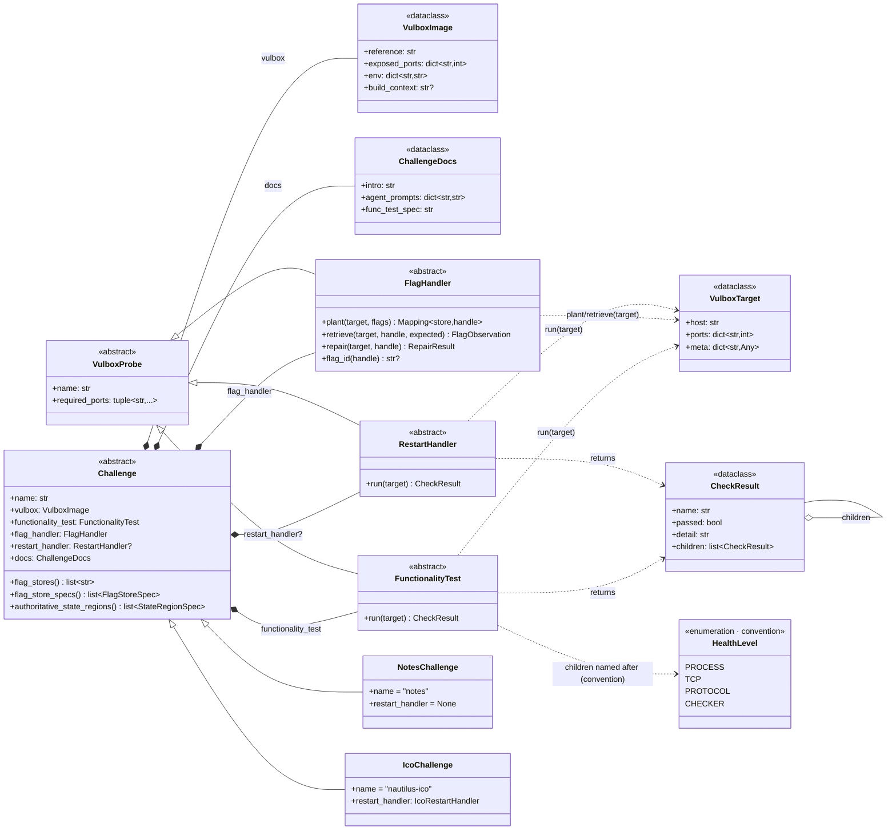
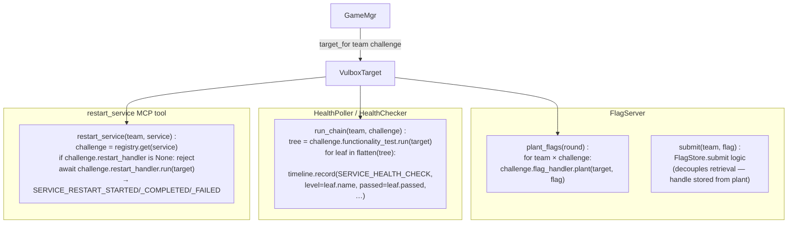

# Challenge layer — UML

Pluggable per-challenge model. Each challenge lives in one directory
under the registered challenge roots and exposes a `Challenge`
subclass composed of five things:

```
challenge = (vulbox, functionality_test, flag_handler,
             restart_handler?, docs)
```

The orchestrator pulls the components off the `Challenge` instance and
drives each independently — no per-mechanism dispatch lives in the
framework. The registry discovers the built-in challenge packages and the
mounted challenge warehouse packages.

> **Status**: live. The v2 abstract interface
> ([`challenges/interface/`](../../challenges/interface/)) + registered
> challenge packages drive all flag / health / restart paths. The v1
> `ChallengeSource` /
> `ChallengeSpec` / `FlagMechanism` / `Service` layer is deleted; see
> [docs/archived/challenge_interface_v2_plan.md](../archived/challenge_interface_v2_plan.md)
> for the staged history.

## Class diagram



## How the facilities use it



Three properties of this shape worth calling out:

1. **No mechanism enum at the framework level.** v1's `FlagMechanism`
   (SERVICE_PROTOCOL / FILE_AT_PATH / …) is retired — `FlagHandler.plant`
   is opaque to the framework. Each challenge decides how the flag
   enters the vulbox (PUT over the service's own protocol, docker exec
   write to a file path, an env var the image reads at start, anything).
2. **`HealthLevel` is convention, not contract.** When the challenge's
   `FunctionalityTest.run()` returns a `CheckResult` tree with children
   named PROCESS / TCP / PROTOCOL / CHECKER, the orchestrator emits one
   `SERVICE_HEALTH_CHECK` event per leaf and the panel renders the
   familiar chip strip. A challenge with a different shape (one leaf,
   nested groups, …) is free to do that; framework code never branches
   on the names.
3. **`restart_handler` is optional.** Challenges with no defense
   workflow leave it `None`. The orchestrator's defense-kickoff
   dispatch + the `restart_service` MCP tool both filter on this and
   skip cleanly.

## Probe loading + facility-side deps (v3)

`challenge.py` **lazy-imports** its probes — the `flag_handler` /
`functionality_test` / `restart_handler` imports live inside the properties, not
at module top. Keep the two probe modules independent (no cross-import).

The facility containers don't `build_challenge()` at all (no registry discovery,
no `Challenge` instantiation / `git rev-parse`): they call
`registry.load_probe(package, "flag_handler"|"functionality_test", base)`, which
imports ONLY that one probe module + instantiates the single concrete subclass.
GameMgr (full env, host-side) resolves the package dir + named ports and passes
them in the `configure` payload. So the flag-service imports only `flag_handler`,
the health-poller only `functionality_test` — never the other's deps.

**`checker.py` (optional).** The deep CHECKER moved out of prod's trust boundary
(the agent is root there — see [health.md](health.md#checker-outside-prods-trust-boundary)).
A challenge may add an OPTIONAL `checker.py`: a **second `FunctionalityTest`
module** the health-poller loads via
`registry.load_optional_probe(package, "checker", FunctionalityTest)` (returns
`None` when absent; raises on a broken module — missing dep / syntax error / two
concrete classes) and runs as a network probe over `target.host`/`target.ports`.
No new ABC — it's a `FunctionalityTest`, kept independent from
`functionality_test.py` by the module-name filter. The alternative form,
`image/checker.sh`, is **un-baked** and shipped over stdin (`exec_stdin`). Either,
both, or neither may be present; `image/checker.sh` is therefore no longer a
required file.

A probe that needs a **third-party** dep declares it with an auto-detected
`flag_facility_setup.sh` / `health_facility_setup.sh` in the challenge package;
`facility.build.build_facility_images` runs them at per-game facility-image build
time onto the lean base (deployed challenges only, matching facility). See
[CHALLENGE_AUTHORING_SOP.md](../CHALLENGE_AUTHORING_SOP.md) §3.1.

## PoC exploit artifact

Each registered challenge may also carry `_exploit.py` beside
`challenge.py`. That file is the deterministic PoC entrypoint used by
scripted verification games. It must run inside the team's dev container, read
`CYBERARENA_*` values from the environment or `/var/lib/cyberarena/agent.env`,
attack the opposing prod host over the arena network, and submit or claim at
least one declared objective through its assigned oracle at
`flag_service:8080` with `CYBERARENA_TEAM_TOKEN`.

The orchestrator provisions `_exploit.py` plus same-directory private helpers
matching `_*.py` into:

```
/var/lib/cyberarena/exploits/<challenge>/
```

The game config should execute the provisioned path, not embed exploit code:

```sh
python3 "${CYBERARENA_EXPLOIT_PATH:?CYBERARENA_EXPLOIT_PATH not provisioned}"
```

## Per-challenge directory layout

```
challenges/
  interface/                       # the abstract ABCs (no deps)
    challenge.py                   # Challenge, VulboxImage, ChallengeDocs
    probe.py                       # VulboxProbe, FunctionalityTest,
                                   # FlagHandler, RestartHandler,
                                   # VulboxTarget, CheckResult, HealthLevel
    __init__.py
    ORIGINAL_DESIGN.md             # historical: the 4-component
                                   # original (no RestartHandler yet)

  notes/                           # game-simple notes (attack-only)
    __init__.py                    # exports NotesChallenge()
    challenge.py                   # NotesChallenge(Challenge)
    _exploit.py                    # scripted verification PoC entrypoint
    functionality_test.py          # port-connect + LIST/COUNT
    flag_handler.py                # protocol-level PUT/GET
    prompts.py                     # attack prompt (no defense)
    build.py                       # docker build of the notes image
    image/                         # docker build context for chal-notes
      Dockerfile
      server.py                    # the daemon, baked at /opt/cyberarena/notes/
      entrypoint.sh                # sshd -D + spawn the daemon

  nautilus_ico/                    # DEFCON ico (full workflow)
    __init__.py
    challenge.py                   # IcoChallenge(Challenge)
    _exploit.py                    # scripted verification PoC entrypoint
    functionality_test.py          # process + tcp liveness via docker exec
    flag_handler.py                # FILE_AT_PATH via docker exec /flag
    restart_handler.py             # docker exec /arena/restart.sh
    prompts.py                     # attack + defense prompts
    build.py                       # docker build of the ico image
    image/                         # docker build context for chal-nautilus-ico
      Dockerfile
      restart.sh
      checker.sh                   # CHECKER — NOT baked; poller ships it over stdin
      entrypoint.sh
    # (a network challenge would instead carry a top-level checker.py and no checker.sh)

  registry.py                      # auto-discovery: build_challenge +
                                   # known_challenge_names + build_images
```

## VulboxTarget — the only thing that flows at runtime

`GameMgr.target_for(team_id, challenge)` constructs a `VulboxTarget`
per call:

```python
VulboxTarget(
    host = team.prod,                                # docker container name
    ports = dict(challenge.vulbox.exposed_ports),    # named-port map
    meta = {
        "team_id": team_id,
        "container_id": …,
        "exec_in_container": <callable>,             # docker exec helper
    },
)
```

Handlers that need to docker-exec inside the vulbox pull the callable
out of `target.meta["exec_in_container"]` — that's the documented
convention for the bridge between the framework-agnostic abstract
interface and the docker-exec world the orchestrator currently lives
in. Future transports (k8s, real SSH) swap what's in `meta`; handler
code is untouched.

The flag facility additionally sets `meta["round_context_seed"]` only on the
fresh target passed to `FlagHandler.plant()`. It is a private, deterministic
64-hex-character seed for the complete placement coordinate set; see
[flag.md](flag.md#deterministic-round-context). Other probe calls do not receive
it.

## Adding a new challenge

```
challenges/<new_chal>/
  __init__.py             # exports exactly one concrete Challenge subclass
  challenge.py            # NewChallenge(Challenge); `name = "<kebab>"` (class attr)
  functionality_test.py
  flag_handler.py
  restart_handler.py      # only if defense-capable
  build.py                # build_image()  (required convention)
  prompts.py
  image/                  # docker build context
```

**No edit to [`challenges/registry.py`](../../challenges/registry.py).** It
auto-discovers: on first use it scans `challenges/*/`, imports each package, and
registers the single concrete `Challenge` subclass it exports by its `name`
class attribute. Per-challenge behavior lives on the `Challenge` itself:

* `name` — kebab-case `ClassVar[str]` (read off the class without instantiating;
  discovery validates non-empty + kebab + unique).
* `initial_start(self, target, exec_in)` — first-start hook. The default waits
  for the primary service port to start accepting connections (a `/dev/tcp`
  probe inside the container, up to `_READY_PORT_TIMEOUT_SECS`) before
  returning, so the framework doesn't plant the first flag against a still-
  booting service; soft (never raises). Challenges that bake-but-don't-spawn
  inherit `RestartScriptInitialStart` (kicks `/arena/restart.sh`, then the same
  port-wait), e.g. ico/mlflow. Notes & the faust-* services self-start from
  their image entrypoint and inherit the default port-wait.
* `health_interval_secs` — intrinsic poll interval (positive float) or `None`;
  a `game.yaml` `challenges[].health_interval_secs` overrides it per match.
* `break_service(self, target, exec_in)` — optional negative-test hook for the
  readiness gate. Sabotage the live service so a faithful `functionality_test`
  turns red (without removing the container) and return a short description, or
  `None` (the default) for no break. The `--build` phase uses it to prove the
  checker reacts to a broken service rather than always passing: break → expect
  health FAIL → restart → expect recovery. Absent ⇒ the gate emits a NOTE, never
  a FAIL.
* image build — `challenges.<pkg>.build.build_image()` (required convention;
  a missing one is a package-named error, not a bare ImportError).

A package that can't import (missing optional dep, syntax error) is skipped with
a logged warning rather than bricking discovery; referencing it from `game.yaml`
then fails loud with the import reason.

The only other touch is `game.yaml`: a `challenges:` entry + the team prod node
`image:`. Zero touches to [gamemgr/](../../gamemgr/), [flag/](../../flag/),
[health/](../../health/), or [agents/prompts/__init__.py](../../agents/prompts/__init__.py).

## File map

| Path | Role |
|---|---|
| [`challenges/interface/challenge.py`](../../challenges/interface/challenge.py) | `Challenge` ABC + `VulboxImage` + `ChallengeDocs` |
| [`challenges/interface/probe.py`](../../challenges/interface/probe.py) | `VulboxProbe`, `FunctionalityTest`, `FlagHandler`, `RestartHandler`, `VulboxTarget`, `CheckResult`, `HealthLevel`, `OracleKind` + `FlagStoreSpec` (which capability a store measures — see [flag.md](flag.md)) |
| [`challenges/interface/ORIGINAL_DESIGN.md`](../../challenges/interface/ORIGINAL_DESIGN.md) | snapshot of the four-component original (pre-`RestartHandler`) — historical reference |
| `challenges/<name>/challenge.py` | concrete `Challenge` subclass — composition root |
| `challenges/<name>/functionality_test.py` | `FunctionalityTest` implementation (liveness) |
| `challenges/<name>/checker.py` | OPTIONAL — a second `FunctionalityTest` run as the network CHECKER in the poller (loaded via `load_optional_probe`) |
| `challenges/<name>/flag_handler.py` | `FlagHandler` implementation |
| `challenges/<name>/restart_handler.py` | `RestartHandler` implementation (defense-capable only) |
| `challenges/<name>/build.py` | `build_image()` — required convention; discovery resolves it via the challenge's package to build the image (`docker build`) |
| `challenges/<name>/image/` | per-challenge docker build context — Dockerfile + entrypoint + any baked assets |
| `challenges/<name>/prompts.py` | `build_attack_prompt(cfg)` / `build_defense_prompt(cfg, …)` for the challenge |
| [`challenges/registry.py`](../../challenges/registry.py) | auto-discovery of `challenges/*/`: `build_challenge` + `known_challenge_names` + `build_images` |
