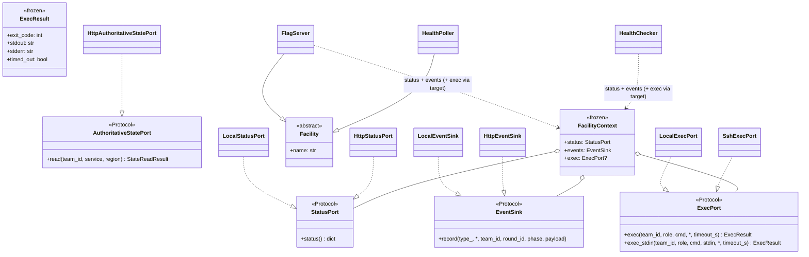
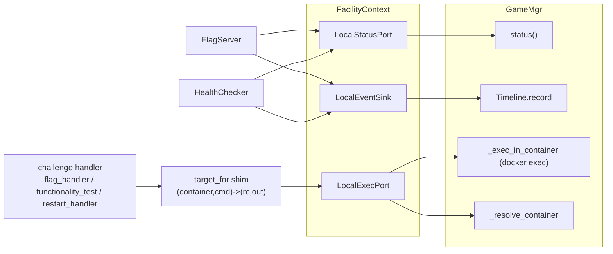
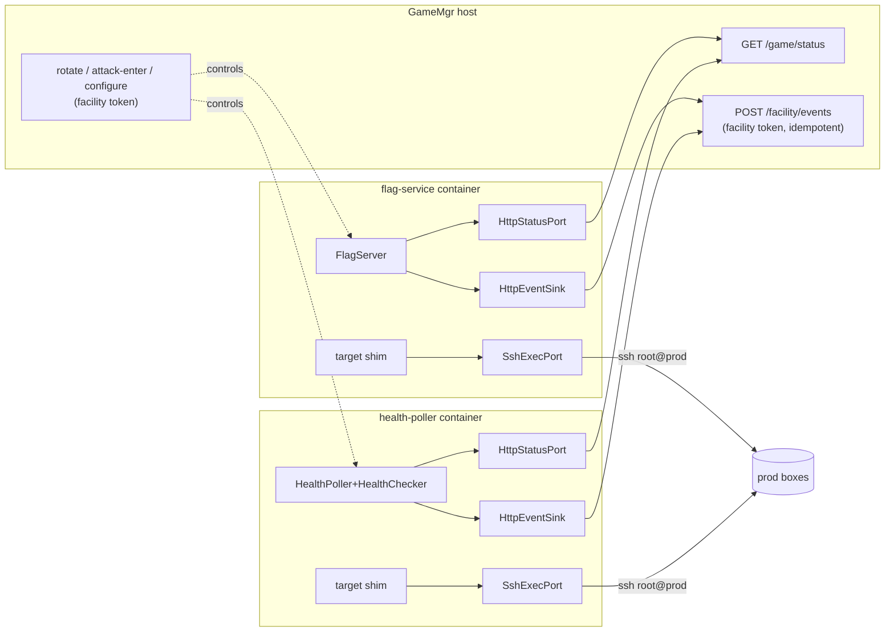

# Facility abstraction — UML

`facility/` defines the boundary between a facility (FlagServer,
HealthPoller, …) and its host (GameMgr): narrow ports bundled in a
`FacilityContext`, plus a thin `Facility` ABC. Stdlib-only; imports
nothing from `gamemgr` / `flag` / `health`, so the boundary stays acyclic.

The boundary now has **two realizations**, selected by config toggles:

- **In-process (default / dev):** `Local*` adapters — facilities run inside the
  GameMgr process; `ExecPort` is docker-exec on the host.
- **Containerized:** each facility runs in its own container talking over HTTP +
  SSH. Status/events go over HTTP to GameMgr (`Http*` adapters); the flag-service
  **plants** and the health-poller **probes** by SSHing into prod directly
  (`SshExecPort`); the MCP server moves into an `mcp-gateway` container. GameMgr
  becomes a backend (round clock + timeline + Docker), not an exec relay.

`AuthoritativeStatePort` is a fourth, OPTIONAL capability, added for evidence
handlers that must not trust anything running inside prod: it reads one
statically-allowlisted region through GameMgr's host Docker archive API
(`POST /facility/state/read`, facility token only). Callers address a region by
`(team_id, service, opaque region name)` — no path, UID, or command crosses this
boundary; GameMgr resolves the path from
`Challenge.authoritative_state_regions()`. It is deliberately not bundled in
`FacilityContext`; the flag service exposes it to a handler only through a
per-target closure scoped to the resolved `(team_id, service)`. See
[flag.md](flag.md) §"Defender-independent reads are mandatory for WRITE".

Lineage: the boundary + in-process path is
[facility_abstraction_plan_v1.md](../archived/facility_abstraction_plan_v1.md)
(Phase 1, shipped). The host-relay containerization is
[facility_containerization_plan_v2.md](../archived/facility_containerization_plan_v2.md)
(Part A + B-0/B-1/B-2, shipped). The current direction — facilities exec into
prod over SSH + MCP containerization + containerized-only — is
[facility_direct_exec_plan_v3.md](../archived/facility_direct_exec_plan_v3.md)
(repo code built + unit-tested; full isolated-game live-verify pending).

## Class diagram

`exec` is consumed by the *target builder* (`GameMgr.target_for` in-process, or
the equivalent shim inside the flag-service / health-poller apps), not by
FlagServer/HealthChecker directly — they reach exec through the
`VulboxTarget.meta["exec_in_container"]` callable the builder installs. So the
exec transport (docker / SSH) swaps behind an unchanged challenge contract.

## In-process wiring (default / dev)

`LocalExecPort` resolves `(team_id, role)` → container host-side, then runs the
blocking docker exec on a daemon thread with a `join(timeout_s)` deadline so a
hung exec can't wedge the round loop.

**`exec_stdin(team_id, role, cmd, stdin, *, timeout_s)`** is a separate,
purpose-built method (the ordinary `exec` contract is untouched): run `cmd`
feeding `stdin` to its standard input. Its sole caller is the health CHECKER
runner, which runs `cmd="bash -s"` with the checker script as `stdin`, so the
executed bytes come from the poller — never from the (agent-root, tamperable)
prod filesystem. `SshExecPort` sends the script over the SSH stdin to a remote
`bash -s` (no `bash -c` wrapper); `LocalExecPort` routes through an injected
`docker_exec_stdin` seam that GameMgr implements as `docker exec -i <qualified>
bash -s` (chosen over the docker SDK's fiddly socket-stdin for a low-frequency,
off-hot-path probe). **Single timeout owner:** `timeout_s` is threaded straight
to the underlying `subprocess.run(timeout=...)` — no second daemon-thread
deadline — so there's no double-kill / duplicate-run / leaked-thread trap.

## Containerized wiring (v3 — built)

Each facility runs in its own off-agent container. Status/events go over HTTP to
GameMgr; the flag-service plants and the poller probes by SSHing into prod
directly (`SshExecPort`, role-allowlisted to `prod`). GameMgr signals the round
clock (`/flags/rotate`, `/poller/attack-enter`) but is not in the exec path.

The agent reaches MCP through the **mcp-gateway** container (no api-router
relay): `submit_flag` goes direct to the flag-service; the GameMgr-coupled tools
(`get_game_state` / `get_attacks_received` / `restart_service` / `report_*`)
forward to GameMgr REST, which still executes privileged ops (docker restart
stays host-side). See [api_router.md](api_router.md) for the relay it replaces.

## What it does NOT do

- **Not a daemon framework.** `Facility.start/stop` default to no-ops; facilities
  are driven by GameMgr signals (`rotate` / `on_attack_enter` — direct calls
  in-process, control-endpoint HTTP when containerized), not a self-owned loop.
- **Not a new event bus.** `EventSink` is a one-way append mirroring
  `Timeline.record`; nothing subscribes. The HTTP sink is idempotent on an
  `event_id`; the single central timeline orders by ingest sequence.
- **Does not change challenge code.** The `(container_name, cmd) -> (rc, output)`
  contract in `challenges/interface/probe.py` is untouched; the exec transport
  swap (docker → SSH) happens behind the `target` shim.
- **No `docker.sock` in any agent-reachable / facility container.** The only
  privileged channels are SSH-into-prod (role-allowlisted) and GameMgr's REST.

## File map

| Path | Role |
|---|---|
| `facility/ports.py` | `StatusPort` / `EventSink` / `ExecPort` + `ExecResult` / `AuthoritativeStatePort` |
| `facility/base.py` | `Facility` ABC + `FacilityContext` |
| `facility/adapters_local.py` | `Local*` in-process adapters (docker exec) |
| `facility/adapters_http.py` | `HttpStatusPort` / `HttpEventSink` + facility-token header |
| `facility/adapters_ssh.py` | `SshExecPort` — facility→prod exec over SSH (prod-only) |
| `flag/service_app.py` · `flag/service_main.py` | flag-service container (plants over SSH) |
| `health/service_app.py` · `health/service_main.py` | health-poller container (probes over SSH) |
| `health/poller_handle.py` | `RemoteHealthPollerHandle` — GameMgr's proxy to the poller container |
| `mcpgateway/` | `mcp-gateway` container (FastMCP tools bound to HTTP backends) |
| `agents/_provisioning.py` | `provision_ssh_pivot` (agent) + `provision_facility_ssh` (facility key) |
| `facility/__init__.py` | re-exports |
