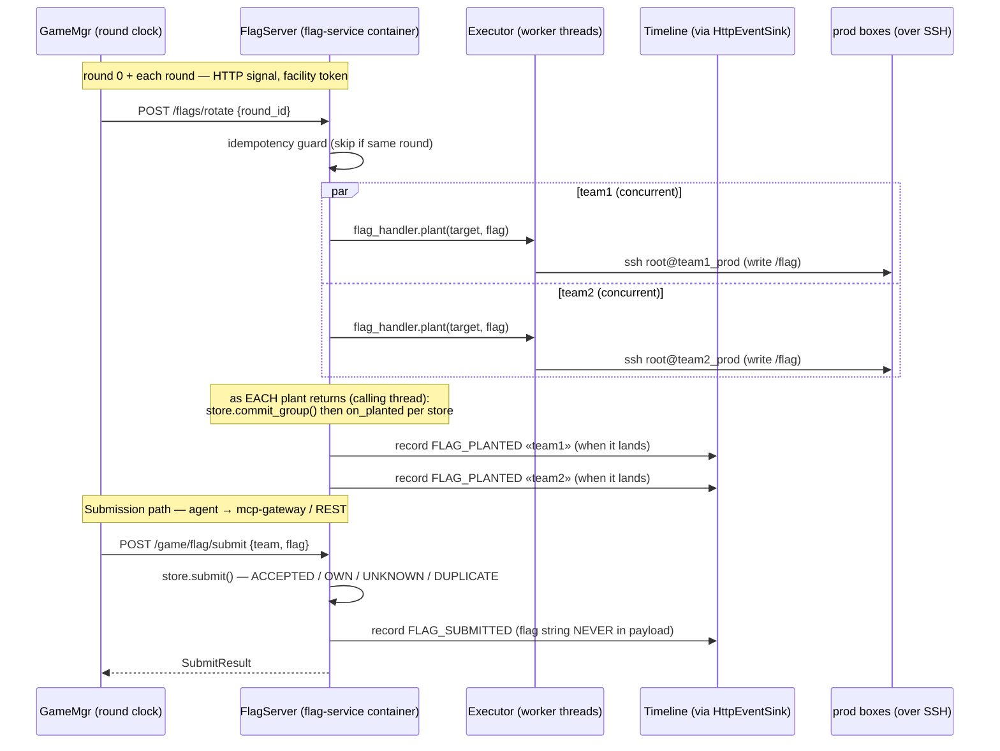

# Flag facility — UML

`flag/` is an independent package consumed by `GameMgr`. Two classes:

- **`FlagStore`** — pure in-memory state. Owns the
  ACCEPTED/UNKNOWN/OWN/DUPLICATE/ROTATED decision logic. A service may hold
  **several objectives at once — one per named *store*** (real A/D "flag IDs"),
  keyed `(team, service, store) → FlagRecord` in ONE map whatever the store's
  `OracleKind`; each scores independently. A rotation's `commit_group()` swaps a
  `(team, service)`'s whole group in atomically and drops the previous group —
  including any store no longer present (orphan cleanup) — so old flags submit
  as UNKNOWN after rotation. No I/O, no timeline, no docker.
- **`FlagServer`** — orchestration over the store. Plants each `(team, service)`
  via the per-challenge `FlagHandler.plant(target, {store: Flag}) → {store:
  handle}` — **all teams in parallel** (each plant is a blocking SSH
  round-trip) — runs per-round rotation, verifies submissions, and records one
  `FLAG_PLANTED` **per store** + `FLAG_SUBMITTED`. A `Facility` (`name="flag"`)
  that talks to its host through a `FacilityContext` — `ctx.events` for records,
  `ctx.status` for round/phase. See [facility.md](facility.md). Single-store
  challenges declare one `DEFAULT_STORE` (via `flag_stores()`) and use the
  `SingleFlagHandler` base (a `plant_one(target, value)` shim); multiflag
  challenges override `flag_stores()` + implement the mapping `plant`.

## Deterministic round context

For each `(round, victim, service)` placement, `FlagServer` puts one private
64-hex-character seed in `target.meta["round_context_seed"]` before calling
`FlagHandler.plant`. It derives the seed with HMAC-SHA-256 from a random
match-long secret and a versioned canonical encoding of the round id, victim,
service, complete attacker set, and complete objective-store set. The same
coordinates therefore reproduce the same seed across a retry, while changing
any coordinate yields a domain-separated seed. Proof tokens remain independently
random.

The challenge uses this seed to converge its application-specific records,
paths, jobs, operation instances, and target ids. It should expand the seed with
labeled HMAC-SHA-256 or HKDF; a non-cryptographic seeded PRNG is not suitable
when observing one generated value must not reveal other teams' context. The
seed is private facility state: it must not enter a plant handle, target id,
attack-info response, event, log, or defender-controlled application state.
Targets used for retrieval, audit, repair, health checks, restarts, or baseline
principal provisioning do not carry this metadata key.

## Baseline access — three modes, one optional facility path

Challenge feasibility selects the application-native access mode:

- **Anonymous or client-generated identity:** no principal is issued.
- **Natural self-registration:** the attacker registers through the application;
  no facility principal is issued.
- **Arena-provisioned:** a trusted administrator must assign a role, ACL, group,
  membership, invitation, tenant, or replacement for a shared login. The
  `FlagHandler.provision_principals()` hook creates one equivalent principal per
  attacker before round 0.

For the third mode, `FlagServer` supplies independent seeds for every
`(victim, service, attacker)`, validates complete and distinct results, and keeps
the assignments outside `FlagStore` because their lifetime is one match rather
than one round. `POST /game/attack-info` returns only the requester's rows under
the sibling `principals` array. Application-specific creation remains in the
challenge and may use a supported API, UI, CLI, or canonical configuration plus
reload. Anonymous and self-registering challenges inherit the default `None`;
an overridden hook must return the complete attacker mapping or fail setup.

## Capability oracles — one mechanism, three outcomes

A store declares WHICH security outcome it measures via
`Challenge.flag_store_specs() → [FlagStoreSpec(name, kind, scope)]` — **the one
authoritative declaration**: planting, scoring, flag counts and the verifier's
checkers all read it and nothing else. `flag_stores()` stays the simple all-READ
authoring hook and the default `flag_store_specs()` wraps it, so a plain read
challenge changes nothing; a write/execute challenge overrides
`flag_store_specs()` **only** (there is no second view to keep in agreement).
`kind` is an `OracleKind`; `scope` is the registered attack-scope id the store
realizes and is REQUIRED for any non-READ kind. **All three kinds run through the same
`FlagHandler.plant` + `.retrieve` pair** — there is no second mechanism, no
second record type, and no second map:

| kind | what `plant` writes | how it scores | in `by_flag`? |
|---|---|---|---|
| `read` | the flag, in protected app state | attacker recovers it → `submit_flag` | yes |
| `execute` | the flag, readable only by code running in the SERVICE execution context (an ordinary-looking helper/operation on the box, in the shape of a `catflag` — never a process-table trick) | attacker reaches execution, runs the helper → `submit_flag` | yes |
| `write` | a facility **integrity token** as its own integrity evidence, plus the writable target | attacker places their per-round **mark** in the writable target → `claim_capability` | **no** |

READ and EXECUTE score identically — a recovered value handed to `submit_flag` —
and differ in WHERE the challenge plants the flag, which is what makes the
recovered value proof of an execution capability rather than a read one. They
differ in one framework rule too: EXECUTE's helper/operation is a **rotating
current-round target**, so like WRITE it MUST publish a nonempty `flag_id()` and
may not reuse a previous round's id. READ keeps the historical default — `None`
is legitimate when the flag's location isn't identity-keyed. Attack-info carries
the EXECUTE target id and never the flag.

The EXECUTE audit checks the mechanism and token together: `retrieve` exercises
the current helper/operation in the service execution context and
requires the expected flag. A privileged read of only the backing token is not a
valid integrity check because removing the helper would deny captures while the
audit still reported `PRESENT`.

WRITE inverts the direction. Its planted value is facility state, so it is
deliberately **kept out of `by_flag`**: recovering the integrity token scores
nothing. What the attacker supplies instead is a placement, and the facility does
the reading.

### `retrieve` answers two questions for a WRITE store

The handle `plant` returns packs the integrity token, so `expected` is the whole
dispatch:

- `expected == <the token>` → the round-end **audit**. Read the integrity
  evidence, return the usual `FlagObservation` statuses. Defender tampering with
  facility state is recorded exactly as flag persistence is.
- anything else → a **claim**. `expected` is one attacker's mark: scan the
  WRITABLE target. Scan the REGION, not a pinned cell, so any genuine write
  across the boundary credits whatever primitive produced it.

The framework then folds the claim observation into two verdicts, and the split
is **conclusive vs. inconclusive**, not one status vs. the rest:

| observation | claim reason |
|---|---|
| `PRESENT` | `ACCEPTED` (subject to the store's eligibility rules) |
| `NOT_FOUND` (region read clean) · `MISMATCH` (region held some other value) | `NOT_OBSERVED` — the mark is demonstrably not there |
| `AUTH_REJECTED` · `ERROR` | `OBSERVE_ERROR` — we could not tell; retry |

Calling an inconclusive read "absent" would hand a defender a claim-denial lever
by being briefly broken; calling a conclusive absence "retry" would leave a
failed attack looping forever.

**Integrity and claim evidence must be logically separable**, so the audit answer
is never derivable from an attacker's write nor a claim answer from facility
state. Physical layout is the challenge's call within one rule: a **scalar /
overwrite** target MUST use a distinct integrity anchor (colocating means a
landed write destroys the token and the audit reports the *defender* for the
*attacker's* action), while an **append / collection** target (a log, table,
directory) MAY colocate the token with attacker marks provided they coexist
rather than displace each other, `retrieve` can tell which of the two it is being
asked about, and no successful write can make the audit report loss or tampering.
`state_scan_observe` is the shared body for the claim half, mirroring
`exec_read_observe` for the audit half. The claim MUST read through a
defender-independent backend (a declared `StateRegionSpec` served by the host):
`exec_in_container` runs where the defender is root, so output it produces cannot
establish that an attacker's mark landed.

### Claiming — `POST /game/flag/claim`

Player-token endpoint (same identity + phase gate as `/game/flag/submit`), routed
**direct to the flag-service** by the `claim_capability` MCP tool. `FlagServer.claim`:

1. `store.issue_mark(attacker, victim, service, store, round)` — mints the
   attacker's mark on first request, idempotent within the round (re-reading
   attack-info never invalidates work in flight), own-team and non-WRITE stores
   get nothing.
2. **outside the lock** (it is an SSH/HTTP round-trip):
   `retrieve(target, rec.handle, mark)`.
3. `store.credit_claim(..., observed=rec, round)` — revalidates that `rec` is
   still the LIVE record and the round is still active before crediting, then
   `rec.claimed.add(attacker)`. Without the identity check a rotation landing
   mid-read would credit the round-N mark against the round-N+1 record.

It emits **`FLAG_SUBMITTED`**, not a new event type — captures are captures, and
every downstream consumer already understands that shape. The payload carries
`store`, `outcome`, `scope`, `oracle`. Marks never appear in it.

Reasons: `ACCEPTED` / `DUPLICATE` / `OWN` / `NO_STORE` / `NOT_OBSERVED` (the mark
isn't there) / `OBSERVE_ERROR` (the region couldn't be read — retry, not a
verdict) / `ROTATED` / `WRONG_PHASE`. A claim that never reached the flag-service
at all (mcp-gateway transport failure) also returns `OBSERVE_ERROR` — same
"could not tell, retry" meaning, and it keeps the claim path to one vocabulary.

### Round safety

- **Active round only.** `submit` and `claim` gate positively on
  `{ATTACK, LIVE}` — an unknown/unreachable status cannot bind evidence to an
  active round, so it rejects rather than crediting through a possible
  transition. A value planted for a past round returns `ROTATED`.
- **Non-accepting rotation window.** `AsyncLoop` rotates at `Phase.SETUP` and only
  publishes the round (ROUND_START, `Phase.LIVE`) once every target committed.
- **Fresh rotating targets.** `commit_group` rejects a WRITE **or EXECUTE**
  `flag_id` reused from a previous round (same-round reconciliation of a retried
  plant is allowed), and `plant_flags` fails the `(team, service)` plant when
  either kind publishes no id at all. READ ids are exempt — their secret rotates
  instead.
- **Fail-loud rotation.** `plant_flags` raises when any target is still pending
  after the retry budget (after emitting `FLAG_PLANT_FAILED`), `/flags/rotate`
  propagates it, and `GameMgr._signal_flag_rotate` / `_configure_flag_service`
  raise — a partially rotated round is never published. The round-end **audit**
  stays best-effort: it only records.
- **`attack_info` is round-consistent.** It returns `[]` outside a live window and
  discards a snapshot assembled ACROSS a round boundary.

### Defender-independent reads are mandatory for WRITE

`exec_in_container` runs inside the container the defender is root in, so a root
defender can rewrite the reader itself. Every challenge with a WRITE store declares
at least one region through
`Challenge.authoritative_state_regions() → [StateRegionSpec(name, path, max_bytes)]`
and its claim-side handler reads by opaque `name` through
`read_authoritative_state` / `state_scan_observe`. The facility calls
`AuthoritativeStatePort.read(team, service, region)`
(`HttpAuthoritativeStatePort` → GameMgr `POST /facility/state/read`, facility
token only); GameMgr resolves the fixed path from trusted challenge metadata and
reads the bytes via the **host Docker archive API** — no shell, reader binary, or
stdout producer runs in prod. Unknown identity, unknown region, oversized or
non-regular-file content are all ERROR, never an attacker miss. Challenges with
only READ and EXECUTE stores need no regions, so most challenges need none of this.

In v3 the FlagServer runs **inside the flag-service container** (off the
agent net) and plants over SSH; GameMgr is the round clock that signals it
over HTTP (`/flags/configure` once, then `/flags/rotate {round_id}` per
round) and forwards player submits (`/game/flag/submit`). It owns the full
flag lifecycle — GameMgr is not in the plant/submit data path. Pluggable
per the v2 `Challenge.flag_handler` contract — no mechanism-by-mechanism
branching lives in the framework. See [facility.md](facility.md) for the
container/SSH transport.

## Concurrency — planting must not stall submits

`/flags/rotate` (SSH planting) and `/game/flag/submit` both do blocking I/O,
so the service-app handlers run them **off the event loop** via
`asyncio.to_thread`. This is load-bearing: a single slow or hung SSH plant
(e.g. a prod box mid-`restart_service`, or unreachable) must not freeze the
loop — otherwise *every* concurrent submit and the next round's rotation
stall behind it (the flag-service-wedge bug: one hung plant at a rotation
killed all submissions + flag rotation for the rest of the match). Because
rotate and submit can now touch `FlagStore` concurrently, the store guards
its maps with a `threading.Lock` (held only for the in-memory mutation,
never for the SSH plant). `SshExecPort` adds fail-fast SSH options
(`ConnectTimeout` + `ServerAlive*`) so a stuck plant aborts in ~10s rather
than hanging to the 120s subprocess backstop. The mcp-gateway maps a
flag-service timeout to a retryable `reason="ERROR"` submit verdict, so an
agent sees a clear "retry" signal instead of an opaque MCP tool error.

## Class diagram

```mermaid
classDiagram
  class Flag {
    <<frozen>>
    +value: str
    +metadata: Mapping
  }

  class FlagStoreSpec {
    <<frozen>>
    +name: str
    +kind: OracleKind
    +scope: str?
  }

  class BaselinePrincipal {
    <<frozen>>
    +principal_id: str
    +credentials: Mapping~str,str~
  }

  class FlagRecord {
    +flag: Flag
    +handle: str
    +round_id: int
    +active: bool
    +flag_id: str?
    +kind: OracleKind
    +marks: dict~attacker,mark~
    +claimed: set~attacker~
  }

  class FlagStore {
    +planted: dict~tuple~team,svc,store~,FlagRecord~
    -by_flag: dict~value,tuple~team,svc,store~~
    -submissions: dict~str,set~
    -objective_target_rounds: dict~key,dict~flag_id,round~~
    +commit_group(team_id, service, records) None
    +submit(submitter_team_id, flag, round_id) SubmitResult
    +issue_mark(attacker, victim, service, store, round_id) tuple
    +credit_claim(attacker, victim, service, store, observed, round_id) SubmitResult
    +attack_targets(requester_team_id, round_id) list
  }

  class SubmitResult {
    <<frozen>>
    +accepted: bool
    +reason: str
    +victim_team_id: str?
    +service: str?
    +store: str?
  }

  class FlagServer {
    +name: str = "flag"
    +store: FlagStore
    -_events: EventSink
    -_status: StatusPort
    -_challenge_by_owner: dict
    -_target: TargetFactory
    -_last_planted_round: int
    +plant_initial_flags() list
    +plant_flags(round_id, on_planted?) list
    +rotate(round_id) None
    +audit(round_id) None
    +submit(team_id, flag) SubmitResult
    +claim(team_id, victim, service, store) SubmitResult
    +provision_principals(team_ids) int
    +principal_info(requester_team_id) list
    +attack_info(requester_team_id) list
    +emit_planted_setup() None
  }

  FlagServer "1" *-- "1" FlagStore : owns
  FlagServer "1" *-- "*" BaselinePrincipal : match-long assignments
  FlagStore "1" *-- "*" FlagRecord : (team,svc,store)→record
  FlagRecord *-- Flag : holds
  FlagRecord ..> FlagStoreSpec : kind from
  FlagStore ..> SubmitResult : returns
  FlagServer ..> Challenge : plant(flag_store_specs → {store: Flag})
  FlagServer ..> EventSink : records FLAG_PLANTED / FLAG_SUBMITTED
  FlagServer ..> StatusPort : round/phase for stamping + gating
```

## Plant dispatch

`plant_flags(round_id, on_planted=None)` walks a single map (populated at
`/flags/configure` from GameMgr's deployment) and plants **every (team,
service) concurrently** in a `ThreadPoolExecutor` — so a rotate's wall-clock
is the slowest single plant, not the sum:

| Path | What runs |
|---|---|
| `_challenge_by_owner[(team, svc)] → Challenge` | build `{store: Flag}` over `challenge.flag_store_specs()` (READ, WRITE and EXECUTE alike), then `challenge.flag_handler.plant(target, flags) → {store: handle}` where `target` resolves to an SSH-into-prod exec (`SshExecPort`) |

Each challenge's `FlagHandler` owns the wire protocol — notes does a
PUT over its newline protocol, ico writes `/flag` over SSH, future
challenges can write several named stores. The framework is opaque to the
choice; it only validates the return is **all-or-nothing** (`set(handles) ==
set(flags)`, else the whole `(team, svc)` plant fails and retries as a unit).
The blocking SSH plant runs in a worker thread; the `FlagStore.commit_group()`
swap and the `on_planted(team, service, store, meta)` callback (**one per
store**) run on the **calling thread** the instant a plant returns, so
`FlagStore` stays single-threaded and each flag is announced the moment it goes
live. Each store's handle is kept on its `FlagRecord` for future `retrieve()`
(own-team verify, or attack agents using the same handler).

`retrieve(target, handle, expected=None) → FlagObservation` is a **pure
read-only, never-raising** structured read: `status` is one of `PRESENT`
(`.value` carries the flag) / `NOT_FOUND` / `MISMATCH` (flag tampering) /
`AUTH_REJECTED` (a read precondition — e.g. a rotatable service credential —
was broken) / `ERROR` (transport/unhealthy → inconclusive). The
round-end flag-persistence audit reads this and must know *why* a read failed,
not just that it did — a bare `str | None` conflates "flag gone" with "service
flaky". Re-establishing a broken read precondition is the separate
`repair(target, handle) → RepairResult` (default `NO_ACTION`; the only writer,
invoked only after an `AUTH_REJECTED`), so observation never mutates the box and
tampering evidence is never laundered into "benign".

## Persistence audit (round-end)

Because the defending agent is root on its own prod box, it can delete or alter
its OWN flag (via IO or the service's API). At **each round's end** — after the
round's flags have been live the whole round, and **before** the next rotation
overwrites them — GameMgr signals the flag-service `POST /flags/audit {round_id}`
(mirror of `/flags/rotate`), from `on_round_stop` (sync) and the async round-end.

`FlagServer.audit(round_id)` snapshots the store (lock-safe) and runs the
per-`(team, service, store)` reads **concurrently** (`_run_batch`, the same
executor strategy `plant_flags` uses — so the round-boundary step costs the
slowest single read, not their sum); the SSH work happens in workers and the
events are emitted on the calling thread in a stable order. It records one
**`FLAG_PERSISTENCE`** event per store with
`payload={service, store, initial_status, status, detail, repair}`:

- **`status`** — the FINAL `FlagObservation` status: `PRESENT` (survived) /
  `NOT_FOUND` / `MISMATCH` (flag tampering) / `AUTH_REJECTED` / `ERROR`
  (inconclusive — service unhealthy/unreachable).
- **`initial_status`** — the FIRST observation, before any repair; equals
  `status` unless a repair ran (i.e. unless the first read was `AUTH_REJECTED`).
- **`repair`** — `null` if no repair ran; otherwise the `RepairResult` of the
  attempt an `AUTH_REJECTED` triggered: `REPAIRED` / `NO_ACTION` / `FAILED`
  (a raising `repair()` is isolated to `FAILED`, never propagated).

On `AUTH_REJECTED` the audit invokes `repair()` (the ONLY write in the pass) and
re-reads to capture the flag's real state — so a healed precondition reads
`status=PRESENT` with `initial_status=AUTH_REJECTED, repair=REPAIRED`.

**INVARIANT:** `repair != null` ⟺ `initial_status == AUTH_REJECTED` ⟺ a
read-precondition tamper was observed this round — *regardless of repair
outcome*. So "attempted but failed" is `repair == "FAILED"` (non-null); a
consumer keys precondition-tamper on `repair != null` (or `initial_status`),
**never** on `status` (which may read `PRESENT` after a successful repair). The
whole per-item op is isolated: a failure even before the first read (e.g.
building the target) is recorded as `initial_status=status=ERROR`, never
aborting the pass.

It is a **read-only, record-only** pass: it observes one round at a time (no
cross-round streak) and **never fails the match** (unlike `FLAG_PLANT_FAILED`,
which is an infra failure — a defender deleting its own flag is gameplay, scored
downstream from the events). It never raises: one unreachable box is recorded as
`ERROR`, not a 500. The blocking SSH reads run off the event loop.

## Rotation lifecycle

GameMgr signals the containerized flag-service over HTTP (round 0 is just
`rotate(0)`). Each rotate plants all teams in parallel; per `(team, service)`
it is **plant-then-swap** — generate the new `{store: Flag}` group, plant every
store, and only on success `commit_group()` the new group in while invalidating
the old (incl. orphan stores) atomically, so there is **no window where a
service has no valid flag** (a failed plant leaves the old flags live and the
round goes to `FLAG_PLANT_FAILED`). It emits `FLAG_PLANTED` **per store, the
instant it lands** (payload carries `store`) — so the event timestamp marks
when the flag actually went live on prod, not when the whole batch finished. (Batching previously made the event lag the live flag
by seconds under slow SSH, so an agent that legitimately exploited a freshly
rotated flag could look like it submitted "before" the plant.)

A plant that fails — its prod box briefly unreachable, typically the defender's
own `restart_service` racing the round tick — is **retried for just the failed
team(s)** with backoff (`_PLANT_RETRY_BACKOFF_S`), so the box coming back within
a few seconds still rotates that round without re-rotating already-planted teams.
`FLAG_PLANTED` carries `attempt` + `latency_ms` for slow-round diagnosis. If the
retries are exhausted, the service emits **`FLAG_PLANT_FAILED` (team, round)**
(with `attempts` + `error`) instead of silently dropping the flag, and does not
raise — one dead box never 500s the rotation or freezes the other teams.



## Attack-info — public flag-ids to attackers

Real A/D CTFs hand attackers a per-round **flag-id**: which record/identity on
the victim holds the current flag (a username, account, item, …). Our harness
surfaces it through one framework feature (not N per-challenge fixes) so flag-id
challenges don't force offense into brute-force enumeration.

- **Author hook** — `FlagHandler.flag_id(handle) → str | None` (non-abstract,
  default `None`). Each challenge already packs its public id inside the opaque
  handle `plant()` returns; a flag-id challenge overrides `flag_id` to unpack and
  return **only the public id — never the flag value**. Default `None` = this
  challenge's flag isn't identity-keyed, so nothing is surfaced.
- **Capture at plant** — as each store lands, `FlagServer` derives
  `flag_id = handler.flag_id(handle)` (guarded — a throwing/absent `flag_id`
  yields `None`, never fails the plant) and stashes it on `FlagRecord.flag_id`
  (the public locator only — never the flag value). It rotates with the flag
  automatically.
- **Read path** — `FlagStore.attack_targets(requester)` returns a **locked**
  snapshot of every *other* team's planted store that has a `flag_id` (own-team
  rows excluded — this is the attacker's view). `FlagServer.attack_info()`
  enriches each with the victim host.
- **Exposure** — a player-token endpoint `POST /game/attack-info` (same
  `X-Team-Token` identity as submit) and the `get_attack_targets` MCP tool, which
  routes **direct to the flag-service** (like `submit_flag`; GameMgr never sees
  the ids, so they stay off its timeline). Returns
  `{targets: [...], principals: [...]}`. Target rows are
  `{team_id, service, host, store, flag_id, round_id, outcome, scope, oracle}`;
  principal rows are `{team_id, service, host, principal_id, credentials}` and
  appear only for arena-provisioned baselines. Both arrays are opponent-scoped;
  principal credentials belong only to the authenticated requester. `targets`
  is empty when no deployed challenge exposes an id, while `principals` is empty
  for anonymous and self-registering challenges or when the round is not live.
  `oracle` is `"submit"` or `"claim"`; a `"claim"` row additionally carries the
  requester's own `mark`. Named in the shared L1 prompt.
- **Marks are minted here** — reading attack-info is what issues a requester's
  WRITE marks, so there is no separate handshake before attacking. A mark is only
  ever useful to the team it was issued to, so leaking one costs nothing.

The public id is the *locator* only; the flag value is still recovered from the
service and submitted by the agent — attack-info narrows the search, it does not
hand out flags.

## What it does NOT do

- **Not a subscriber.** GameMgr signals rotation (and forwards submits)
  over HTTP; FlagServer doesn't listen to PHASE_CHANGE or run its own loop.
- **Doesn't own the kickoff handler set or `_defense_pending`** —
  those are defense-phase orchestration state on GameMgr.
- **Doesn't manage challenge deployment** — that's still
  `GameMgr.deploy_challenges()`; FlagServer just plants into already-
  deployed services.
- **Doesn't leak flag strings or marks.** Neither a flag nor a mark ever appears
  in `FLAG_PLANTED` or `FLAG_SUBMITTED` payloads — those go to the public
  panel + on-disk JSONL.
- **Doesn't read protected bytes into the timeline.** An authoritative-state read
  stays inside the flag facility; only the claim verdict leaves it.

## File map

| Path | Role |
|---|---|
| `flag/__init__.py` | re-exports `FlagServer`, `FlagStore`, `SubmitResult`, `new_flag` |
| `flag/store.py` | `FlagStore` + `FlagRecord` + `SubmitResult` + `new_flag` / `new_mark` (state + decision logic) |
| `flag/principals.py` | Setup-time seeds, validation and match-long principal assignment mapping |
| `challenges/interface/probe.py` | `Flag`, `BaselinePrincipal`, `FlagHandler`, `SingleFlagHandler`, `DEFAULT_STORE`, `OracleKind`, `FlagStoreSpec`, `validate_flag_stores` / `validate_flag_store_specs`, `exec_read_observe` / `state_scan_observe`, `read_authoritative_state` (the author-facing contract) |
| `challenges/interface/challenge.py` | `flag_store_specs()`, `authoritative_state_regions()`, `StateRegionSpec` |
| `flag/server.py` | `FlagServer` (setup-time principals; parallel plant / rotate / submit; records via `ctx.events`) |
| `flag/service_app.py` · `flag/service_main.py` | flag-service container app (HTTP endpoints → FlagServer over SSH) |
