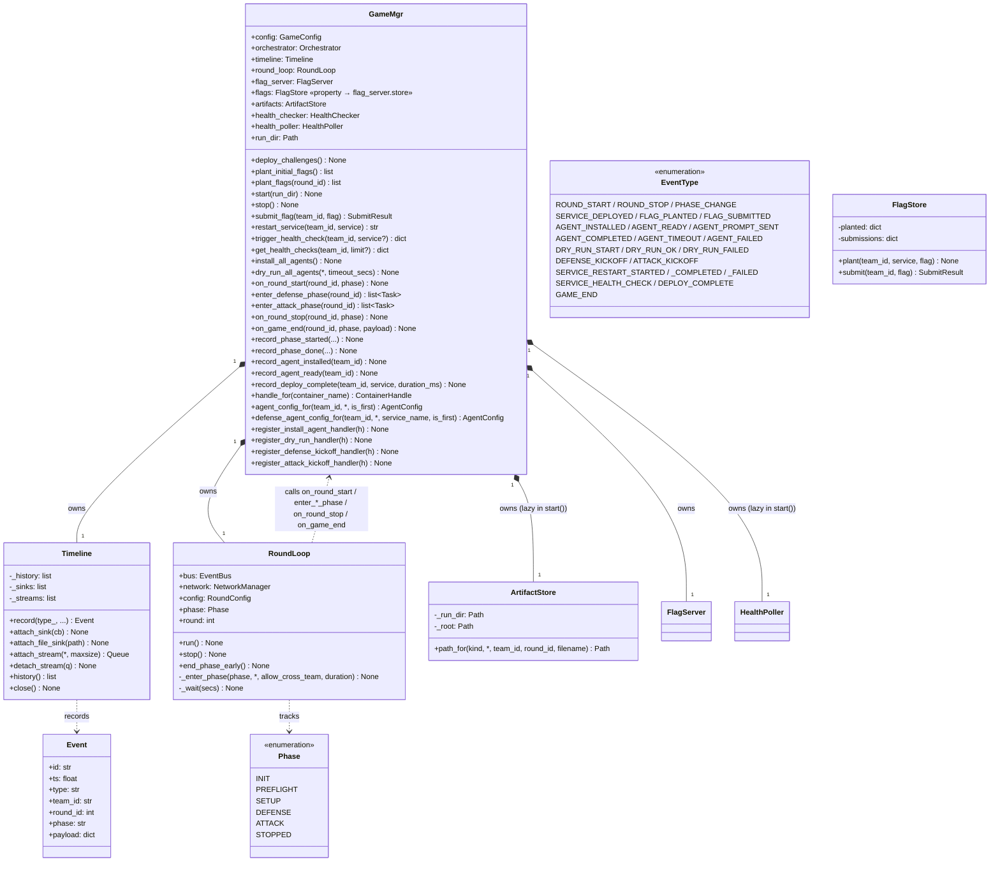
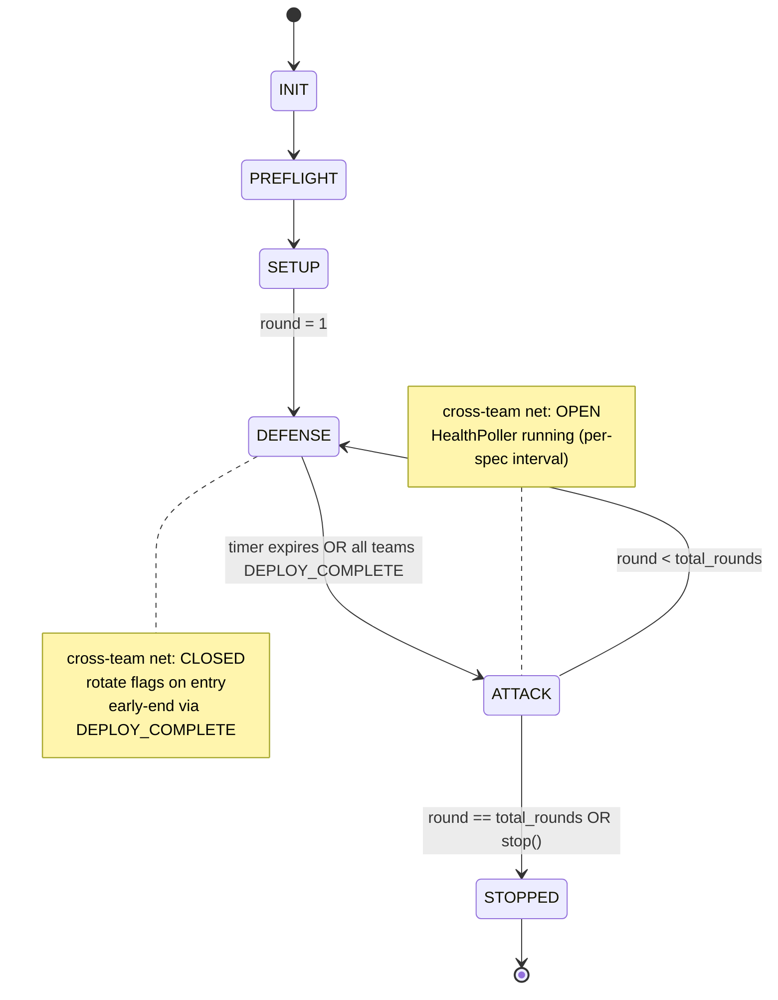
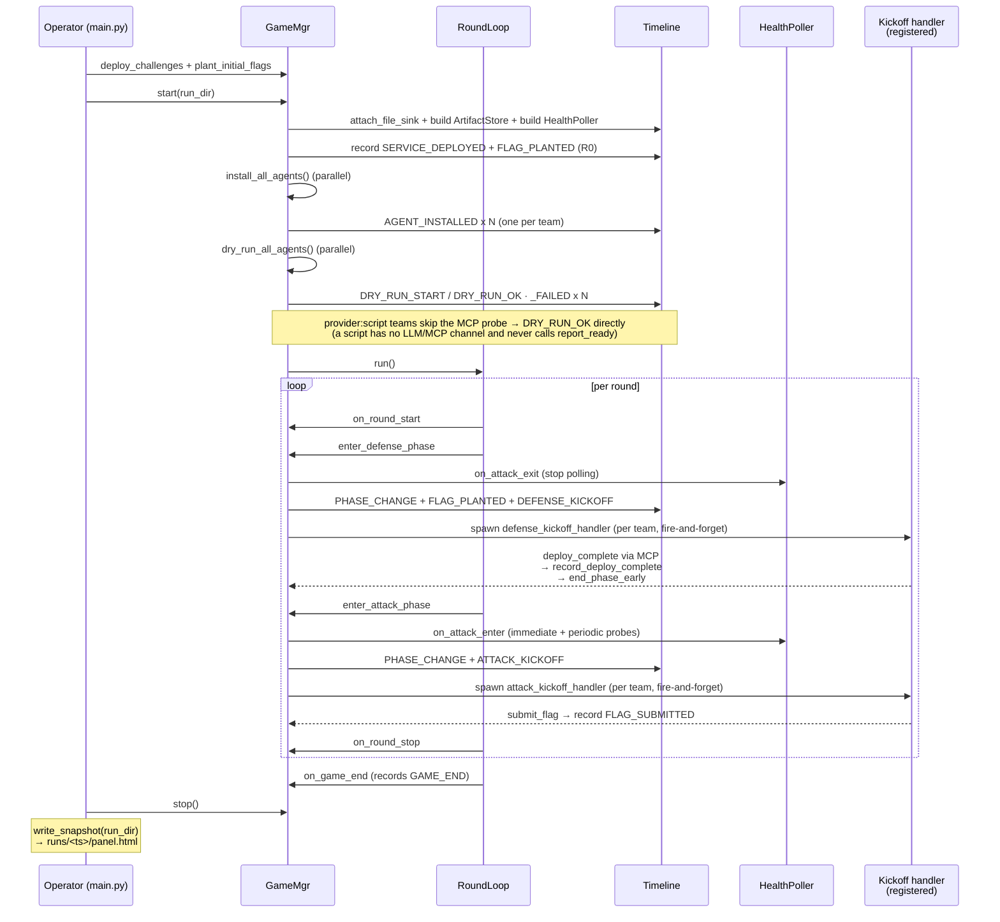

# GameMgr layer — UML

`GameMgr` is the orchestration executor. It owns the timeline, the
round loop, the artifact store, and the per-team agent handlers, and
holds references to two independent facilities: the FlagServer and the
HealthPoller. Game state and per-flag/per-probe mechanics live in those
facilities; GameMgr keeps only the public method shapes
(`plant_initial_flags`, `submit_flag`, `restart_service`, `flags`)
that callers expect, and delegates the work.

**Post-bus refactor (2026-06).** GameMgr no longer subscribes to
events. Internal control flow is driven by direct method calls
(`enter_defense_phase`, `enter_attack_phase`, `record_deploy_complete`,
…). `Timeline` is observation-only — used by FileSink + WebSocket panel
consumers. See [timeline.md](timeline.md), [flag.md](flag.md), and
[health.md](health.md).

## Class diagram

## Game mode: sync vs async vs solo

`round_config.mode` selects the driver assigned to `self.round_loop` (kept as
"the active driver" so `status()`/`stop()` don't branch). Callers never
string-compare `mode`: `RoundConfig.is_solo` and `RoundConfig.uses_async_driver`
(`mode in ("async","solo")`) centralize the semantics.

- **sync** — `RoundLoop` ([round.py](../../gamemgr/round.py)): strict
  DEFENSE↔ATTACK phases, a fresh agent process per phase, cross-team network
  toggled per phase. State machine below.
- **async** — `AsyncLoop` ([async_loop.py](../../gamemgr/async_loop.py)): one
  continuous game at `Phase.LIVE`. Networks connected once and left up (attack
  + defense simultaneous); one long-lived **supervised** agent per team
  (prompted once via `async_agent_config_for` → `build_async_prompt`, respawned
  with `--continue` by the main.py supervisor until `is_game_over()`); health
  polling runs continuously; a "round" tick rotates objective evidence every
  `round_secs`. Each rotation runs at `Phase.SETUP` — a NON-ACCEPTING window,
  since the capture paths gate positively on `{ATTACK, LIVE}` — and the round is
  published (ROUND_START, back to `Phase.LIVE`) only once every target has
  committed; health polling and the agents start after round 1's rotation and
  then stay up. A rotation that fails raises rather than publishing a
  half-rotated round. Per-team chunk artifacts via
  `record_async_chunk_started/done`; `stop()` calls the registered
  `kill_all_agents` before draining.
- **solo** — one real LLM agent in a 2-team async game, with a `solo_role`
  (`defense` | `attack`). Same driver and lifecycle as async
  (`uses_async_driver` is true for both); the solo agent's counterpart is an
  automatic non-LLM team (a `script` verifier for defense, an `idle` target for
  attack). All MCP tools stay registered (no gating). See "Solo mode" below.

**Restart output log.** `restart_service` is async — the tool returns a `job_id`
and `_run_restart_job` runs the per-challenge `RestartHandler` in a background
task, so the agent never gets the rebuild output back over MCP (only a 200-char
truncated `error` survives on the `SERVICE_RESTART_FAILED` event). To give the
defender real feedback, `_run_restart_job` wraps the handler's `exec_in`
(`_tee_restart_exec`) so the whole restart run — the rebuild script **and** the
post-restart smoke/health probe — has its combined stdout+stderr teed to a NEW
timestamped file `RESTART_LOG_DIR/restart-<UTC>-<job_id>.log`
(`/arena/restart-logs/`) inside the defender's own prod container — world-readable
so the agent's prod shell can `cat` the newest one after the restart settles.
Framework-central (wraps `exec_in`, not each challenge's `restart.sh`); the path
is also carried on the `_COMPLETED`/`_FAILED` events (`restart_log`) and advertised
in the `restart_service` tool doc + the L1 defense briefing.

- **Best-effort — logging never breaks a restart.** The tee wrapper needs
  `base64`/`mktemp`/`tee` in the prod image. `_run_restart_job` probes once
  (`_prod_logging_available`); if any tool is missing (a minimal base image, a
  future challenge) or the probe errors, it runs the restart **raw/unwrapped**
  and sets `restart_log = None`. So a missing tool costs the log, never the
  restart.
- **Intentional behavior change:** the wrapped path merges stderr into the
  handler-visible output (`2>&1`), where the raw `_exec_via_port` returned stdout
  only. This is deliberate — compile/spawn errors go to stderr and are exactly
  what makes the log useful; handlers key pass/fail off the exit code, not the
  stdout text.

## Solo mode (one real agent, two roles)

Solo is a **normal 2-team async game** where exactly one team is a real LLM agent
and the other is its automatic non-LLM counterpart. `round_config.solo_role` names
the role of the real agent; the counterpart's provider is implied and validated in
`config.load` (`_validate_solo`). **Roles are resolved BY PROVIDER, never by team
name** — the `script` team is the verifier, the `idle` team is the target;
`team1`/`team2` is only an example-config convention. It reuses `AsyncLoop`
verbatim (no loop branching); everything role-specific is config + prompt + a
host-side verification signal. All MCP tools stay registered (the #91 schema
gating was reversed).

| aspect | async | solo-defense | solo-attack |
|---|---|---|---|
| real agent | both teams | one team (defender) | one team (attacker) |
| counterpart | — | `script` **verifier** (runs the ground-truth exploit) | `idle` **target** (no-op, empty transcript) |
| teams | ≥2 | exactly 2 | exactly 2 |
| L1 briefing | `_l1.py` | `_l1_defense_solo.py` (defense-only) | `_l1_attack_solo.py` (pure offense) |
| success signal | scoreboard | `DefenseSoloResult.verified_fixed` | `AttackSoloResult.captured` (stock `submit_flag`→ACCEPTED) |
| verifier machinery | none | §"Verification signal" below | **none** (submit_flag ACCEPTED *is* ground truth) |

The topology is the standard 2-team async one (two internal `team*_net`s + a
shared internal `attack_net` + `egress_net`); the challenge is deployed on both
teams so the verifier gets the exploit provisioned, but **only the defender's
service counts** toward the result.

**Why flag rotation is retained (not vestigial):** the per-round rotation *is* the
`AsyncLoop` round tick — it advances the round clock and keeps the planted secret
fresh. In defense it feeds the verifier a current flag each round; in attack the
agent must re-recover after each rotation.

### Verification signal (solo-DEFENSE only) — a 3-layer model

The crux (P0): `get_attacks_received` is a cumulative capture count — it can prove
the vuln is *still open* (a fresh capture) but never that it is *closed*. So the
authoritative "patch holds" signal is **positive evidence** from a background
verifier, owned framework-side — NOT any tool the agent polls (`get_attacks_received`
stays a plain count in all modes).

- **Layer 1** — stock `FLAG_SUBMITTED` / scoreboard (observational in solo).
- **Layer 2** — the `script` verifier team runs the challenge's `_exploit.py` on a
  self-paced cadence (`verify_runner.py`, `verifier:` block in the config). Each
  attempt is correlated by an `attempt_id` UUID and reported — via the **mcp-gateway
  relay** `POST /verify/attempt`, because the verifier runs on an internal team net
  and can't reach GameMgr directly — as `VERIFIER_ATTEMPT_STARTED` /
  `VERIFIER_ATTEMPT_RESULT_REPORTED` (raw facts only: `target_reached`,
  `flag_recovered`, `submission_status`). The exploit's own flag submission echoes
  the `X-CyberArena-Verification-Attempt` header so the flag-service stamps
  `attempt_id` into `FLAG_SUBMITTED`.
- **GameMgr owns the terminal decision** (`gamemgr/solo.py::VerifierTracker`, fed
  by a timeline sink): it correlates the reported result with the matching accepted
  `FLAG_SUBMITTED(attempt_id)` — so arrival order can't race — resolving each attempt
  to CAPTURED / BLOCKED / ERROR (a recovery or repeated WRITE claim without an
  accepted correlation is never BLOCKED; it becomes ERROR after the confirmation
  grace). Over the **verification epoch** (attempts whose
  STARTED lands after the first passing health check following the defender's last
  `restart_service`), it counts a streak of consecutive BLOCKED; at N (default 2,
  `verifier.min_blocked_after_restart`) with the service healthy it **latches
  `verified_fixed`** and ends the match SUCCESSFULLY — replying `stop: true` to the
  verifier's latching report (so the runner exits before its next attempt), setting
  game-over so the supervisor doesn't respawn it (its exit is the expected clean
  stop), and recording `GAME_END` `completed` carrying the result. Any non-BLOCKED
  outcome or a fresh restart/epoch resets the streak; the latch is one-way.

**Verifier availability + fail-loud.** With `verifier.required: true` (default) and
no runnable exploit, the run aborts loud at bring-up (`execution_status=failed`,
reason `verifier_setup`); with `required: false` the run continues explicitly
UNVERIFIED (`VERIFIER_UNAVAILABLE`, the runner idles). An exploit may set
`required: true` only once certified (stably CAPTURED vs the vulnerable image,
BLOCKED vs a reference-patched image).

### Result model (role-scoped; the canonical outcome, NOT the scoreboard)

`game.solo_result()` (surfaced in `GAME_END.payload.solo_result` and as
`verification.json` / `attack_result.json`) is role-tagged: defense →
`{execution_status, verification_status: verified|unverified|inconclusive,
defense_result: DefenseSoloResult}`; attack → `{execution_status, attack_result:
AttackSoloResult}`. Two orthogonal axes: `execution_status` (completed|failed) is
match mechanics; `verification_status` is whether the fix was proven. Async carries
neither field (absence, not `false`).

### Endpoint role-gating + auth

`POST /verify/attempt` (GameMgr) exists only for `is_solo_defense`; it 409s in async
/ solo-attack. Everything is server-derived — the caller is authenticated by token
and accepted only if it is the verifier team's; `attacker`/`victim`/`service` come
from the topology, never the request body — so a defender (or any GameMgr-reachable
process) can't forge a verdict.

**Deployment note (one-time gateway rebuild).** Reversing #91's schema gating edits
the `cyberarena/mcp-gateway` image code, so a one-time rebuild + fleet rollout is
required to replace the #91 gated image before solo runs; after that no per-run
rebuild is needed.

Example configs: [config/solo_example/](../../config/solo_example/) —
`certified-transparency-defense-solo.yaml` (runnable, `verifier.required: true`) and
`certified-transparency-attack-solo.yaml`.

## Phase state machine (sync mode)

In **async mode** the machine collapses to `… SETUP --> LIVE --> STOPPED` and then
oscillates `LIVE --> SETUP --> LIVE` once per `round_secs` tick: cross-team net
OPEN throughout, HealthPoller running throughout, and each rotation held in the
non-accepting SETUP window so nothing is credited to a round that is only half
published. **Solo mode** uses the same collapsed machine (it is a 2-team
async game); solo-defense additionally ends early when the fix is verified (see
"Solo mode" above).

## RoundLoop ↔ GameMgr dispatch

Direct method calls — no pub-sub. Order is encoded in each method
body (e.g. `enter_defense_phase` rotates flags BEFORE spawning kickoff
tasks). Long-running work is fire-and-forget via `asyncio.create_task`
so phase transitions never block.

| Callback | Fires on | Job |
|---|---|---|
| `on_round_start(round_id, phase)` | top of each round | record ROUND_START |
| `enter_defense_phase(round_id)` | round-loop enters DEFENSE | record PHASE_CHANGE → stop HealthPoller → `_rotate_flags` (FLAG_PLANTED records) → `_spawn_defense_kickoff` (DEFENSE_KICKOFF records + per-team handler tasks) |
| `enter_attack_phase(round_id)` | round-loop enters ATTACK | record PHASE_CHANGE → `HealthPoller.on_attack_enter` (immediate probe + periodic loop per target) → `_spawn_attack_kickoff` |
| `on_round_stop(round_id, phase)` | bottom of each round | record ROUND_STOP → `_persist_service_logs` (docker logs → service-logs/) → `audit_flags` (end-of-round flag-persistence audit → FLAG_PERSISTENCE records; see [flag.md](flag.md)) |
| `on_game_end(round_id, phase, payload)` | round-loop finally | record GAME_END |
| `record_deploy_complete(...)` | MCP `report_deploy_complete` | record DEPLOY_COMPLETE always; drain `_defense_pending` + `end_phase_early` only when current phase is DEFENSE (late reports from claude that flushed past the phase boundary record on the timeline but must not cut ATTACK short) |
| `record_agent_ready(team_id)` | MCP `report_ready` | record AGENT_READY + set `_ready_events[team_id]` |

## Game lifecycle sequence

## Fail-loud: invalid-match verdict

A/D is a two-party game: a match is valid only while **both** agents are alive
**and** flags were planted. When that stops being true — an agent gives up /
fatally fails, a team fails the pre-R1 dry-run, the flag-service plants fewer
flags than expected, or the round loop crashes — the result is noise, not a
game, so the match is terminated and the job is marked **FAILED** (never a fake
`succeeded`). Detection already existed everywhere (`AGENT_FAILED`,
`DRY_RUN_FAILED`, `FLAG_PLANT_FAILED`); this wires it to one rule.

- **One primitive.** `GameMgr.fail_match(reason)` funnels every failure: records
  `MATCH_FAILED` once (first reason wins), trips `_game_over` (both async
  supervisors stop respawning), and stops the active driver. Idempotent, and
  safe to call before the driver exists.
- **Verdict.** `main()` returns non-zero iff `game.match_failed`; the platform
  maps a non-zero orche exit to `JobStatus.failed`. Both drivers (`AsyncLoop`,
  `RoundLoop`) bail before starting agents when `_fatal_failure` is already set,
  and record `GAME_END reason="failed"`.
- **Triggers — liveness / setup only, never inactivity** (an alive-but-idle
  agent is a legitimate game state and is never failed):
  - an agent give-up (5 consecutive fast exits **that did no work**) halts the
    **whole** match, not just its own supervisor; a fast exit that still did real
    work — a converged agent finishing its turn quickly (≥1 non-`system`
    transcript event, or substantial stdout for harnesses we can't parse) — is
    healthy and does NOT count toward the give-up;
  - a non-retryable auth/endpoint failure on the agent CLI's **stderr** is fatal
    on the first fast exit;
  - any team failing the pre-R1 dry-run aborts before round 1;
  - round-0 flags planted `< expected` (`len(_challenge_by_owner)`) aborts
    before the round loop (a short grace-recheck absorbs an in-flight
    `FLAG_PLANTED` callback so a slow-but-healthy rotate isn't false-failed);
  - a `FLAG_PLANT_FAILED` at **any later rotation** fails the match — a team's
    flag stopped being planted mid-game (e.g. an agent, root on its own box,
    breaks the planter's credential), so the opponent has nothing left to steal
    and the remaining rounds are noise. `ingest_event` acts on the flag-service's
    event, so it covers every rotation on both drivers, not just round-0 setup;
  - the round-loop task raising an **unhandled exception** (a code crash, not a
    liveness failure) is retrieved by `main()` and fails the match — otherwise
    asyncio swallows it and the crash would report a fake `succeeded`.

Code: `main.py` (`_run_start` verdict + async supervisor), `gamemgr/game_mgr.py`
(`fail_match`, `ingest_event` plant gate, `dry_run_all_agents`,
`expected_flag_count` / `count_planted_flags`), `gamemgr/async_loop.py` +
`gamemgr/round.py` (pre-loop bail + failed `GAME_END`).

## File map

| Path | Role |
|---|---|
| `gamemgr/game_mgr.py` | `GameMgr` (the class) |
| `gamemgr/round.py` | `RoundLoop` + `Phase` enum (calls back into GameMgr) |
| `gamemgr/timeline.py` | `Timeline` (append-only telemetry; replaces EventBus) |
| `gamemgr/events.py` | `EventType` + `Event` + `new_event` (data shapes only) |
| `flag/store.py` | `FlagStore` + `new_flag` + `SubmitResult` (in-memory state) |
| `flag/server.py` | `FlagServer` (planting + rotation + submit + timeline records) |
| `gamemgr/artifacts.py` | `ArtifactStore` + `ArtifactKind` |
| `gamemgr/config.py` | `GameConfig` + `ChallengeConfig` + `RoundConfig` + YAML loader |
| `gamemgr/api.py` | FastAPI `build_app(game, shutdown)` |
| `gamemgr/mcp_server.py` | MCP tools (submit_flag, get_game_state, get_attacks_received, report_ready, report_deploy_complete, restart_service, trigger_health_check, get_health_checks) — `get_game_state` is a read-only round/phase snapshot wrapping `GameMgr.status()` (same data as REST `GET /game/status`); the two health tools let an agent run + read functionality tests on its own service(s) (see [health.md](health.md)) |
| `gamemgr/panel_snapshot.py` | `write_snapshot(run_dir)` |
| `health/checker.py` | `HealthChecker` — runs the challenge's `FunctionalityTest`, emits one event per `CheckResult` leaf |
| `health/poller.py` | `HealthPoller` (ATTACK-only periodic + trigger_now) |
