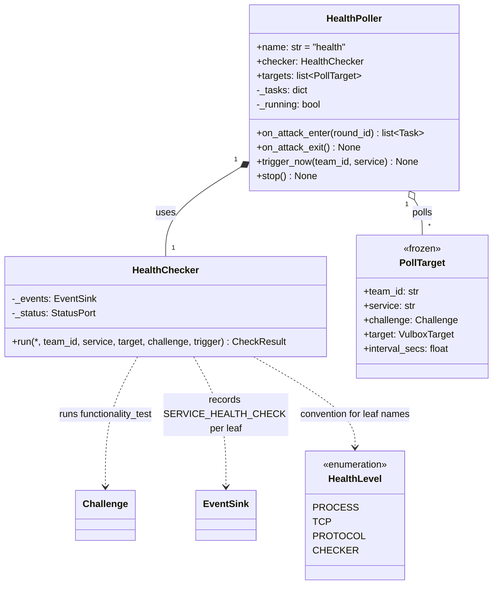
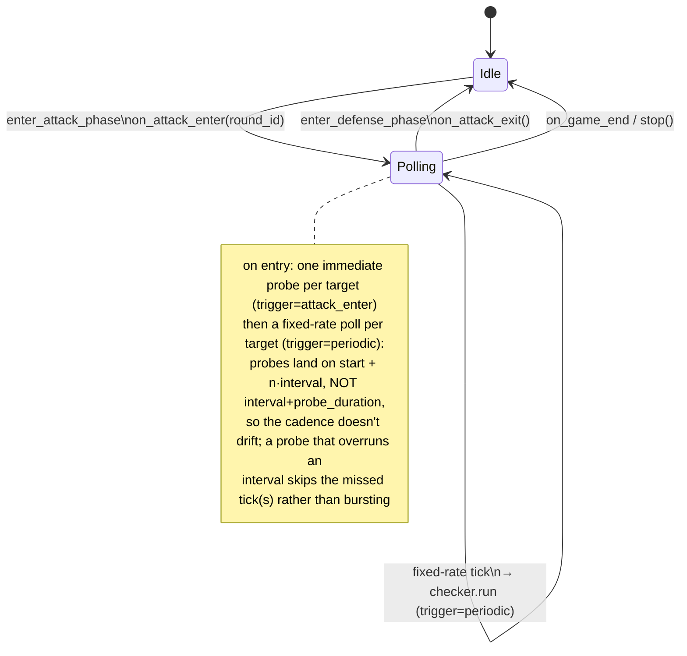

# Health facility — UML

`health/` is an independent package consumed by `GameMgr`. Two classes:

- **`HealthChecker`** — thin wrapper that runs
  `challenge.functionality_test.run(target)` in a thread executor,
  **then runs the auto-detected CHECKER forms** (`checker.py` / `checker.sh`,
  see [CHECKER outside prod](#checker-outside-prods-trust-boundary)), merges
  everything into one `CheckResult` tree, and emits one
  `SERVICE_HEALTH_CHECK` per leaf. Stateless; takes a `FacilityContext`
  and uses `ctx.events` (records) + `ctx.status` (round/phase stamping).
  Each event carries a `trigger` (`periodic` / `attack_enter` /
  `restart`) so off-cadence one-shots are distinguishable from periodic
  ticks.

- **`HealthPoller`** — periodic scheduler and the health `Facility`
  (`name="health"`, overrides `stop()`). Driven by GameMgr at phase
  boundaries; does not subscribe to anything. Owns per-target periodic
  tasks (one per (team, defense-capable service)). Also exposes
  `trigger_now(team, service)` for the restart-post one-shot probe.

The package is pluggable per the v2 `Challenge` ABC: each PollTarget
holds a concrete `Challenge` + a pre-built `VulboxTarget`, and the
checker only knows to call `challenge.functionality_test.run(target)`.

## Class diagram

## State machine — when the poller is running

`trigger_now` is allowed in **either** state — used by `_run_restart_job`
in `GameMgr` to surface a fresh check right after a successful restart,
even during DEFENSE. That probe is tagged `trigger="restart"`.

### Bring-up is fail-loud; runtime probes are telemetry (Finding 2)

Two failure modes, deliberately handled oppositely:

- **Startup `configure()` — fail-loud.** `RemoteHealthPollerHandle.configure()`
  pushes the host map + cadence once at bring-up. It is **retried, then raised**
  as `HealthPollerConfigureError` (never swallowed), and
  `GameMgr._build_health_facility` converts that into `fail_match`. An
  unconfigured poller (container down, or a load-induced 500 during a
  simultaneous cold start) runs **zero probes**, so the match must end **FAILED**
  rather than report a fake `succeeded` with `probes:0` / `uptime_pct:null`. The
  retries absorb the transient cold-start 500s (paired with the submission
  stagger); a persistent failure ends the match.
- **Runtime probe failure — telemetry, not a verdict.** Once configured, a probe
  whose **target service** is down records `SERVICE_HEALTH_CHECK(passed=false)`
  and **never fails the match** — the broken thing is the checked container, not
  the poller. The runtime control forwards (`attack-enter`/`exit`, `trigger-now`,
  `stop`) stay **best-effort** (logged, not raised) for the same reason: a
  transient blip must not fail a live match.

### Trigger tagging

Every `SERVICE_HEALTH_CHECK` carries a `trigger` in its payload:

| trigger | source | on the poll grid? |
|---|---|---|
| `periodic` | the fixed-rate poll loop | yes |
| `attack_enter` | the one immediate probe at ATTACK entry | no (t≈0 of ATTACK) |
| `restart` | `trigger_now`, post-`restart_service` | no (whenever the restart finished) |
| `manual` | `trigger_now`, agent's `trigger_health_check` MCP tool | no (whenever the agent asked) |

The one-shots land off the periodic grid **by design** (a probe is
wanted at attack entry, right after a restart, and whenever an agent
asks). The tag is how a reader — and the panel, which draws off-cadence
probes as a diamond (periodic ticks are circles) — tells an intentional
one-shot from a drifting periodic tick.

Every leaf event of a single run shares a `probe_id` (a per-run uuid
stamped by `HealthChecker.run`), so a consumer can regroup the per-level
leaves back into the one probe they came from — see `get_health_checks`.

## CHECKER outside prod's trust boundary

The defender agent has **root on its own prod box** (`provision_ssh_pivot`), so
anything baked into prod — including the old `/arena/checker.sh` — is tamperable
(root ignores the `555` mode bits; it can rewrite the script or swap the
interpreter). The deep CHECKER therefore moved **out of prod**, into two
OPTIONAL, auto-detected forms `HealthChecker.run` executes after the
functionality test (impl in `health/checkers.py`):

- **`checker.py`** — an optional second `FunctionalityTest` module (loaded via
  `registry.load_optional_probe(pkg, "checker", FunctionalityTest)`). A network
  probe that runs **entirely inside the health-poller container** over
  `target.host`/`target.ports`; never execs into prod, so root-on-prod can't
  touch it. **Preferred form.** Its `CheckResult` leaves merge as-is (author
  names kept — convention: name the single leaf `checker`).
- **`checker.sh`** — the challenge's script, **un-baked** from the image and
  shipped over stdin: the poller runs `bash -s` in prod with the script bytes as
  stdin (`ExecPort.exec_stdin` → `SshExecPort` `ssh … bash -s` / `LocalExecPort`
  `docker exec -i … bash -s`). Runs in prod's netns (so `127.0.0.1:<port>`
  reaches the real service) but the executed bytes come from the poller. Only for
  checks that genuinely must run in-container.

**Independence, not order:** whichever forms are present both run — **no
short-circuit** — each an independent leaf, AND-combined into the root pass, so a
failure localizes to the network layer (`checker.py`) vs the in-prod local layer
(`checker.sh`). Running `checker.py` before `checker.sh` is a display convention
only. **Leaf naming:** the framework names only the synthesized `checker.sh` leaf
— `checker` when it's the sole form (the familiar chip), `checker.sh` when a
`checker.py` also runs (so the two are distinguishable); a raising `checker.py`
yields one fixed `checker.py` leaf carrying the exception type.

**Guarantee (precise):** `checker.sh` protects checker **source** integrity (the
authoritative bytes can't be permanently modified), NOT **execution** integrity
(a root agent can still swap the interpreter or present a fake service). It's a
health signal + basic tamper resistance, not a proof against a malicious root
agent — `checker.py` (network-only) is the strongest achievable position. Any
check that CAN move to `checker.py` should not stay in `checker.sh`.

## Agent-facing health MCP tools

Two tools (in `gamemgr/mcp_server.py`, forwarded by `HttpBackend` →
GameMgr REST) let an agent drive + read health checks for its **own**
service(s):

- **`trigger_health_check(service?)`** → `GameMgr.trigger_health_check`.
  Fire-and-forget one-shot functionality test on the team's defendable
  service(s) (every one it owns if `service` is omitted; an attack-only /
  unknown service is rejected as InvalidParams). Forwards to
  `health_poller.trigger_now(..., trigger="manual")`; the per-level results
  land asynchronously as `SERVICE_HEALTH_CHECK` events, exactly like the
  restart-post probe.
- **`get_health_checks(limit?)`** → `GameMgr.get_health_checks`. Reads the
  team's recent `SERVICE_HEALTH_CHECK` events back, regrouped by `probe_id`
  into one entry per run (overall `passed` = all levels passed), newest
  first. `limit` defaults to `health_poller.recent_results_default` (yaml,
  default 10), clamped to `_MAX_RECENT_HEALTH_RESULTS`. Records
  `MCP_HEALTH_QUERY` for panel visibility (mirrors the other read tools).

## Configuration

- **Which services get polled:** `build_targets` filters on
  `challenge.restart_handler is None`. Attack-only challenges (notes)
  have nothing to defend, so periodic CHECKER probes there would be
  wasted load.
- **`get_health_checks` default count:** `health_poller.recent_results_default`
  in `game.yaml` (positive int, default 10) sets how many recent runs the
  query tool returns when the agent passes no explicit `limit`.
- **Per-challenge poll interval:** lives in
  [`challenges/registry.py::_HEALTH_INTERVAL_SECS`](../../challenges/registry.py).
  `build_targets` reads it via the `interval_lookup` injected callable
  (typically `registry.health_interval_secs`) with `DEFAULT_INTERVAL_SECS`
  (10s) as the fallback.
- **Leaf names:** the `HealthLevel` enum (PROCESS / TCP / PROTOCOL /
  CHECKER) is a convention. The framework emits one event per
  `CheckResult` leaf using `leaf.name` verbatim; both bundled
  challenges use this convention. A challenge whose `FunctionalityTest`
  returns a different tree shape (one leaf, nested groups) is free to;
  no framework code branches on the names.

## What it does NOT do

- **Does not subscribe to anything.** GameMgr drives all entry/exit;
  the checker has no event coupling beyond `ctx.events.record()`.
- **Does not run during DEFENSE.** `on_attack_exit` cancels all tasks
  on every DEFENSE entry; `trigger_now` is the only DEFENSE-time path.
- **Does not deduplicate** a `trigger_now` racing the periodic loop.
  Both records are independent events; the panel reads them as-is.

## File map

| Path | Role |
|---|---|
| `health/__init__.py` | re-exports `HealthChecker`, `HealthPoller`, `PollTarget` |
| `health/checker.py` | `HealthChecker.run` (FT + checker composition) + `leaves(tree)` tree-walker |
| `health/checkers.py` | CHECKER runner: `load_checkers(pkg)` (auto-detect) + `run_checker_leaves` (checker.py + checker.sh, independent, head+tail-truncated detail) |
| `health/poller.py` | `HealthPoller` + `PollTarget` + `build_targets` + `DEFAULT_INTERVAL_SECS` |
