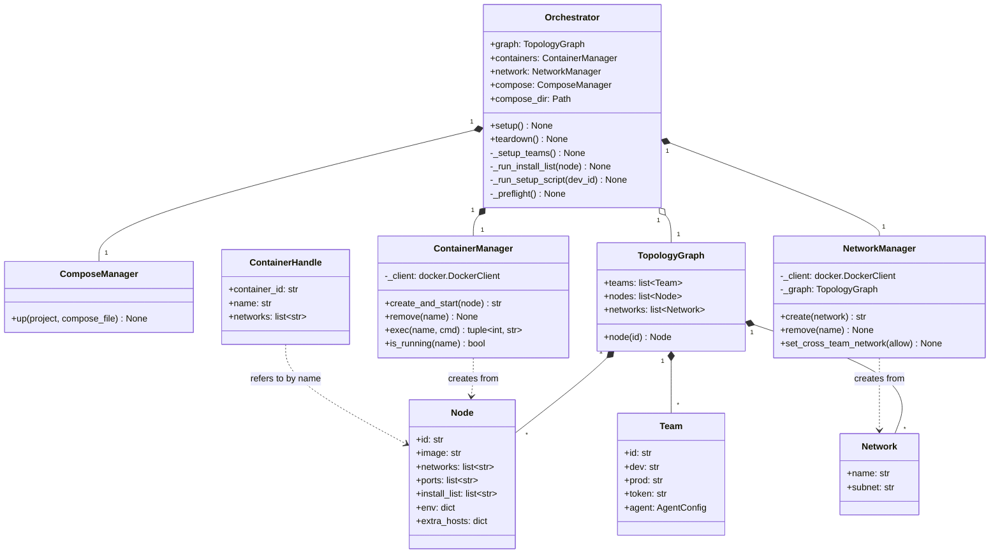
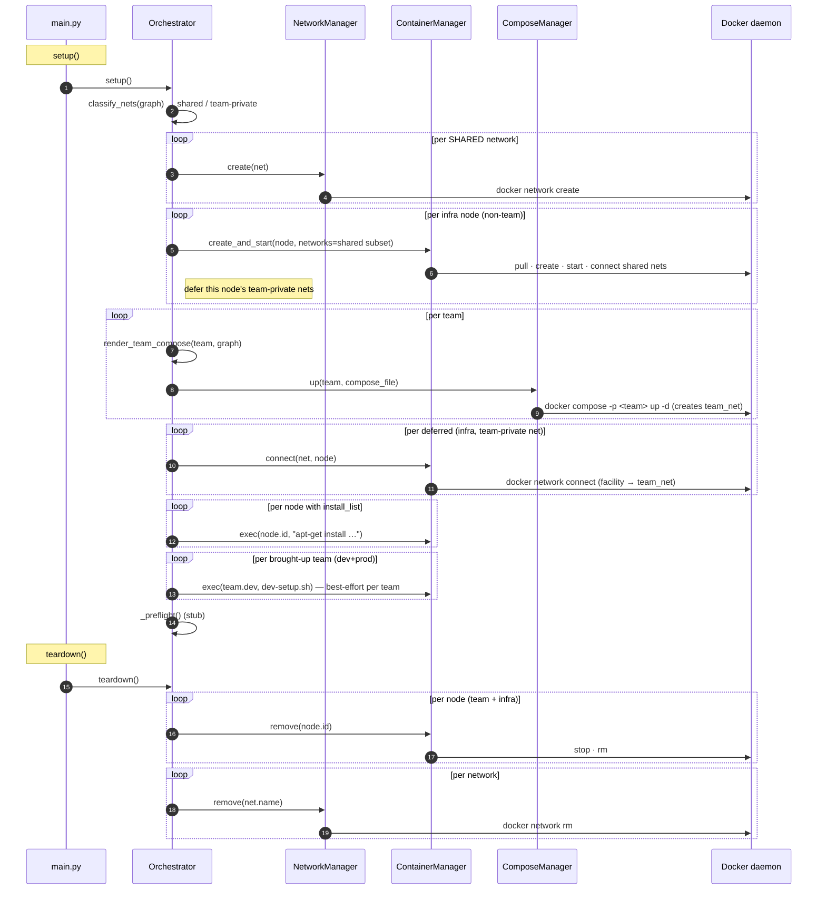
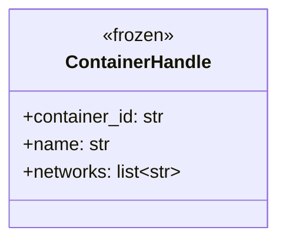

# Orchestrator layer — UML

Container + network lifecycle for the arena. Owns Docker. Knows
nothing about agents or game state — those build on top.

## Class diagram

## Network state per phase

The arena has three classes of network:

| Network | Always connected | Phase gate |
|---|---|---|
| `team{N}_net` | yes (intra-team) | always — `team{N}_dev` ↔ `team{N}_prod` |
| `game_net` | only in ATTACK | `set_cross_team_network(allow=True)` attaches all prods |
| attack net | only in ATTACK | reaches the opposing prod's service+ssh (the attack surface) |

The attack net comes in two shapes, both matched by the `attack_net` prefix and
toggled identically:
- **per-team** `attack_net_team{N}` — opponent's dev ↔ this team's prod, keeping
  dev containers isolated from each other (most configs).
- **single shared** `attack_net` — every team container on one net (e.g.
  `game_ico_v3_isolated_async_mixed.yaml`). This adds dev↔dev *reachability*, but
  agent (`cyberarena/agent-<provider>`) containers run no listening service (`CMD sleep
  infinity`, no `EXPOSE`), so the only real attack surface either way is each
  prod (`EXPOSE 4265 22`).

`set_cross_team_network(allow)` flips `game_net` and every `attack_net*` in
lockstep — DEFENSE = all detached, ATTACK = all attached. Detach is `docker
network disconnect`, re-attach is `docker network connect`.

## Hybrid bring-up (SDK shared layer + compose-owned team nets)

`classify_nets(graph)` (`orchestrator/compose.py`) first partitions every network:

- **team-private** — a net whose only team `dev`/`prod` members belong to a
  single team (e.g. `team1_net` = `team1_dev`, `team1_prod`, plus the infra
  services that declare it). Owned by that team's compose project.
- **shared** — spans ≥2 teams (`game_net`, `attack_net_*`, `facility_net`) or is
  infra-only (`egress_net`). Stays SDK-managed.

`setup()` then runs seven steps:

1. **SDK-create shared nets only** via `NetworkManager` (exact `subnet`/`internal`
   + the per-phase switch stay under SDK control). Team-private nets are *not*
   created here — compose makes them (step 4).
2. **Start shared infra on its shared nets** (`api-router`, `mcp-gateway`,
   `flag_service`, `health_poller` — everything not in `team_node_ids(graph)`) via
   `ContainerManager.create_and_start(node, networks=<shared subset>)`. These nodes
   hold already-`${VAR}`-expanded secrets, so keeping them on the SDK keeps secrets
   out of any compose file. Each infra node's **team-private** memberships (e.g.
   api-router/mcp-gateway declare `team1_net`/`team2_net`) are **deferred**.
3. **Each team → its own `docker compose` project.** `_setup_teams()` renders a
   file from the team's nodes (`render_team_compose(team, graph)`) — the team's
   private net is emitted **compose-created** (driver + subnet + `internal`), every
   shared net `external: true` — writes it to `compose_dir` (set by `main.py` to
   `runs/<ts>/compose/`, else a tempdir), and runs `docker compose -p <team> up -d`.
   This is what **creates `team{N}_net`** and attaches that team's dev/prod.
4. **Deferred connect:** for each recorded `(infra node, team-private net)` pair,
   `ContainerManager.connect()` runs `docker network connect` — i.e. the facility
   services (api-router/mcp-gateway) are attached into each `team{N}_net` *after*
   compose created it.
5. `install_list` runs for **all** nodes by name.
6. **Dev-deps preflight:** for each brought-up team (dev **and** prod present),
   `_run_setup_script(team.dev)` execs `config/docker/dev-setup.sh` inside the
   dev container to install supplementary eval/offensive tooling on top of
   the dev node's agent image (`cyberarena/agent-base` + harness). The script is
   install-if-missing — it derives the
   probe and the install list from one sentinel→package map, so only
   genuinely-absent packages are fetched (a fully baked image is a no-op).
   **Best-effort per team:** a failure is logged and isolated to that team (it
   runs with a degraded toolset), never aborting the others. Isolated/egress-cut
   nets must bake the deps into the agent-base Dockerfile
   (`dockerfiles/agent/base/Dockerfile`).
7. `_preflight()`.

**Invariant the renderer must hold:** the round loop, flag planting, health
checks and `set_cross_team_network` all address containers and networks **by
exact name**. So each compose service pins `container_name`/`hostname` to
`node.id`, and every network is referenced with an explicit `name:` so compose
never project-prefixes it.

**Teardown is uniform SDK.** `teardown()` removes every node by `node.id` via
`ContainerManager.remove` — reaching the compose-created team containers and the
deferred-connected infra alike — then removes the networks (incl. the
compose-created team nets, removable once their endpoints are gone). So teardown
carries no compose state, and the standalone `main.py teardown` process works
without the generated compose files.

## Setup / teardown sequence

## ContainerHandle — opaque pointer to a running container

The agents layer, transport backends, and the flag/health facilities
pass `ContainerHandle` to identify which container a command targets.
Decoupled from the legacy `Service` ABC (deleted with the challenge
interface v2 migration); per-challenge install/start/restart lifecycle
now lives in the `Challenge` ABC's `flag_handler` / `restart_handler`
and the `challenges.registry.initial_start` hook. See
[challenges.md](challenges.md).

## File map

| Path | Role |
|---|---|
| `orchestrator/orchestrator.py` | `Orchestrator` (setup / teardown) |
| `orchestrator/compose.py` | `ComposeManager` + `render_team_compose` / `team_node_ids` (per-team compose bring-up) |
| `orchestrator/infra/docker.py` | `ContainerManager` |
| `orchestrator/infra/network.py` | `NetworkManager` |
| `orchestrator/handle.py` | `ContainerHandle` dataclass |
| `orchestrator/topology.py` | YAML → `TopologyGraph` |
| `models/topology.py` | `Team` / `Node` / `Network` / `TopologyGraph` dataclasses |
