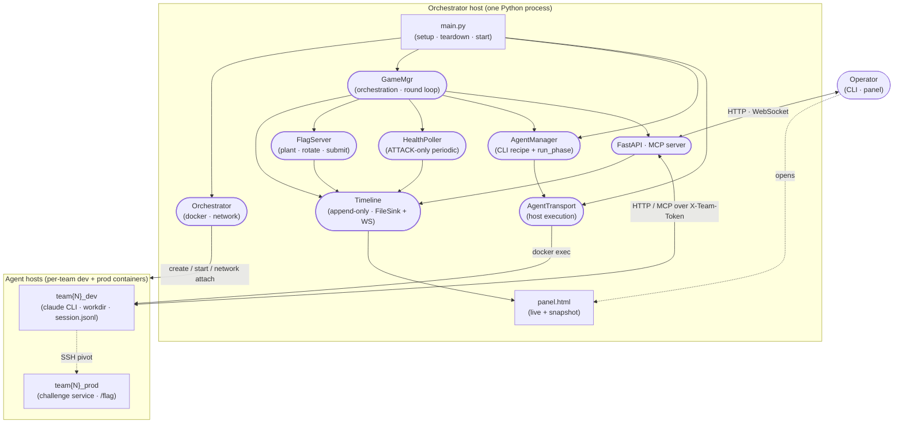

# CyberArena — System Overview

How the pieces fit together at the highest level. Drill down into a
section for class diagrams + sequence diagrams.

## Component diagram



## Roles

| Component | Responsibility | Details |
|---|---|---|
| **main.py** | Entry point | Wires `Orchestrator`, `GameMgr`, `AgentManager` per team via registry, registers handlers, starts FastAPI + round loop |
| **Orchestrator** | Docker lifecycle | Creates containers + networks per [topology.yaml](../archived/m1_topology_plan.md), exposes `set_cross_team_network(allow)` for phase-driven isolation. See [orchestrator.md](orchestrator.md) |
| **GameMgr** | Orchestration executor | Owns timeline, round loop, artifact store; holds references to FlagServer + HealthPoller facilities. Records AGENT_* events; drives phase transitions via direct methods. See [game_manager.md](game_manager.md) |
| **Timeline** | Append-only telemetry | `record()` + `attach_file_sink` + `attach_stream`. Replaces the legacy EventBus — no subscribers drive internal logic. See [timeline.md](timeline.md) |
| **FlagServer** | Flag mechanics | Delegates plant + retrieve to each challenge's `FlagHandler`, runs per-round rotation, verifies submissions, records FLAG_PLANTED / FLAG_SUBMITTED. See [flag.md](flag.md) |
| **HealthPoller** | Service health observation | Runs the challenge's `FunctionalityTest` via `HealthChecker` and emits one `SERVICE_HEALTH_CHECK` per `CheckResult` leaf. Bundled challenges use the `PROCESS → TCP → PROTOCOL → CHECKER` convention; the framework doesn't require it. Runs periodically during ATTACK + one-shot after restart. See [health.md](health.md) |
| **AgentManager** | Per-CLI recipe + one-phase glue | ABC: `install` + `phase_command` + `run_phase` + 2 constants. Concrete: ClaudeAgentManager (codex / gemini future). See [agent_manager.md](agent_manager.md) |
| **AgentTransport** | Host execution | Protocol: `run_command` / `write_file` / `kill_session`. Concrete: DockerExecBackend (SSH later). See [agent_manager.md](agent_manager.md) |
| **FastAPI + MCP** | External surface | REST `/game/flag/submit` etc.; WebSocket `/events/stream` for panel; MCP HTTP `/mcp/` for agent tool calls. Three token tiers: player `X-Team-Token` (per-team, agent-facing REST mirrors); facility `X-Facility-Token` (containerized facilities → `/facility/events`); admin `X-Admin-Token` (control plane `/game/start`, `/game/stop`). All three fail closed when their env secret is unset. The panel read-plane (`/game/status`, `/game/agents`, `/game/metrics`, `/game/events`, `/topology`, `/events/stream`) is intentionally tokenless — guard it at the platform proxy, not in-app |
| **panel.html** | Observer UI | Live mode connects WebSocket; snapshot mode replays `events.jsonl` embedded at game end (`runs/<ts>/panel.html`) |
| **Challenge** | Pluggable vulnerable app | `Challenge` ABC composing `vulbox` + `functionality_test` + `flag_handler` + `restart_handler?` + `docs`, discovered from registered challenge packages. See [challenges.md](challenges.md) |

## Game lifecycle (one game, top-down)

```
main.py
  ├─ Orchestrator.setup()          ← create containers + networks
  ├─ GameMgr.deploy_challenges()    ← install challenge into prod containers
  ├─ GameMgr.plant_initial_flags()  ← R0 flag plant
  └─ GameMgr.start()
       ├─ install_all_agents()      ← npm install + ssh pivot + agent.env / mcp.json + exploit artifacts per team
       ├─ dry_run_all_agents()      ← per-team readiness probe (report_ready via MCP)
       └─ RoundLoop.run()              ← sync mode (round_config.mode: sync)
            ├─ R1: DEFENSE → ATTACK
            ├─ R2: DEFENSE → ATTACK
            └─ R3: DEFENSE → ATTACK → GAME_END

         (game.stop closes file sink; panel_snapshot.write_snapshot
          freezes the run into runs/<ts>/panel.html)
```

**Async mode** (`round_config.mode: async`) swaps `RoundLoop` for `AsyncLoop`:
one continuous game at `Phase.LIVE` (networks always open → attack + defense
simultaneous), one long-lived supervised agent per team that self-directs via
`get_game_state` over MCP, and a flag-rotation tick every `round_secs`. See
[game_manager.md](game_manager.md).

Two cross-cutting concerns:

- **Memory across phases** — Claude CLI's `--continue` flag re-loads
  the session store at `~/.claude/projects/<workdir-cwd>/<id>.jsonl`,
  pinned to a dedicated workdir per arena.
- **MCP control channel** — agent calls `submit_flag` /
  `report_ready` / `restart_service` / `report_deploy_complete` on
  the orchestrator's FastMCP HTTP endpoint; each tool authenticates
  via `X-Team-Token`.

## Further reading

- [docs/UML/agent_manager.md](agent_manager.md) — agent layer (install + phase_command + transport + runner)
- [docs/UML/game_manager.md](game_manager.md) — GameMgr internals (timeline, round loop, artifacts)
- [docs/UML/timeline.md](timeline.md) — Timeline append-only telemetry stream (post-bus refactor)
- [docs/UML/flag.md](flag.md) — FlagServer + FlagStore (plant / rotate / submit)
- [docs/UML/health.md](health.md) — HealthChecker + HealthPoller (per-challenge probe tree + ATTACK polling)
- [docs/UML/orchestrator.md](orchestrator.md) — Docker / network lifecycle
- [docs/UML/challenges.md](challenges.md) — pluggable challenge sources
- [docs/UML/api_router.md](api_router.md) — API Router (egress gateway + LLM metering proxy)
- [docs/archived/persistent_memory_agent_plan_v1.md](../archived/persistent_memory_agent_plan_v1.md) — design rationale for the agent layer
- [docs/archived/design_v1.7.md](../archived/design_v1.7.md) — overall system design
