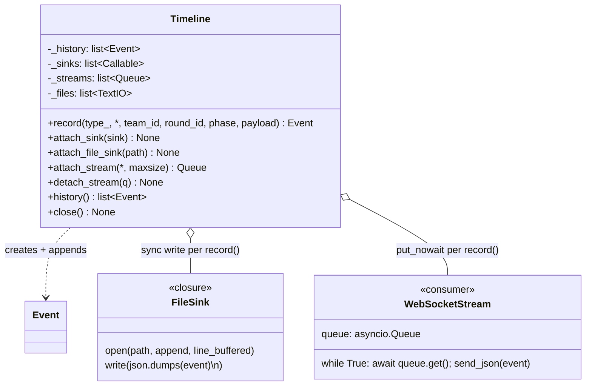

# Timeline — UML

`Timeline` is the append-only event stream the panel and JSONL file sink
read from. It replaces the legacy `EventBus` in 2026-06 along with the
move to direct-method dispatch (see [game_manager.md](game_manager.md)).

The single most important property: **nothing internal subscribes**.
Timeline is observation-only. Anything that needs to react to an event
(rotation, kickoff, health-check, deploy-complete drain) is a method
call on GameMgr (or another facility), not a Timeline subscriber. This
removes "ORDER MATTERS" sequencing concerns and means a slow consumer
can never back-pressure the game.

## Class diagram

## record() semantics

`record(type_, *, team_id=None, round_id=0, phase="", payload=None)`:

1. Build an `Event` via `new_event(...)`.
2. Append to `_history` (synchronous list append; atomic).
3. For each sync sink, call `sink(event)` inline. Exception → log + continue.
4. For each stream queue, `q.put_nowait(event)`. `QueueFull` → warn + drop
   (only possible when caller asked for a bounded queue).

The method is **synchronous** and **non-blocking**. Callers never await
it.

## Sink kinds

| Kind | API | When to use |
|---|---|---|
| **Sync sink** | `attach_sink(callable)` | Synchronous write inside `record()`. Used by `FileSink` so the on-disk JSONL preserves a single monotonic timeline. |
| **File sink** | `attach_file_sink(path)` | Convenience wrapper: opens path line-buffered and registers a closure. Closed by `Timeline.close()`. |
| **Stream queue** | `attach_stream(*, maxsize=0)` → `asyncio.Queue[Event]` | Async consumer (WebSocket panel). Per-connection queue; `record()` does `put_nowait`. Detach via `detach_stream(q)` on disconnect. |

## What it does NOT do

- **No subscribe/unsubscribe** for control-flow handlers. Internal
  reactions are method calls (`game.enter_defense_phase`, …).
- **No async publish**. There's no `await timeline.publish(...)`.
- **No ordering between streams**. Each stream queue receives the same
  events in `record()` order; consumers run independently.

## File map

| Path | Role |
|---|---|
| `gamemgr/timeline.py` | `Timeline` |
| `gamemgr/events.py` | `EventType` / `Event` / `new_event` (data shapes) |
