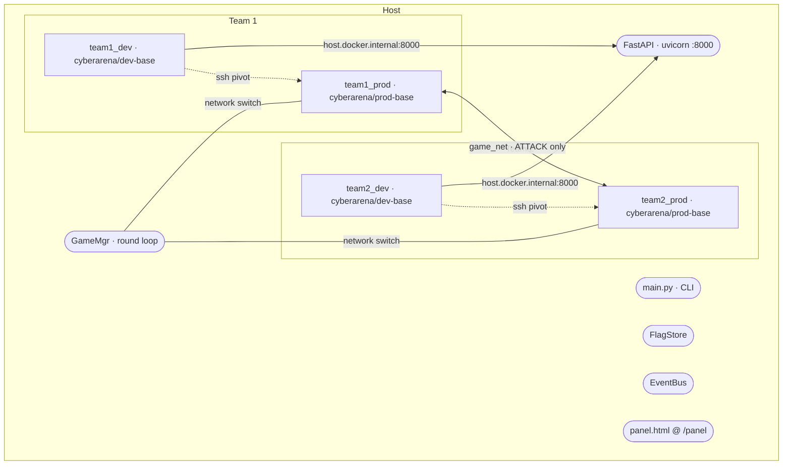
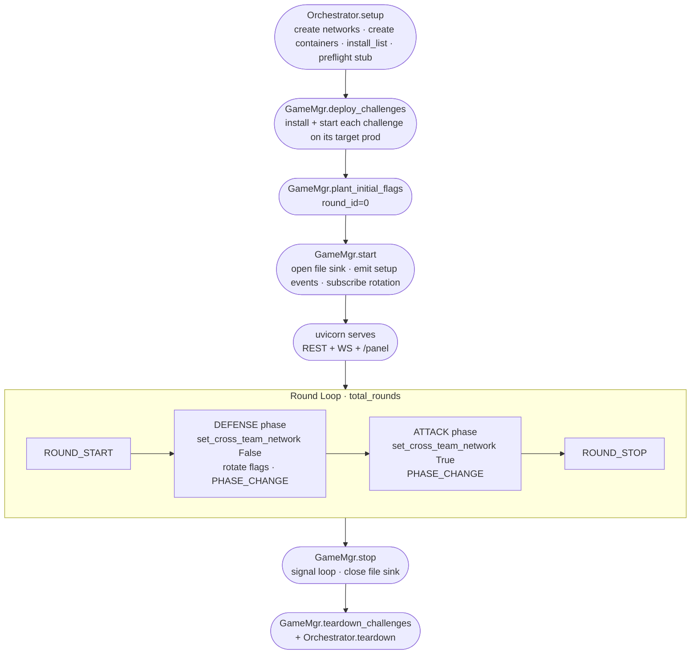

# Cyber Arena — System Design (v1.6)

> v1.6 supersedes [design_v1.md](design_v1.md). It documents what the codebase
> *actually* implements after milestones M1 → M6, rather than what v1 sketched
> as an MVP target. The shape of the system has shifted enough that v1 is now
> a historical reference, not a blueprint.
>
> | Module | Status | Notes |
> |--------|--------|-------|
> | Orchestrator | ✅ shipped | container + network lifecycle |
> | GameMgr | ✅ shipped | round loop, flag store, event bus, FastAPI, panel |
> | Challenges | ✅ shipped (1 adapter) | `notes` TCP service; registry pluggable |
> | Agent (LLM) | ✅ shipped | Claude Code CLI in dev container, SSH pivot to own prod |
> | Observation Panel | ✅ shipped | single-file HTML served from FastAPI |
> | TeamMgr (v1) | ❌ removed | folded into GameMgr + agents/; no separate module |
> | Reverse channel — MCP agent action channel (`submit_flag` / `report_ready` / `report_deploy_complete`) + host-emit `AGENT_INSTALLED` / `AGENT_LAUNCHED` | ✅ shipped (M4.5) | replaces v1's WS reverse channel; agent-side WS removed |
> | Poller / Healthcheck | ⬜ deferred | no interface yet |
> | Scoreboard | ⬜ deferred | `FlagStore.submissions` is the time series source |
>
> **VM model**: every node (dev + prod) is a Docker container. No Kata. The
> word "VM" in v1 is gone from this doc.

---

## 1. Departures from v1

These are the load-bearing changes; the rest of v1 is unchanged or only renamed.

1. **No `team_mgr/` module.** v1 carved out a TeamMgr that managed per-team
   containers, installed an in-container agent server, drove heartbeats, and
   offered `remoteLogin`. None of that exists. The work that survived moved to:
   - **GameMgr** owns per-team state directly: `_token_to_team`, `agent_config_for()`.
   - **`agents/`** package owns the LLM agent lifecycle (install / status / kill
     / fetch_logs) and the SSH pivot.
   - **Orchestrator** still owns container + network lifecycle.

2. **The "agent" is the LLM CLI itself, not a custom daemon.** v1 imagined a
   Python websocket daemon inside each dev container that sent heartbeats and
   reported `deploy_complete`. v1.6 ships the Claude Code CLI (`claude -p
   --output-format stream-json …`) supervised by a `setsid` bash wrapper. No
   heartbeat, no WebSocket back to the host — the agent's only interaction
   with the host is the same public REST surface every observer uses
   (`POST /game/flag/submit`).

3. **Round durations are fixed, not adaptive.** v1's
   `min(600s, max(last_deploy_time))` formula requires a `deploy_complete`
   reverse channel that doesn't exist. v1.6 reads `defense_secs` and
   `attack_secs` from `round_config:` in `game.yaml` and uses them verbatim.
   Adaptive duration is deferred to M4.5.

4. **Flag rotation is per-round.** v1 only specified an initial flag plant.
   v1.6 (M5.5) rotates one fresh flag per (team, service) at the entry of
   every DEFENSE phase. The old flag immediately becomes `UNKNOWN` on submit.

5. **Per-team token auth on submit.** `POST /game/flag/submit` requires
   `X-Team-Token: <team.token>` in the header; the request body's `team_id`
   is ignored (M5.5). Bad/missing tokens are rejected silently — no event is
   emitted, to avoid turning the public event stream into a token oracle.

6. **Agent-driven attack ships (M5.6).** Provisioning of the dev → own_prod
   SSH pivot is integrated into `ClaudeAgentManager.install`: ephemeral
   ed25519 keypair generated per `install()`, pubkey + sshd injected into
   prod, privkey + ssh config dropped into dev. The system prompt walks the
   LLM through the full ssh-pivot + LIST/GET + curl-submit recipe.

7. **Observation panel ships as a single served HTML (M6).** v1 specified a
   `panel/panel.html` loaded from disk. v1.6 serves it at `GET /panel` (same
   origin as `/events/stream`, dodging mixed-content / CORS) and renders the
   live event timeline in vanilla JS — no D3.js, no build step.

8. **Event surface is narrower than v1's wish list.** Actual event types:
   `ROUND_START`, `PHASE_CHANGE`, `ROUND_STOP`, `SERVICE_DEPLOYED`,
   `AGENT_INSTALLED` (declared, not yet emitted by the agent manager —
   demos publish it), `FLAG_PLANTED`, `FLAG_SUBMITTED`. v1's
   `DEPLOY_COMPLETE`, `AGENT_CONNECTED`, `AGENT_DISCONNECTED`, `SERVICE_UP`,
   `SERVICE_DOWN`, `SCORE_UPDATE` are all deferred to their owning milestones.

---

## 2. Topology



### Networks

| Network | Subnet (default) | Members | Switched? |
|---------|------------------|---------|-----------|
| `team1_net` | 10.1.0.0/24 | team1_dev, team1_prod | never |
| `team2_net` | 10.2.0.0/24 | team2_dev, team2_prod | never |
| `game_net`  | 10.0.0.0/24 | team1_prod, team2_prod | **yes** (per phase) |

Dev containers never touch `game_net`. The only path from a dev container to
the opposing prod is `dev → own_prod (team_net) → opposing_prod (game_net)`,
which only opens during ATTACK.

`host.docker.internal` resolves to the host gateway from inside both dev
containers — wired via `Node.extra_hosts: {host.docker.internal:
host-gateway}` so the agent's `curl` can reach the gameserver.

### Network switching

`NetworkManager.set_cross_team_network(allow: bool)` connects/disconnects
every prod container to/from `game_net`. Idempotent on container state.
ATTACK = connect; DEFENSE = disconnect.

Backend: docker network attach/detach. Causes a brief TCP reset on phase
transitions; acceptable for MVP. An iptables backend (no reconnect blip)
is a future swap behind the same interface.

### Port exposure

Prod containers expose their challenge port on `127.0.0.1:<host>` only
(loopback bind), not `0.0.0.0`. This prevents a "container-via-host-gateway"
sidechannel where the agent's dev container could reach the opposing prod by
routing through the docker host network.

```
team1_prod: 127.0.0.1:8001 -> :5000
team2_prod: 127.0.0.1:8002 -> :5000
```

---

## 3. Lifecycle



Where each step lives:

| Step | Code | Sync/Async |
|------|------|------------|
| `Orchestrator.setup()` | [orchestrator/orchestrator.py:36](../orchestrator/orchestrator.py#L36) | sync |
| `GameMgr.deploy_challenges()` | [gamemgr/game_mgr.py:51](../gamemgr/game_mgr.py#L51) | sync |
| `GameMgr.plant_initial_flags()` | [gamemgr/game_mgr.py:72](../gamemgr/game_mgr.py#L72) | sync |
| `GameMgr.start()` | [gamemgr/game_mgr.py:116](../gamemgr/game_mgr.py#L116) | async — runs the round loop |
| `RoundLoop.run()` | [gamemgr/round.py:38](../gamemgr/round.py#L38) | async |
| Rotation subscriber | [gamemgr/game_mgr.py:160](../gamemgr/game_mgr.py#L160) | async |
| `GameMgr.stop()` | [gamemgr/game_mgr.py:179](../gamemgr/game_mgr.py#L179) | async |
| `GameMgr.teardown_challenges()` | [gamemgr/game_mgr.py:105](../gamemgr/game_mgr.py#L105) | sync |
| `Orchestrator.teardown()` | [orchestrator/orchestrator.py:52](../orchestrator/orchestrator.py#L52) | sync |

CLI entry points (in [main.py](../main.py)):

```
python main.py setup       # Orchestrator.setup only
python main.py teardown    # Orchestrator.teardown only
python main.py start       # setup + deploy + plant + uvicorn + round loop + teardown on exit
```

`start` traps SIGINT/SIGTERM to drain cleanly: stop round loop → shutdown
uvicorn → teardown challenges → teardown containers.

### Pre-flight

`Orchestrator._preflight` is a logging stub. Real checks (image pullable,
subnet free, containers READY, etc.) remain deferred — current
`create_and_start` flow already throws on most of these implicitly.

### Defense / Attack durations

Read verbatim from `round_config:` in `game.yaml`:

```yaml
round_config:
  defense_secs: 10
  attack_secs: 10
  total_rounds: 3
```

The v1 `min(600s, max(last_deploy_time))` adaptive formula is gone until
the M4.5 reverse channel ships `deploy_complete`.

---

## 4. Orchestrator

[orchestrator/](../orchestrator/) — docker container + network lifecycle. No game logic.

```python
Orchestrator(graph, containers?, network?)

orchestrator.setup()
  ├── for net in graph.networks:  NetworkManager.create(net)
  ├── for node in graph.nodes:    ContainerManager.create_and_start(node)
  ├── for node in graph.nodes:    run install_list (apt-get) if any
  └── _preflight()                # log-only stub

orchestrator.teardown()
  ├── ContainerManager.remove(node.id) for each node
  └── NetworkManager.remove(net.name)  for each network

orchestrator.network.set_cross_team_network(allow: bool)
  └── attach/detach game_net on every prod container in the graph
```

`Service` ABC ([orchestrator/service.py](../orchestrator/service.py))
deploys app code into a container. It exposes
`install / start / stop / is_alive / plant_flag` against a
`ContainerHandle`. Used by `GameMgr.deploy_challenges()`.

---

## 5. GameMgr

[gamemgr/](../gamemgr/) — round state machine, event bus, flag store, FastAPI surface.

### 5.1 Round state machine ([gamemgr/round.py](../gamemgr/round.py))

```
INIT → PREFLIGHT → SETUP → DEFENSE ⇄ ATTACK → STOPPED
                              ↑          ↓
                              └── round+=1
```

`RoundLoop.run()` iterates `total_rounds` times. Each round:

1. `ROUND_START` event.
2. `_enter_phase(DEFENSE, allow_cross_team=False, duration=defense_secs)`
   - `network.set_cross_team_network(False)`
   - `PHASE_CHANGE` event (triggers rotation subscriber → fresh flags + `FLAG_PLANTED` events)
   - `asyncio.wait_for(stop_event.wait(), timeout=defense_secs)`
3. If stopped, break.
4. `_enter_phase(ATTACK, allow_cross_team=True, duration=attack_secs)`
5. `ROUND_STOP` event.

`stop_event` is set by `GameMgr.stop()` (also called from `POST /game/stop`
and SIGINT/SIGTERM).

### 5.2 EventBus ([gamemgr/events.py](../gamemgr/events.py))

In-process pub/sub with bounded history. Subscribers are
`Callable[[Event], Awaitable[None]]`; `publish` awaits them in order, which
makes the rotation subscriber a synchronous-feeling hook on phase change.

```python
@dataclass(frozen=True)
class Event:
    id: str          # 12-char hex
    ts: float        # wall clock
    type: str        # see EventType
    team_id: str | None
    round_id: int
    phase: str
    payload: dict
```

Event types currently emitted:

| Type | Where | When |
|------|-------|------|
| `ROUND_START` | RoundLoop | start of each round |
| `PHASE_CHANGE` | RoundLoop | DEFENSE entry, ATTACK entry |
| `ROUND_STOP` | RoundLoop | end of each round |
| `SERVICE_DEPLOYED` | GameMgr | once per (service × prod) at `emit_setup_events()` |
| `FLAG_PLANTED` | GameMgr | once per (team, service) at round_id=0 and every DEFENSE entry |
| `FLAG_SUBMITTED` | GameMgr.submit_flag | every accepted/rejected submission with a *valid token* (BAD_TOKEN is silent on both REST and MCP) |
| `AGENT_INSTALLED` | host — `ClaudeAgentManager.install` prep stage end (M4.5) | install files / env / mcp.json / ssh provisioned, **before** launch |
| `AGENT_LAUNCHED` | host — after `_wait_for_pid` (M4.5) | supervisor process running, wrapper pid captured |
| `AGENT_READY` | MCP `report_ready` tool (M4.5) | LLM proved the MCP channel works; best-effort — never load-bearing |
| `DEPLOY_COMPLETE` | MCP `report_deploy_complete` tool (M4.5) | agent self-reports defense deploy finished; pre-validated against `is_known_service` |

Sinks attached during `start()`:

- `FileSink` — appends every event as JSONL to `runs/<utc-ts>/events.jsonl`.
- `_on_rotation_event` — listens for `PHASE_CHANGE → DEFENSE`, re-plants
  flags, emits `FLAG_PLANTED`. Idempotent via `_last_planted_round`.
- WebSocket `events_stream` (per client) — backfills history then streams.

### 5.3 FlagStore ([gamemgr/flag.py](../gamemgr/flag.py))

In-memory only. Three structures:

```python
planted:     dict[(owner_team, service), flag_str]   # the live flag
by_flag:     dict[flag_str, (owner_team, service)]   # O(1) submit lookup
submissions: dict[submitter_team, set[flag_str]]     # who already claimed what
```

`plant(team, service, flag)` overwrites `planted[(team, service)]` and
purges the prior flag from `by_flag` — that's what makes rotation work:
the old flag's submit returns `UNKNOWN` instantly, no scheduled cleanup
needed.

`submit(submitter, flag)` returns one of:

| reason | meaning |
|--------|---------|
| `ACCEPTED` | first successful submit of a *live* flag by this submitter |
| `UNKNOWN` | flag string not in `by_flag` (never existed or rotated out) |
| `OWN` | flag belongs to submitter's own team |
| `DUPLICATE` | submitter already claimed this exact flag |
| `BAD_TOKEN` | (API-layer only — never reaches FlagStore) |

UNKNOWN is checked before DUPLICATE, so a stale rotated flag can never trip
DUPLICATE — keeping multi-round retries clean.

### 5.4 FastAPI surface ([gamemgr/api.py](../gamemgr/api.py))

| Route | Verb | Notes |
|-------|------|-------|
| `/panel` | GET | serves [panel/panel.html](../panel/panel.html) (same-origin with WS) |
| `/game/status` | GET | `{phase, round, total_rounds}` |
| `/game/rounds` | GET | `{current_round, total_rounds}` |
| `/game/events?since=<ts>` | GET | bus history (JSON array), filtered by ts |
| `/game/start` | POST | no-op — game loop is started by `main.py start` at boot |
| `/game/stop` | POST | calls `game.stop()` and sets the shutdown event |
| `/game/flag/submit` | POST | body `{flag}`, header `X-Team-Token: <team.token>` |
| `/events/stream` | WS | backfills history, then streams new events |

Auth model on `/game/flag/submit`:
- The `X-Team-Token` header is the **only** identity. Body `team_id` is
  ignored.
- Missing / unknown token → `{accepted: false, reason: "BAD_TOKEN"}` and
  **no event is published** (event stream must not become a token oracle).
- Valid token resolves to the team via `_token_to_team` (built from config
  at `GameMgr.__init__`).

### 5.5 Per-team agent provisioning ([gamemgr/game_mgr.py:232](../gamemgr/game_mgr.py#L232))

`GameMgr.agent_config_for(team_id, submit_base_url)` merges:

- **Static** config (yaml `teams[].agent`): cli, model, api_key, base_url.
- **Runtime** topology context: own team prod hostname, opposing prods,
  team token, submit URL.
- **Prompt**: `build_attack_prompt(cfg)` from [agents/prompts.py](../agents/prompts.py).

The result is an `AgentConfig` ready for `ClaudeAgentManager.install`.

---

## 6. Agents

[agents/](../agents/) — LLM agent lifecycle. Replaces v1's TeamMgr.

### 6.1 AgentManager ABC ([agents/manager.py](../agents/manager.py))

```python
class AgentManager(ABC):
    def install(container, cfg): ...
    def status(container) -> AgentState
    def kill(container): ...
    def fetch_logs(container) -> AgentLogs
```

`AgentConfig` (a frozen dataclass in [models/agent.py](../models/agent.py))
carries everything the manager needs: cli command, API credentials,
system_prompt, plus the M5.6 attack-mode fields (team_id, team_token,
own_prod_host, own_prod_container_name, opposing_prod_hosts, submit_url,
extra_env).

### 6.2 ClaudeAgentManager ([agents/claude.py](../agents/claude.py))

Default implementation. Steps in `install()`:

1. `mkdir -p /var/lib/cyberarena /var/log/cyberarena /var/run/cyberarena` in container.
2. `kill()` any prior supervisor + clear stale pid/exit_code files.
3. If `cfg.cli` starts with `claude`: `npm install -g @anthropic-ai/claude-code`.
4. If `cfg.own_prod_container_name`: `_provision_ssh_pivot(dev, cfg)`
   - `ssh-keygen -t ed25519 -N ""` in a host `tempfile.TemporaryDirectory`
   - push pubkey to `/root/.ssh/authorized_keys` on own prod
   - `ssh-keygen -A && /usr/sbin/sshd` on own prod
   - drop privkey + `~/.ssh/config` (StrictHostKeyChecking=no) on dev
   - keys never persist past `install()`
5. Write `PROMPT_PATH` (prompt.txt) and `ENV_PATH` (agent.env).
6. `_launch`: `setsid bash -c '<cli> < prompt > stdout 2> stderr & wait $!; echo $? > exit_code'`
   under `nohup`, capture supervisor pid via `$BASHPID` so `kill -- -<pgid>`
   sweeps the whole process group on `kill()`.
7. `_wait_for_pid` until `agent.pid` is written.

`status()` reads the pid + exit_code files; `kill()` SIGTERMs the supervisor
process group (so node helpers spawned by the CLI also die).

`fetch_logs()` returns stdout/stderr text + exit_code — what tests assert against.

### 6.3 Registry ([agents/registry.py](../agents/registry.py))

`build(cfg)` picks an `AgentManager` subclass by the first whitespace-separated
token of `cfg.cli`. Today only `claude` is mapped explicitly; everything
else falls back to `ClaudeAgentManager` (which works because the supervisor
mechanics don't actually need `claude` — only the npm install step is
gated on the prefix).

### 6.4 Attack prompt ([agents/prompts.py](../agents/prompts.py))

The prompt is *prescriptive*, not exploratory. Headless Claude (`claude -p`)
runs one turn-loop and exits; wandering exploration burns tokens without
landing a submission. The prompt gives:

- The full network topology in words.
- The notes-service wire protocol (`LIST` → `COUNT n`, `GET i` → text).
- The exact ssh + Python one-liner that scrapes every note from the
  opposing prod.
- The exact curl invocation for `/game/flag/submit` (with the team token).
- Rotation guidance: `UNKNOWN` on submit ⇒ flag rotated, scrape again.

In practice (M5.6 verification), Claude landed an `ACCEPTED` on the first
turn with two tool calls (one ssh, one curl).

---

## 7. Challenges

[challenges/](../challenges/) — challenge adapters. One adapter today: `notes`.

### 7.1 NotesService ([challenges/notes.py](../challenges/notes.py))

A tiny TCP daemon (`PUT <text>` / `GET <id>` / `LIST` / newline-terminated)
shipped as a `python3` script. `install()` tars the script into the
container, `start()` runs it under `nohup`, `plant_flag()` opens a local
socket and PUTs the flag.

`is_alive()` does a protocol-level check (LIST → expects `COUNT `).

### 7.2 Registry ([challenges/registry.py](../challenges/registry.py))

```python
REGISTRY: dict[str, type[Service]] = {"notes": NotesService}

def build(type_: str, **kwargs) -> Service: ...
```

`game.yaml` references by string: `challenges: [{name, type, port, deploy_on}]`.

---

## 8. Configuration

[config/game.yaml](../config/game.yaml) — single source of truth. Five top-level keys:

```yaml
teams:                 # list of {id, dev, prod, token, agent}
  - id: team1
    dev: team1_dev
    prod: team1_prod
    token: dev-team1-token        # used for X-Team-Token on /game/flag/submit
    agent:                        # passed to AgentManager.install
      cli: claude -p --dangerously-skip-permissions --output-format stream-json --verbose
      model: claude-sonnet-4-6
      api_key: ${API_ROUTER_KEY}  # ${VAR} expanded against env / .env
      base_url: ${API_ROUTER_BASE}

nodes:                 # list of {id, image, networks, ports, install_list, env, extra_hosts}
  - id: team1_dev
    image: cyberarena/dev-base
    networks: [team1_net]
    extra_hosts: {host.docker.internal: host-gateway}

  - id: team1_prod
    image: cyberarena/prod-base
    networks: [team1_net, game_net]
    ports: ["127.0.0.1:8001:5000"]   # loopback-only to block side-channels

networks:              # name -> {subnet}
  team1_net: {subnet: 10.1.0.0/24}
  team2_net: {subnet: 10.2.0.0/24}
  game_net:  {subnet: 10.0.0.0/24}

challenges:            # list of {name, type, port, deploy_on}
  - name: notes
    type: notes
    port: 5000
    deploy_on: [team1, team2]

round_config:
  defense_secs: 10
  attack_secs: 10
  total_rounds: 3
```

`${VAR}` placeholders are resolved against the process env (with `.env`
auto-loaded) by `_expand_env_vars` in [gamemgr/config.py](../gamemgr/config.py).
Bounded depth (8) with cycle detection. Real matches keep `API_ROUTER_KEY`
and team tokens out of the committed yaml by way of `.env`.

### Container images

Built by [scripts/build_images.sh](../scripts/build_images.sh):

- `cyberarena/dev-base` ([config/docker/Dockerfile.dev](../config/docker/Dockerfile.dev))
  — ubuntu:24.04 + python3 + nodejs + npm + ssh client + nmap/netcat/sqlmap/gobuster + websockets/requests/pwntools (pip).
- `cyberarena/prod-base` ([config/docker/Dockerfile.prod](../config/docker/Dockerfile.prod))
  — minimal ubuntu:24.04 + python3 + openssh-server.

Both default to `sleep infinity`; everything runs via `docker exec`.

---

## 9. Observation Panel

[panel/panel.html](../panel/panel.html) — single HTML file, ~430 lines incl. CSS.

- Vanilla JS, no framework, no CDN.
- Served at `GET /panel` (FastAPI `FileResponse`) so it shares an origin
  with `/events/stream` — no CORS / mixed-content edge cases.
- On load: HTTP backfill via `GET /game/events`, then WebSocket
  `/events/stream` with exponential-backoff reconnect.
- Rendering: header (round counter + phase chip), phase-timeline strip
  (one band per PHASE_CHANGE), per-team lane (one chip per
  SERVICE_DEPLOYED / AGENT_INSTALLED / FLAG_PLANTED / FLAG_SUBMITTED),
  footer (connection dot + scoreboard placeholder).
- Submitter routing on `FLAG_SUBMITTED` reads `payload.submitter_team_id`
  (set by GameMgr) and renders green (ACCEPTED) / red (rejected) chips
  per team lane.

Screenshots from a live attack are committed under
[docs/screenshots/m5_6_attack/](screenshots/m5_6_attack/).

---

## 10. Security boundaries

What the agent can and can't do today:

| From | Reach | Why |
|------|-------|-----|
| dev → own prod | yes (SSH root, key-only) | provisioned at agent install for the attack pivot |
| dev → opposing prod | no | dev never on `game_net`; prods bind challenges on loopback |
| dev → host (gameserver) | yes | via `host.docker.internal:8000` for `/game/flag/submit` only |
| dev → docker daemon | no | no `/var/run/docker.sock` mount |
| own prod → opposing prod | only during ATTACK | `game_net` is detached during DEFENSE |
| own prod → host services | no | prod doesn't have `host.docker.internal` wired |

SSH keys are generated per `install()` invocation in a host
`tempfile.TemporaryDirectory` and exist only for the duration of that call.
Keys never persist between runs, never bake into images.

Per-team tokens (`teams[].token` in `game.yaml`) live in `.env` in real
matches and are loaded by `gamemgr/config.py`. They're checked against the
`X-Team-Token` header on every flag submission.

---

## 11. Module map

```
cyber-arena-orch-v2/
├── main.py                      # CLI entry (setup / teardown / start)
├── config/
│   ├── game.yaml                # teams + nodes + networks + challenges + round_config + agents
│   └── docker/
│       ├── Dockerfile.dev       # cyberarena/dev-base
│       └── Dockerfile.prod      # cyberarena/prod-base
│
├── models/
│   ├── topology.py              # Node, Network, Team, TopologyGraph
│   └── agent.py                 # AgentConfig, AgentLogs, AgentState, AgentStatus
│
├── orchestrator/
│   ├── orchestrator.py          # setup() / teardown() lifecycle
│   ├── topology.py              # standalone YAML loader (topology only)
│   ├── service.py               # Service ABC + ContainerHandle
│   └── infra/
│       ├── docker.py            # ContainerManager
│       └── network.py           # NetworkManager + set_cross_team_network
│
├── gamemgr/
│   ├── game_mgr.py              # GameMgr: deploy_challenges, plant_flags,
│   │                            #   start/stop, submit_flag, agent_config_for
│   ├── round.py                 # RoundLoop + Phase enum
│   ├── events.py                # Event, EventBus, FileSink, new_run_dir
│   ├── flag.py                  # FlagStore + SubmitResult + new_flag
│   ├── config.py                # full game.yaml loader (incl. ${VAR} expansion)
│   └── api.py                   # FastAPI app + /panel + /game/* + /events/stream
│
├── agents/
│   ├── manager.py               # AgentManager ABC
│   ├── claude.py                # ClaudeAgentManager (default impl, incl. SSH pivot)
│   ├── registry.py              # build(cfg) by cli flavor
│   └── prompts.py               # build_attack_prompt
│
├── challenges/
│   ├── notes.py                 # NotesService (TCP, PUT/GET/LIST)
│   └── registry.py              # build(type_, **kwargs)
│
├── panel/
│   └── panel.html               # single-file live panel (served via /panel)
│
├── scripts/
│   ├── build_images.sh
│   └── m6_screenshot_demo.py    # live demo + screenshot capture
│
├── tests/                       # 46 tests across M1–M6 (incl. live Claude smokes)
└── docs/
    ├── design_v1.md             # historical baseline
    ├── design_v1.6.md           # this doc
    └── m{1..6}_*_plan.md / _report.md
```

---

## 12. Tech stack

| Component | Choice |
|-----------|--------|
| Container runtime | Docker (engine 20.10+ or Docker Desktop / OrbStack) |
| Container SDK | docker-py |
| API | FastAPI + uvicorn (REST + WebSocket) |
| Event bus | in-process `asyncio` pub/sub |
| Persistent event log | JSONL per-run under `runs/<utc-ts>/events.jsonl` |
| Agent CLI | `claude -p --output-format stream-json` (npm-installed in dev container at agent install) |
| Agent process supervision | `setsid` bash wrapper + pid/exit_code files |
| Agent ↔ host channel | none — agent uses the same public `/game/flag/submit` as any client |
| Agent ↔ own prod channel | SSH (root, key-only, key-per-install) |
| Frontend | single HTML file, vanilla JS, dark theme |
| Config | YAML with `${VAR}` env-expansion (`.env` auto-loaded) |
| Language | Python 3.11+ |
| Host OS | Linux (docker engine) or macOS (Docker Desktop / OrbStack) |

---

## 13. Milestones — current status

| # | Milestone | Doc | Status |
|---|-----------|-----|--------|
| M1 | Local topology runs | [m1_topology_*](m1_topology_plan.md) | ✅ done |
| M2 | Game loop runs (state machine + first service) | [m2_gameloop_*](m2_gameloop_plan.md) | ✅ done |
| M3 | Cross-team network switching | [m3_network_*](m3_network_plan.md) | ✅ done |
| M4 | Agent install + launch (Claude CLI in dev container) | [m4_agent_*](m4_agent_plan.md) | ✅ done |
| M5 | Flag plant + submit | [m5_flag_*](m5_flag_plan.md) | ✅ done |
| M5.5 | Per-round rotation + per-team token auth | [m5_5_rotation_*](m5_5_rotation_plan.md) | ✅ done |
| M5.6 | Agent-driven attack via SSH pivot | [m5_6_agent_attack_*](m5_6_agent_attack_plan.md) | ✅ done |
| M6 | Observation panel | [m6_panel_*](m6_panel_plan.md) | ✅ done |
| M4.5 | MCP agent channel (replaces deferred WS reverse channel) | [m4_5_mcp_*](m4_5_mcp_plan.md) | ✅ done |

### Deferred

| Item | Owning milestone |
|------|------------------|
| Adaptive defense duration (consumes `deploy_reports` from M4.5) | Adaptive duration milestone |
| `AGENT_CONNECTED` / `AGENT_DISCONNECTED` (MCP session lifecycle) | future panel-liveness milestone |
| `arena-deploy` in-container CLI for the defense workflow | Defense workflow milestone |
| Poller / Healthcheck / `SERVICE_UP` / `SERVICE_DOWN` | Poller milestone |
| Scoreboard (`/game/scoreboard`, `SCORE_UPDATE`, panel table) | Scoreboard milestone |
| Multi-flavor agent support (codex / gpt) | trivial extension to `agents/registry.py` |
| iptables-based network switching (no reconnect blip) | future, behind existing interface |
| Multi-team (N>2) | requires only config changes; no design change anticipated |

---

## 14. MCP agent channel (M4.5)

Agent ↔ host reverse path is an **MCP server** mounted on FastAPI at
`/mcp/`, not WebSocket. Agent-side WS removed entirely. Three tools:
`submit_flag` (shares handler with REST `/game/flag/submit`),
`report_ready`, `report_deploy_complete`. Auth via `X-Team-Token`
header preset in mcp.json; bad token returns generic `Unauthorized`.

Agent lifecycle is a three-event chain — `AGENT_INSTALLED` and
`AGENT_LAUNCHED` are host-emitted around `_launch` (deterministic;
mid-install failures are observable), `AGENT_READY` is LLM-emitted via
the MCP tool (best-effort).

Full design: [m4_5_mcp_plan.md](m4_5_mcp_plan.md).
