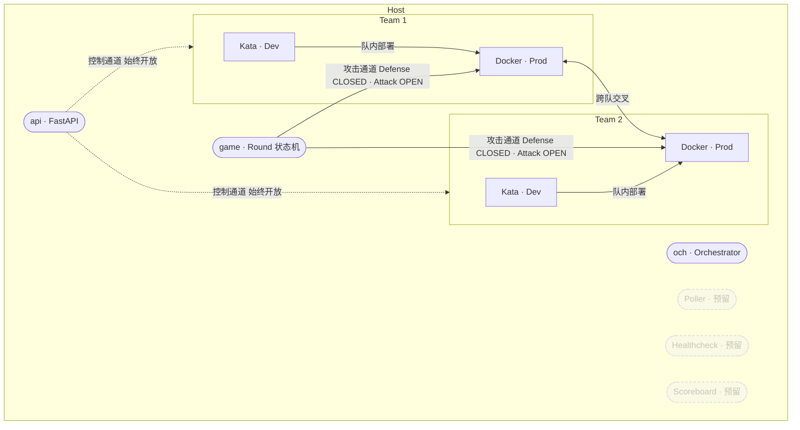
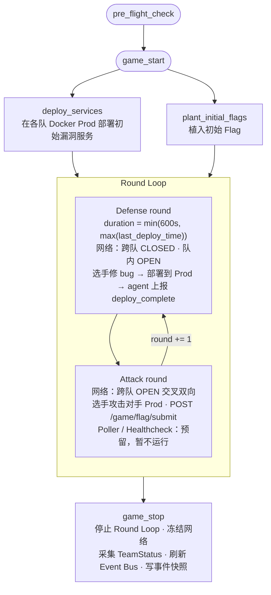

# Cyber Arena — System Design

> **当前版本：MVP**
>
> | 模块 | MVP 实现 | 预留接口，暂不实现 |
> |------|----------|--------------------|
> | Orchestrator | ✅ 容器创建/销毁、网络拓扑、install_list | — |
> | GameMgr | ✅ Round 状态机、网络开关、Event Bus、API 骨架 | ⬜ Poller、Healthcheck、Scoreboard |
> | TeamMgr | ✅ Agent 安装、心跳、round 启停、remoteLogin | ⬜ 日志采集持久化 |
> | Observability | ✅ 本地 panel.html + WS 事件流 | ⬜ 远程部署、多屏 |
>
> **VM 实现**：所有 VM（DevVM / ProdVM）均以 Docker container 实现。

---

## 设计原则

以最简洁方式实现 MVP 基础功能；保留扩展空间，接口尽量通用。

- **简洁优先**：只实现当前 milestone 需要的逻辑，不预先抽象未使用的能力
- **预留接口**：对未来需要替换/扩展的模块（Poller / Healthcheck / Scoreboard 等）只暴露稳定接口，内部以 stub 占位
- **通用接口**：公开方法不绑定具体实现细节（例如 `set_cross_team_network` 不暴露 docker / iptables 区别），便于后续切换底层

---

## 1. 拓扑结构



### 连线语义

| 颜色     | 连接关系                                  | 状态控制                                      |
|----------|-------------------------------------------|-----------------------------------------------|
| **紫**   | `api` → Team 1 / Team 2                   | 始终开放（控制通道：Round 启停、状态查询）    |
| **绿**   | `game` ↔ Team1.Prod / Team2.Prod（交叉）  | Defense: **CLOSED**；Attack: **OPEN**         |
| 虚线框   | Team 内部边界                             | 队内 Kata(Dev) → Docker(Prod) 始终互通        |

### 节点定义

| 节点 | 实现 | MVP | 说明 |
|------|------|-----|------|
| `och` | Host 进程 | ✅ | Orchestrator |
| `api` | FastAPI 进程 | ✅ | REST + WebSocket 入口 |
| `game` | GameMgr 内部逻辑 | ✅ | Round 状态机 + 网络开关 |
| `Poller` | Host 进程 | ⬜ 预留 | 定时探测服务可用性 |
| `Healthcheck` | Host 进程 | ⬜ 预留 | 功能性探测 + Flag 验证 |
| `Scoreboard` | Host 进程 | ⬜ 预留 | 实时计分 |
| `Kata (Dev)` × N | Docker container | ✅ | 队伍开发机 |
| `Docker (Prod)` × N | Docker container | ✅ | 队伍生产服务（攻击目标） |

---

## 2. Pre-flight Check

游戏启动前校验所有 objects，**全部通过才进入 game start**。

**MVP 实现**：打印"校验开始"与"校验通过"两行，无实际校验逻辑。

后续扩展点（暂不实现）：
- `validate(Orchestrator)` — 拓扑无环、镜像可拉取、网络段不冲突
- `validate(GameMgr)` — 服务配置完整、端口无冲突
- `validate(TeamMgr × N)` — DevVM/ProdVM 可达、team_cfg 字段完整
- `wait_for_infra_ready()` — server online 探测
- `wait_for_agents_ready()` — agent online 心跳确认

---

## 3. Game Start 与 Round Loop

### 3.1 总体序列



### 3.2 Defense Round 时长

`duration = min(600s, max(last_deploy_time across all teams))`

- `last_deploy_time`：上一 Round 中该队 Agent 上报 `deploy_complete` 的用时
- 取 **max** 保证所有队伍都有机会完成部署；取 **min(600s)** 防止无限拖延
- 首轮无历史数据时使用配置默认值（`config.defense_default_secs`，建议 300s）

### 3.3 网络切换

- **Defense 开始**：调用 `orchestrator.network.set_cross_team_network(allow=False)`，断开各队 ServiceContainer 与 `game_net` 的连接
- **Attack 开始**：调用 `orchestrator.network.set_cross_team_network(allow=True)`，重新接入 `game_net`
- `poller.start()` / `healthcheck.start()` 预留，MVP 暂不调用

---

## 4. Orchestrator

**职责**：Docker container 生命周期 + 网络拓扑管理。MVP 完整实现。

### 4.1 接口

```python
Orchestrator(graph, {docker, network}, install_list)

# 主要方法
orchestrator.setup()                         # topology consolidation → runtime setup
orchestrator.teardown()                      # 销毁所有容器和网络
orchestrator.network.set_cross_team_network(allow)   # 跨队网络开关（docker network attach/detach）
orchestrator.node(id).exec(cmd)              # 在容器内执行命令
orchestrator.node(id).install(pkg)           # 安装软件包
```

### 4.2 拓扑与队伍配置（YAML 示例）

队伍与拓扑耦合度高（每队的 dev/prod 容器一一对应专属 team_net），MVP 合并为单个 `game.yaml`：

```yaml
# config/game.yaml

teams:
  - id: team1
    dev: team1_dev
    prod: team1_prod
  - id: team2
    dev: team2_dev
    prod: team2_prod

nodes:
  - id: team1_dev
    image: kalilinux/kali-rolling
    networks: [team1_net]

  - id: team1_prod
    image: vulnerables/web-dvwa   # 可替换为自定义漏洞服务
    networks: [team1_net, game_net]
    ports: ["8001:80"]

  - id: team2_dev
    image: kalilinux/kali-rolling
    networks: [team2_net]

  - id: team2_prod
    image: vulnerables/web-dvwa
    networks: [team2_net, game_net]
    ports: ["8002:80"]

networks:
  team1_net:
    subnet: 10.1.0.0/24

  team2_net:
    subnet: 10.2.0.0/24

  game_net:
    subnet: 10.0.0.0/24
    # Defense: 各队 ServiceContainer 与 game_net 断开；Attack: 重新接入（由 GameMgr 调用 set_cross_team_network 切换）
```

### 4.3 执行流程

```
topology consolidation
    → 解析 graph，DAG 校验，生成有序部署序列
            │
            ▼
runtime setup
    → 创建 Docker network（team1_net, team2_net, game_net）
    → 按序启动容器，attach 网络
    → 对每个节点执行 install_list
    → 健康探测：所有容器就绪 → 标记 READY
```

### 4.4 数据结构

```python
@dataclass
class Node:
    id: str
    image: str
    networks: list[str]
    ports: list[str]          # "host:container"
    env: dict[str, str]
    install_list: list[str]   # apt/pip 包名

@dataclass
class Edge:
    src: str
    dst: str
    type: str                 # lan | wan | isolated

@dataclass
class TopologyGraph:
    nodes: list[Node]
    edges: list[Edge]
```

---

## 5. GameMgr

**职责**：Round 状态机、网络开关控制、Event Bus、API。MVP 实现核心骨架，Poller / Healthcheck / Scoreboard 留接口。

### 5.1 接口

```python
GameMgr(graph, install_list)

game_mgr.setup()          # 部署服务、植入 Flag
game_mgr.start()          # 进入 Round Loop
game_mgr.stop()           # 停止游戏
game_mgr.submit_flag(team_id, flag_str) → bool   # Flag 提交验证
```

### 5.2 服务层（MVP vs 预留）

| 服务 | MVP 实现 | 说明 |
|------|----------|------|
| **defcon setup** | ✅ | 部署漏洞服务 + 植入初始 Flag |
| **Poller** | ⬜ 预留接口 | `poller.start()` / `poller.stop()` / `poller.get_status(team_id)` → `ServiceStatus` |
| **Healthcheck** | ⬜ 预留接口 | `healthcheck.run(team_id)` → `HealthResult` |
| **Scoreboard** | ⬜ 预留接口 | `scoreboard.update(event)` / `scoreboard.get()` → `ScoreSnapshot` |

**预留接口桩（MVP 中以 stub 实现）**：

```python
class Poller:
    def start(self): pass                              # TODO
    def stop(self): pass                               # TODO
    def get_status(self, team_id: str) -> ServiceStatus:
        return ServiceStatus(team_id=team_id, healthy=None)  # stub

class Healthcheck:
    def run(self, team_id: str) -> HealthResult:
        return HealthResult(team_id=team_id, passed=None)    # stub

class Scoreboard:
    def update(self, event: Event): pass               # TODO
    def get(self) -> ScoreSnapshot:
        return ScoreSnapshot(scores={})                # stub
```

### 5.3 API 端点（MVP vs 预留）

| 端点 | 方法 | MVP | 说明 |
|------|------|-----|------|
| `/game/status` | GET | ✅ | 当前阶段、Round、时间戳 |
| `/game/start` | POST | ✅ | 启动游戏 |
| `/game/stop` | POST | ✅ | 停止游戏 |
| `/game/rounds` | GET | ✅ | Round 列表与阶段时间戳 |
| `/game/flag/submit` | POST | ✅ | 提交 Flag（返回 success/fail） |
| `WS /events/stream` | WS | ✅ | 实时事件推送（给 panel.html） |
| `/game/events` | GET | ✅ | 历史事件查询 `?since=T` |
| `/game/scoreboard` | GET | ⬜ 预留 | 返回 stub `{}` |
| `/game/services` | GET | ⬜ 预留 | 返回 stub `[]` |
| `/game/services/{id}/health` | GET | ⬜ 预留 | 返回 stub `null` |

### 5.4 Round 状态机

```
INIT → PREFLIGHT → SETUP → DEFENSE ⇄ ATTACK → STOPPED
                               └── × N rounds ──┘
```

---

## 6. TeamMgr

**职责**：队伍容器管理、Agent 安装与通信、Shell 访问。MVP 完整实现。

### 6.1 接口

```python
TeamMgr(DevVM, ProdVM, orche, team_cfg)

team_mgr.install_agent()             # 在 DevVM + ProdVM 上部署 Agent
team_mgr.round_start(round_id, phase)  # 通知 Agent：DEFENSE | ATTACK
team_mgr.round_stop(round_id)          # 冻结，采集快照
team_mgr.remote_login(vm, mode)        # prompt | logging
team_mgr.status() → TeamStatus
```

### 6.2 Agent（MVP 实现）

轻量 Python 守护进程，运行在每个容器内：

```
Agent 职责（MVP）
  ├─ WebSocket 长连接 → Host GameMgr（通过 host.docker.internal 寻址，兼容 Ubuntu / macOS）
  ├─ 接收指令：round_start(phase) / round_stop
  ├─ 上报：heartbeat（每 5s）
  └─ 上报：deploy_complete(team_id, round_id, timestamp)
       └─ 触发时机：选手在 Dev 容器内执行 `arena-deploy` 命令
```

### 6.3 remoteLogin

| 模式 | 实现 | 触发时机 |
|------|------|----------|
| `prompt` | `docker exec -it <container> /bin/bash` | Defense Round 开始时开放 |
| `logging` | `docker logs -f <container>` | 全程采集，写本地文件 |

### 6.4 TeamStatus

```python
@dataclass
class TeamStatus:
    team_id: str
    dev_vm: str               # running | stopped | error
    prod_vm: str
    agent: str                # connected | disconnected
    current_round: int
    current_phase: str        # DEFENSE | ATTACK | IDLE
    last_deploy_time: float   # epoch，用于 defense_duration 计算
    score: int                # MVP 暂为 0，Scoreboard 实现后更新
```

---

## 7. Observability Panel

**MVP 实现**：单文件 `panel/panel.html`，浏览器直接打开，WebSocket 连接本地 API。  
**预留**：WS 地址通过 URL 参数配置（`?ws=ws://remote:8000/events/stream`），后续无需改代码即可远程接入。

### 7.1 Event Bus（MVP 完整实现）

```python
@dataclass
class Event:
    id: str
    timestamp: float
    type: str          # 见下表
    team_id: str | None
    round_id: int
    phase: str
    payload: dict
```

| EventType | MVP | 触发时机 |
|-----------|-----|----------|
| `ROUND_START` | ✅ | Round 开始 |
| `PHASE_CHANGE` | ✅ | DEFENSE → ATTACK |
| `DEPLOY_COMPLETE` | ✅ | Agent 上报 |
| `FLAG_SUBMITTED` | ✅ | Flag 提交（成功/失败） |
| `AGENT_CONNECTED` | ✅ | Agent 上线 |
| `AGENT_DISCONNECTED` | ✅ | Agent 掉线 |
| `ROUND_STOP` | ✅ | Round 结束 |
| `SERVICE_UP` | ⬜ 预留 | Poller 触发 |
| `SERVICE_DOWN` | ⬜ 预留 | Poller 触发 |
| `SCORE_UPDATE` | ⬜ 预留 | Scoreboard 触发 |

### 7.2 Panel 布局（MVP）

```
┌──────────────────────────────────────────────────────────────┐
│  Cyber Arena  —  Live Timeline                   Round 2/5   │
├──────────────────────────────────────────────────────────────┤
│  [DEFENSE 04:12]──────────────[ATTACK 07:45]─────────► now   │
│                                                              │
│  Team 1  ══╦══════════════╦═════════════════════════════►    │
│            │deploy(02:10) │flag_submit(✓)                    │
│  Team 2  ══╦══════════════╦═════════════════════════════►    │
│            │deploy(03:40) │flag_submit(✗)                    │
├──────────────────────────────────────────────────────────────┤
│  Agents: Team1 ● connected   Team2 ● connected               │
│  [Scoreboard / Service Health: 预留，待 Poller 实现后接入]    │
└──────────────────────────────────────────────────────────────┘
```

### 7.3 API 接口（含预留）

```
# MVP 实现
WS   /events/stream              实时事件推送
GET  /events?since={timestamp}   历史事件查询

# 预留（MVP 返回空占位）
GET  /timeline                   结构化时间轴（按 Round 分组）
GET  /scoreboard                 计分快照（Scoreboard 实现后接入）
```

---

## 8. 模块依赖与启动顺序

```
Orchestrator
    ▲
    │
GameMgr ──► Orchestrator（容器安装、网络开关）
    │   │
    │   └──► Event Bus ──► WS /events/stream ──► panel.html
    │
TeamMgr ──► Orchestrator（DevVM / ProdVM 容器引用）
    │
    └─ Agent × N ──► GameMgr（heartbeat / deploy_complete）
```

**启动顺序**：

```
1. Orchestrator.setup()           # 创建容器 + 网络
2. GameMgr.setup()                # 部署漏洞服务 + 植入 Flag
3. TeamMgr.setup() × N           # 安装 Agent，等待心跳
4. pre_flight_check()             # server online + agent online 全量校验
5. 浏览器打开 panel/panel.html    # 观测面板上线
6. GameMgr.start()               # 进入 Round Loop
```

---

## 9. 技术选型

| 组件 | 技术 |
|------|------|
| 容器管理 | Docker SDK for Python (docker-py) |
| 网络控制 | Docker network attach/detach（跨队开关） |
| API | FastAPI（REST + WebSocket） |
| Agent 通信 | WebSocket（asyncio，双向持久连接） |
| 事件总线 | asyncio.Queue → broadcast to WS clients |
| 前端面板 | 单文件 HTML + D3.js（CDN） |
| 配置 | YAML |
| 语言 | Python 3.11+ |
| Host OS | Ubuntu 20.10+ / macOS（Docker Engine 或 Docker Desktop 均可） |

---

## 10. 目录结构

```
cyber-arena/
├── orchestrator/
│   ├── orchestrator.py        # ✅ MVP
│   ├── infra/
│   │   ├── docker.py          # ✅ 容器生命周期
│   │   └── network.py         # ✅ docker network 跨队开关
│   └── topology.py            # ✅ TopologyGraph 解析
│
├── game_mgr/
│   ├── game_mgr.py            # ✅ Round 状态机
│   ├── preflight.py           # ✅ pre_flight_check
│   ├── round.py               # ✅ Round Loop + defense duration
│   ├── events.py              # ✅ Event Bus + EventType
│   ├── service/
│   │   ├── defcon.py          # ✅ 服务部署 + Flag 植入
│   │   ├── poller.py          # ⬜ stub（预留接口）
│   │   ├── healthcheck.py     # ⬜ stub（预留接口）
│   │   └── scoreboard.py      # ⬜ stub（预留接口）
│   └── api/
│       └── routes.py          # ✅ FastAPI 路由 + WS /events/stream
│
├── team_mgr/
│   ├── team_mgr.py            # ✅ MVP
│   ├── agent/
│   │   ├── installer.py       # ✅ Agent 部署
│   │   └── agent_server.py    # ✅ Agent 守护进程（含 arena-deploy 命令）
│   └── remote/
│       ├── login.py           # ✅ prompt / logging 模式
│       └── logger.py          # ✅ 日志采集（写本地文件）
│
├── panel/
│   └── panel.html             # ✅ 本地单文件面板（WS 地址 URL 参数化）
│
├── models/
│   ├── topology.py            # ✅
│   ├── team.py                # ✅
│   ├── game.py                # ✅
│   └── events.py              # ✅
│
├── config/
│   └── game.yaml              # ✅ 队伍 + 两队四容器拓扑 + 网络
│
└── main.py                    # ✅ 启动入口
```


## Security Boundary (MVP)

For MVP, the agent controls its own ServiceContainer via SSH/root access from DevContainer.

The agent may modify files, run commands, restart service processes, and inspect logs inside its own ServiceContainer.

The DevContainer does not mount `/var/run/docker.sock` and cannot control the Docker daemon or other containers.


## Network Control Strategy

Public interface（GameMgr 只调用此接口，不感知实现）：

```python
orchestrator.network.set_cross_team_network(allow: bool)
```

MVP 实现：Docker network attach/detach。

- **Defense**：`docker network disconnect game_net <team_service>` 断开各队 ServiceContainer
- **Attack**：`docker network connect game_net <team_service>` 重新接入

reconnect 会有短暂中断，MVP 可接受。


## 11. 实现 Milestones

按依赖关系自底向上推进，每个 milestone 都有可独立验证的产出。

| # | Milestone | 验证标准 |
|---|-----------|----------|
| 1 | Local topology runs | `Orchestrator.setup()` 拉起所有容器与网络，`docker ps` 可见全部节点 READY |
| 2 | Game loop runs | `GameMgr.start()` 跑通 DEFENSE ⇄ ATTACK 状态机（网络开关可先用 no-op stub） |
| 3 | Network switching works | `set_cross_team_network(allow)` 真实切换 `game_net`，跨队连通性符合 phase 预期 |
| 4 | Agent works | Agent 在 Dev/Prod 容器内上线，`heartbeat` 与 `deploy_complete` 正确上报 GameMgr |
| 5 | Flag submit works | `POST /game/flag/submit` 全链路：选手提交 → 验证 → 发出 `FLAG_SUBMITTED` 事件 |
| 6 | Panel works | `panel.html` 通过 WS 实时显示 Round / Phase / 事件流 |

**依赖与并行性**：

- M2 可在 M3 未完成前用 no-op 网络开关跑通状态机
- M5 依赖 M2（API）和 M4（队伍上下文），不依赖 M6
- M6 仅消费 Event Bus，M2 之后任意时点都可接入
